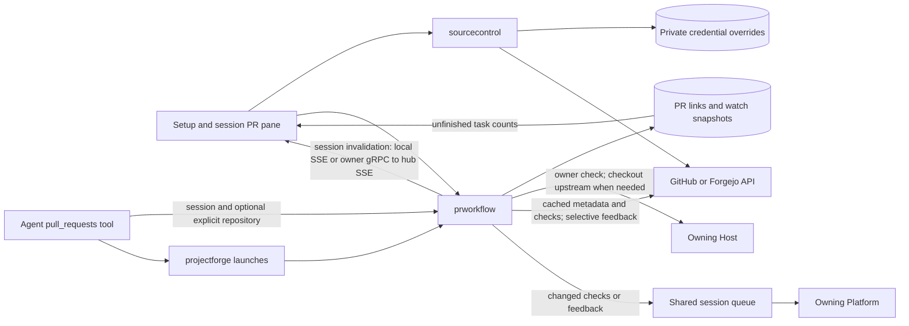

## Source-control setup

Open **Settings → Connections → Source control** to see each configured forge,
the authenticated account, and the credential source. **Recheck credentials**
reloads the hub's CLI and environment credentials without restarting ocman.

GitHub uses `GITHUB_TOKEN`, then `GH_TOKEN`, then the hub's GitHub CLI login.
Forgejo and Gitea hosts come from the hub's tea configuration. Their credentials
use `FORGEJO_TOKEN`, then `GITEA_TOKEN`, then the tea login's token.

You can also save a token for `github.com` or an explicit Forgejo/Gitea hostname.
Ocman verifies it before saving. A saved token overrides discovered credentials
for that host. Removing it restores discovery. Use repository and pull-request
read access for PR monitoring. Account verification does not prove access to
every private repository.

Tokens are stored in the hub's private state database, not browser storage, and
are never returned by these APIs. Protect database backups as credentials.
Setup and PR mutation endpoints require privileged local access. Git fetch and
push use the checkout owner's separate Git authentication; API sign-in does not
configure SSH keys or Git credential helpers.

## Link a PR to a session

Open the session's **PRs & Issues** pane. Under **Linked to this session**, choose
an upstream and enter the PR number. Links are persisted with the session's
platform, owning machine, repository and PR number. Launching a session or
worktree from a PR also saves its link. Multiple PRs can be linked to one session.

Agents can also link PRs from other repositories through the MCP tool by supplying
the forge `host`, `repo` in `owner/name` format, and PR `number`. The relationship
stays attached to the originating session without moving it to another project.
The host must be supported by a configured hub forge client.

**Unlink** removes the relationship and stops its watch. It does not close the
PR, delete its branch or archive the session. PRs opened independently by an
agent or outside ocman must be linked manually.

## Watch checks and feedback

**Watch PR** asks for confirmation because background follow-ups can use model
credits. Ocman records the current checks and comments as a baseline, then
checks watched PRs about every two minutes without needing an open browser.
Changes queue a session follow-up through the shared delivery queue:

- Newly failing checks or failures on a new head commit.
- All reported checks passing. This is not a merge-readiness decision.
- New or edited comments and review feedback, excluding the current forge user.
- Newly reported merge conflicts.

Quiet PRs with settled checks and known mergeability slow down to roughly five
to six minutes after 30 minutes without a metadata update. Feedback is reread
when the head or metadata changes, and on the first poll after ten minutes to
catch comment edits that do not update the PR timestamp. Missing
timestamps keep the full-read behavior. GitHub background reads share the same
one-minute response cache as the sidebar and previews.

The linked-PR pane refreshes once per minute while the document is visible.
The sidebar **Refresh** control refreshes both the PR list and linked PRs,
explicitly revalidating GitHub metadata within the shared request budget.
Reopening the pane uses the cached read path.

Active turns and sessions waiting on prompts are not interrupted. Disconnected
owners are skipped without falling back to the hub. Read failures preserve the
last good snapshot and back off. Eight consecutive failures stop the watch and
show an explanation. Ten consecutive comment-only updates also stop it, limiting
automated reply loops. A merged or closed PR stops its watch without archiving
the session.

Rate limits pause reads until the provider's retry deadline, with a two-minute
minimum pause. They do not count toward the eight-failure limit. Stale responses
do not advance the watch snapshot or its feedback watermark.

Watch state and pending notifications survive restarts. A crash after queue
acceptance but before the notification receipt is saved can repeat a notice.
**Stop watching** prevents future watch deliveries but does not retract a message
already accepted by the session queue. Ocman never automatically merges a PR.

## Prepare a feedback task

**Address feedback**, **Fix failing checks**, and **Resolve conflicts** fetch fresh
PR context and open an editable task. Review and copy it into the session when
ready. Nothing is sent to the agent or posted to the forge by preparing a task.
Review feedback is bounded in the draft; larger discussions direct the agent to
the forge for the remaining context. Forge content is explicitly untrusted.

## MCP tool

The `pull_requests` tool exposes these workflows to local agents. Start with
`{"action":"help"}` for inputs, output descriptions and examples.

- `upstreams`, `list`, `checks`, `mergeability` read project forge information.
  Supply an absolute `directory` and explicit `remote_id`, using `local` for
  this machine. Except `upstreams`, also supply the upstream `remote` name.
- `launch` starts a PR session or worktree. Supply the project inputs plus
  `number`, `platform`, `mode` (`session` or `worktree`) and `task` (`handle` or
  `review`). It does not create a PR. Cross-fork fetch confirmation stays in
  the dashboard.
- `linked`, `link`, `unlink`, `watch`, `unwatch` manage session PR links and
  watches. Supply `session_id` and `platform`, including its remote owner prefix
  when applicable. Mutations also need `number`; `link` accepts either `remote`
  from the session's checkout or explicit `host` and `repo`, not both. Use the
  latter for a PR created in another repository. Other mutations use the `host`
  and `repo` returned by `linked`.
- `feedback`, `checks_prompt`, `conflicts_prompt` return unsent task prompts.
  Supply the session identifiers, `host`, `repo` and `number`.

For example, to attach another repository's PR to the session that created it:

```json
{"action":"link","platform":"opencode","session_id":"ses_example","host":"github.com","repo":"other/project","number":42}
```

After creating a PR, agents must link it and verify the repository and number
with `action: "linked"` before reporting completion. Linking does not start a watch.

Launches and watches require user authorization because they can consume model
credits. Draft actions do not send messages or post comments. No action merges,
force-pushes, archives sessions or changes credentials. Disconnected explicit
owners fail closed, just as in the dashboard.

## How the PR workflow works




- `sourcecontrol` owns privileged setup routes, verified per-host tokens and
  live credential resolution for project PR operations, Factory and watches.
  Saved tokens override CLI/environment discovery without altering Git auth.
  Discovery itself (`sourcecontrol.DiscoverClients`: `GITHUB_TOKEN`/`GH_TOKEN`,
  `gh`, `FORGEJO_TOKEN`/`GITEA_TOKEN`, tea logins) and its credential-source
  labels live there too; the server only resolves remotes through it.
- `prworkflow` owns session-qualified links, feedback-task drafts and its joined
  two-minute watch worker. It persists snapshots and pending notices separately
  from conversations. The hub reads forge metadata; owner disconnection never
  routes checkout or session work to another machine.
- Explicit `host` and `repo` links resolve through configured hub forge clients
  without consulting the session checkout's upstreams. The session retains its
  owning project and directory; links can refer to multiple other repositories.
  The linked-PR badge reads checks through a session-qualified endpoint using
  the saved repository identity, including for links created from an upstream.
- Watch reads reuse GitHub's credential-scoped one-minute transport cache with
  sidebar and preview reads. Head/metadata timestamps gate feedback pagination,
  with a ten-minute safety reread. Quiet settled PRs slow to five-minute due
  times on the two-minute worker. Provider rate limits pause the host without
  exhausting a watch's read-failure allowance. Terminal PRs skip checks/feedback.
- Its `pull_requests` MCP tool reuses fixed session HTTP handlers and an injected
  `projectforge` PR-only handler. MCP authentication precedes dispatch; existing
  owner checks and validation still apply. Draft actions return prompts without
  sending them, and cross-fork fetch confirmation remains dashboard-only.
- Successful link/watch saves and removals publish an owner-qualified
  `ocman.session.changed` event on `/api/events`. The PR controls and background
  task notice refresh on matching events and SSE reconnects, alongside the
  session list. Forwarded mutations notify hub clients after owner acceptance.
  An authenticated owner-to-hub invalidation stream also carries direct owner
  mutations and automatic stops, without requiring a browser conversation
  stream. The hub qualifies identities from its connection, not the payload.
  Polling remains a backstop for missed events.
- Watches are opt-in, deduplicate changes and queue follow-ups rather than
  running an agent polling loop. Polling continues while a session cannot accept
  follow-ups, so merged or closed PRs stop their watches. Notification delivery
  waits until the session is ready. Stop/unlink serializes with delivery. Merging
  and session archival remain explicit user decisions.
- Session lists add durable watches to native background-task counts, keyed by
  the full platform and session identity. Active watches and pending nonterminal
  updates keep the background indicator visible and delay completion-based
  archive resurfacing without holding foreground execution busy. Stop, unlink,
  or detecting a merged or closed PR removes that watch's contribution, even
  when its final notice still awaits delivery.
