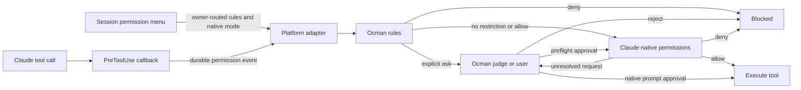

Use `/permissions` in a session, or select **permissions** in the command
palette, to review recorded requests and manage Ocman's approval rules.

The dialog includes pending requests, one-time approvals, rejections and
previous automatic approvals. Search the recorded commands or permission
types, then choose **allow**, **ask** or **deny** to add an editable rule.
You can also add rules manually.

For example, after approving `tea do something`, add this rule:

| Permission | Pattern | Action |
| --- | --- | --- |
| `bash` | `tea do *` | `allow` |

Save the rules to apply them to pending and future requests. Rules remain
attached to this session across refreshes and Ocman restarts. They also cover
its nested subagents, but do not carry into separate sessions or worktree
splits.

## Choosing a mode for a new conversation

The lock button in a new conversation's composer picks the permission mode
before the session exists: **Default**, **Plan only**, **Auto-accept edits**
or **YOLO**. The mode is applied when the session is created, before the first
prompt runs. **Default** keeps the machine and project permission defaults;
any other mode replaces them for that session. YOLO asks for confirmation.
The pick is saved with the draft. Change it later from the same button in the
session.

## Rule behavior

- **Allow** answers matching requests with a one-time approval.
- **Ask** requires your decision, even if Ocman's AI judge or cache would
  otherwise approve the request.
- **Deny** rejects matching requests.
- Without a matching rule, Ocman's existing approval behavior applies.

`*` matches any text and `?` matches one character. Escape a literal wildcard
with a backslash, such as `cat \*`. Rules created from a recorded request
start with escaped wildcards so you can broaden them deliberately. A wildcard
matches command text, not parsed shell subcommands, so keep allow patterns
narrow.

The last matching rule wins for each requested resource. Move rules up or down
to change their priority. If a request contains several resources, any denied
resource rejects the request; all resources must be allowed for automatic
approval. A subagent's own rules take priority over its ancestor's rules.

These rules affect **Ocman's approval logic only**. They do not change the
agent's native configuration, grant access the agent has already refused, or
intercept actions that do not ask Ocman for permission. Remote sessions keep
their rules on their owning machine, which must be connected to view or edit
them.

## Native permissions and ocman review

Native platform approvals and ocman's auto-approval judge are separate controls.
Claude Code 2.1.299 or newer exposes native Auto through the session permission
menu. OpenCode keeps its existing permission rules and ocman reviewer; it does
not advertise a native classifier mode.

- Native mode is persisted with Claude session ownership, independently of the
  ocman ruleset and the per-session judge toggle. Mode changes never replace
  ocman rules. Idle children resume with the saved mode; running children use an
  acknowledged `set_permission_mode` control request. Without a child the UI
  marks Auto as pending for the next turn. Model/provider eligibility
  remains authoritative in Claude, and rejected changes are shown to the user.
- New Claude children register a pre-execution SDK callback before the first
  prompt. Ocman evaluates restrictions before Claude's native classifier or
  configured approvals. An unrestricted or approved callback returns an empty
  hook result, not a native allow, so Claude's own denials remain effective.
- Preflight callbacks use the existing durable push-only permission/reply flow.
  Missing ocman rules fail closed. An unanswered callback kills its child after
  30 minutes, before Claude's one-hour hook timeout could allow execution to
  continue; shutdown kills children with unresolved preflight callbacks before
  closing their control pipes.
- Claude's reported permission mode is retained, including fallback to Default
  after an unsupported model switch. The menu refreshes on session changes and
  window focus. Capability checks hide native Auto on older owners and OpenCode.
- Rules still apply to tool requests rather than sandboxing commands. An allowed
  shell command has the host user's filesystem and network access.
