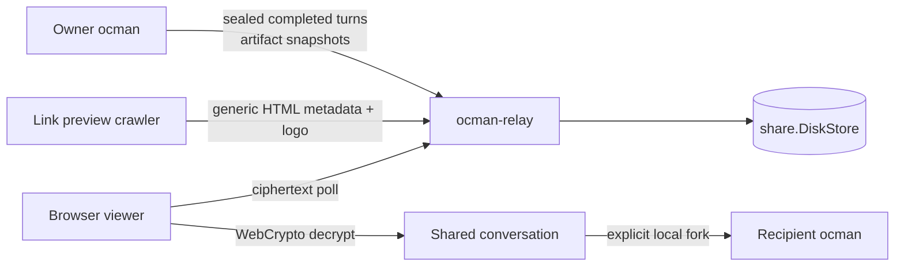

A shared conversation is an encrypted, read-only copy of a session that
follows its completed turns. Anyone with the link can read it in a browser;
the decryption key stays in the link's URL fragment, so the share relay only
stores ciphertext. Revoking a share deletes it from the relay. Recipients can
fork it into their own ocman as an unsent draft. Sharing uses the relay set by
`-relay-url` or `OCMAN_RELAY_URL`, or the built-in default; see
[Configuration](../../configuration/). [Artifacts](artifacts.md#sharing)
use the same relay.

## How sharing works

Ocman can publish a shared conversation through the standalone `ocman-relay`
binary. The relay stores only AES-256-GCM ciphertext in a directory tree
through `share.DiskStore` (`Put`/`Get`/`List`/`DeletePrefix`). The per-share
key stays in the URL fragment, so it never reaches the relay.

- Chunk zero is a complete snapshot; later chunks contain the latest
  completed turn and the viewer merges them as id-keyed upserts.
- The owner allocates sequence numbers. Nonces derive from those sequence
  numbers, and the share id plus sequence is authenticated as GCM AAD.
- Revocation deletes the relay prefix. The relay stores only a hash of its
  append/delete token and needs no database.
- Viewer HTML includes generic Open Graph and Twitter summary metadata with
  an ocman logo. Previews never contain conversation text, artifact titles or
  decryption keys. Behind a TLS-terminating proxy, enable `-trust-proxy` and
  have the proxy overwrite `X-Forwarded-For` and `X-Forwarded-Proto` so image
  and page URLs use the public HTTPS scheme. Relay `robots.txt` allows known
  preview crawlers to fetch only the viewer and logo; search engines remain
  disallowed and viewer responses carry `X-Robots-Tag: noindex, nofollow`.
- Forking fetches and decrypts in the recipient's authenticated local ocman
  UI, lets the recipient choose a local project, and parks the transcript as
  an unsent composer draft. Imported text never runs automatically.
- Artifact shares reuse the relay but are written once: chunk zero is a sealed
  manifest (title, links, file list) and later chunks are the sealed file
  bytes. Ocman checks the relay's per-share byte and chunk limits before
  uploading, and deletes a half-written share on failure. See
  [Artifacts](artifacts.md).
