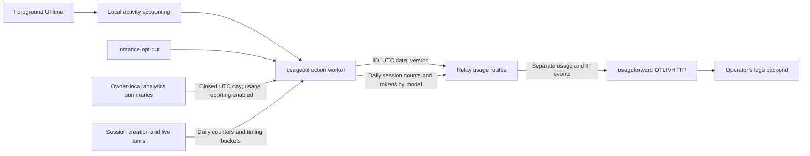

Ocman sends product usage reports by default. We use them to count daily
active installations and see which models are used most, so we can decide
where to focus improvements. The reports count installations, not people.

To stop usage and health reports, open **Settings → Privacy & usage** and turn
off **Send usage reports**. You can also [opt out before first use](#opt-out).

## What Ocman sends

| Report | What it contains |
| --- | --- |
| Daily activity | A randomly generated installation ID, the UTC date, and the Ocman version. It indicates that someone used the foreground UI that day, not how long they used it. |
| Daily model usage | The same installation ID, UTC date, and version, plus the total session count and session, input-token, and output-token counts by model. Only known public model names are sent. All others are grouped as `other`. The report has no separate platform field. |
| Daily health | UTC date, Ocman version, and counts by platform for session creation, turn outcomes, and time to first visible assistant text. Health uses a random batch ID for retries, not the persistent installation ID. |

Usage reports do not include prompts, responses, source code, file paths,
repository names, account IDs, or session IDs. Raw UI activity intervals stay
on your machine. The installation ID stays the same across days, so reports
from one installation can be linked over time. The reports are pseudonymous,
not anonymous.

## Where reports go

By default, reports go to `https://relay-ocman.stenic.io`. The settings page
shows the destination. To use a different relay, set `-relay-url` or
`OCMAN_RELAY_URL`.

The relay sees the source IP when it receives a request. The IP is not in the
usage report. The relay forwards it separately as a security event for
activity and model report requests, and can record it for rejected health
requests. It does not forward IP addresses on successful health reports.
The relay forwards reports to a configured logging
backend rather than storing them on disk itself. The backend operator controls
access and retention. Proxy or CDN logs are configured separately.

## Opt out

Open **Settings → Privacy & usage** and turn off **Send usage reports**. This
applies to the ocman instance, persists across restarts and clears pending reports.
It does not disable sharing, webhooks or separately configured OpenTelemetry
diagnostics. Activity while collection is disabled is not backfilled. Reports
already received cannot be recalled by opting out.

To opt out before first use, set this in the configuration file:

```yaml
version: 1
settings:
  usage.collection_enabled: false
```

See [Configuration](../configuration/_index.md) for file locations. Configure each
remote instance separately.

## Report contents

After newly credited foreground UI time, the ordinary activity report sends only:

```json
{
  "installationId": "3f70f326-5593-4b78-a31f-c67a23920334",
  "date": "2026-11-11",
  "version": "0.275.0"
}
```

The random installation UUID persists in state.db. It is not derived from an
account, credential, hostname or hardware identifier. The date is a UTC day.
Release versions retain supported prerelease suffixes; custom builds, commit
hashes, branch names and build metadata become `dev`.

Prompts, responses, code, paths, repository names, account identifiers and session
IDs are excluded. Raw UI activity intervals remain local. Background uptime and
server startup do not count; foreground time excludes inactivity over five minutes.

One successful daily report is checkpointed locally, including across restarts.
Failed delivery retries no more frequently than every 15 minutes while the
process runs, with a five-second request timeout. Stale dates are dropped, not
backfilled. Ambiguous network failures can still produce duplicate events.

Delivery failures are silent and stay in the background worker. They do not show
UI errors, prevent Settings changes or block shutdown. An unavailable relay does
not prevent normal app use; the worker retries later with the same backoff.

Reports use `POST /v1/usage` on the configured share relay, independently of the
sharing toggle or webhook-only relay override. Settings shows the destination.
With no relay configured, nothing is sent. Public destinations require HTTPS;
plain HTTP is accepted only for loopback development. Redirects are rejected.

## Relay forwarding

### Daily health summaries

`POST /v1/usage/health` sends only the previous UTC day's counters. Counts
are grouped by platform: OpenCode, Claude Code, or Codex. The report includes:

- Session creation outcomes: ready, failed, timed out, or canceled.
- Observed live turns: started, completed, failed, interrupted, or canceled.
- Settled turns with no observed assistant text, and counts in first-response
  buckets: under 1s, 1–2s, 2–5s, 5–10s, 10–30s, 30–60s, and at least 60s.

Timing starts when the live conversation stream sees the turn start, not when
you click Send. Turns that start before the stream connects are not measured.
A started turn and its outcome can land on different dates. Remote owners
report their own creation outcomes; the hub does not report health from
remote conversation streams. Reports contain no raw errors or stack traces.

Ocman keeps unsent health counts in memory. A restart can lose unreported
counts, and turning off reports discards them. The relay exports one
`ocman.usage.health.daily` record per platform. Deduplicate on UTC date,
platform, and `ocman.health.batch` before summing. Don't share breakdowns
based on just a few reports. Deploy collector support and the relay before
clients; older relays do not accept health reports.

### Daily model summaries

Daily model summaries follow **Send usage reports**, which is enabled by
default. Existing opt-outs apply to both report types. The first eligible
bucket is the next full UTC day after the worker first observes that reporting
is enabled. Only yesterday's bucket is sent, with no historical backfill.
Turning off usage reports cancels pending sends.

`POST /v1/usage/daily` sends the installation ID, date and version with a
`daily` object containing `sessions` and `models`. Each model entry contains
`model`, `sessions`, `inputTokens` and `outputTokens`. Ocman reads owner-local
assistant analytics summaries, not transcripts. A session with a valid
assistant message counts once overall and once per model used that day. Missing
token accounting is not estimated. Only exact allowlisted public model IDs
are sent; other names become `other`. No session IDs or message content are sent.

Update collector filters first, deploy the relay second, and upgrade clients
last. Older relays do not support the daily route. Ordinary activity reports
continue independently. The daily route shares rate limits and has a 4 KiB cap.

### OTLP events

The relay forwards events to an OTLP/HTTP logs endpoint, without writing usage
records, IP logs or an export queue to disk. Existing encrypted share and webhook
storage is unchanged. Rate-limit buckets and in-flight requests are memory-only.

Configure the relay with `-otel=https://collector.example.com` or one of:

```sh
OTEL_EXPORTER_OTLP_ENDPOINT=https://collector.example.com
OTEL_EXPORTER_OTLP_LOGS_ENDPOINT=https://collector.example.com/v1/logs
```

The explicit flag wins, then the logs-specific environment variable, then the
general variable. Base URLs get `/v1/logs` appended; the logs-specific variable is
the complete endpoint URL. Standard `OTEL_EXPORTER_OTLP_HEADERS` and
`OTEL_EXPORTER_OTLP_LOGS_HEADERS` provide authentication. Credentials in URLs are
rejected. Only `http/protobuf` is supported, not OTLP/gRPC.

Forwarding uses system TLS trust, rejects redirects, times out after three seconds
and does not retry internally. Its custom HTTP client does not apply exporter
certificate/client-certificate or timeout environment overrides. The relay returns
204 only after export succeeds, and 503 if no collector is configured, export
fails or all 32 export slots are busy. App foreground use never waits on this
network request.

Activity payloads are limited to 1 KiB and unknown fields are rejected. Submission limits
are 60 requests/hour/IP with a burst of ten. `-trust-proxy` must only be used behind
a proxy that overwrites forwarded headers. Rejected-request security forwarding
has a separate rate limit to bound abuse logging.

| Event body/name | Log attributes |
| --- | --- |
| `ocman.usage.active` | `ocman.installation.id`, `ocman.activity.date`, `ocman.version` |
| `ocman.usage.daily` | Activity identity fields plus `ocman.sessions` |
| `ocman.usage.model.daily` | Activity identity fields plus `ocman.model`, `ocman.sessions`, `ocman.tokens.input`, `ocman.tokens.output` |
| `ocman.usage.security` | `client.address`, `http.response.status_code` |

All use resource `service.name=ocman-relay`. Usage timestamps are the activity
day's UTC midnight and observed timestamps record receipt. Security timestamps
record receipt; security events do not contain installation IDs or versions.
Invalid payload content is never forwarded. IP security events can be lost during
an OTLP outage because the relay has no durable buffer.

The backend operator controls access and retention. Route IP events to restricted
storage and configure proxy/CDN access logs separately. Opting out stops usage
requests, not necessary security logging for other service requests. Separate
events can still be correlated by arrival time, so they are not unlinkable.

## Counting activity

Allowlist the daily event names and the corresponding attributes above in
the usage pipeline, not the restricted security pipeline. For retries, keep
the latest record per installation and date for overall totals, and per
installation, date and model for model totals. Summing counts across models
can count the same session twice. Summing daily counts yields session-days.

Filter `ocman.usage.active` over the chosen UTC activity dates, deduplicate
installation/date pairs, then count distinct installation IDs for daily, weekly
or monthly active installations. Do not sum daily uniques into weekly uniques or
count raw events as people. Use each installation's latest report in the period
for version breakdowns that must sum to the total.

Keep installation IDs and IPs as log attributes or structured metadata, not
indexed Loki labels, OTEL resource attributes or Prometheus metric labels.
Multiple installations, shared instances, opt-outs, offline clients and fabricated
submissions mean these counts remain estimates, not verified humans.

## Data flow



`internal/usagecollection` owns the setting, ID, pending date and checkpoint.
`internal/analytics` signals ordinary reporting after newly credited foreground time.
`internal/usagewire` defines the report and strict decoder. `internal/relay`
validates/rate-limits intake. `internal/usageforward` exports SDK-created log
records synchronously without installing global providers or retaining events.
