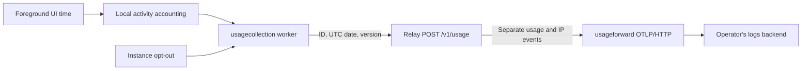

Vanilla installations use `https://relay-ocman.stenic.io` and enable usage
collection by default. Override the relay with `-relay-url` or `OCMAN_RELAY_URL`,
or opt out below to stop usage reports. It measures
active installations, not distinct people. The data is pseudonymous, not anonymous.

## Opt out

Open **Settings → Privacy & usage** and turn off **Send usage reports**. This
applies to the ocman instance, persists across restarts and clears pending reports.
It does not disable sharing, webhooks or separately configured OpenTelemetry
diagnostics. Activity while collection is disabled is not backfilled. Reports
already received cannot be recalled by opting out.

To opt out before first use, set this in the configuration file:

```yaml
version: 1
settings:
  usage.collection_enabled: false
```

See [Configuration](../configuration/_index.md) for file locations. Configure each
remote instance separately.

## Report contents

After newly credited foreground UI time, the background worker sends only:

```json
{
  "installationId": "3f70f326-5593-4b78-a31f-c67a23920334",
  "date": "2026-11-11",
  "version": "0.275.0"
}
```

The random installation UUID persists in state.db. It is not derived from an
account, credential, hostname or hardware identifier. The date is a UTC day.
Release versions retain supported prerelease suffixes; custom builds, commit
hashes, branch names and build metadata become `dev`.

Prompts, responses, code, paths, repository names, account identifiers and session
IDs are excluded. Raw UI activity intervals remain local. Background uptime and
server startup do not count; foreground time excludes inactivity over five minutes.

One successful daily report is checkpointed locally, including across restarts.
Failed delivery retries no more frequently than every 15 minutes while the
process runs, with a five-second request timeout. Stale dates are dropped, not
backfilled. Ambiguous network failures can still produce duplicate events.

Delivery failures are silent and stay in the background worker. They do not show
UI errors, prevent Settings changes or block shutdown. An unavailable relay does
not prevent normal app use; the worker retries later with the same backoff.

Reports use `POST /v1/usage` on the configured share relay, independently of the
sharing toggle or webhook-only relay override. Settings shows the destination.
With no relay configured, nothing is sent. Public destinations require HTTPS;
plain HTTP is accepted only for loopback development. Redirects are rejected.

## Relay forwarding

The relay forwards events to an OTLP/HTTP logs endpoint, without writing usage
records, IP logs or an export queue to disk. Existing encrypted share and webhook
storage is unchanged. Rate-limit buckets and in-flight requests are memory-only.

Configure the relay with `-otel=https://collector.example.com` or one of:

```sh
OTEL_EXPORTER_OTLP_ENDPOINT=https://collector.example.com
OTEL_EXPORTER_OTLP_LOGS_ENDPOINT=https://collector.example.com/v1/logs
```

The explicit flag wins, then the logs-specific environment variable, then the
general variable. Base URLs get `/v1/logs` appended; the logs-specific variable is
the complete endpoint URL. Standard `OTEL_EXPORTER_OTLP_HEADERS` and
`OTEL_EXPORTER_OTLP_LOGS_HEADERS` provide authentication. Credentials in URLs are
rejected. Only `http/protobuf` is supported, not OTLP/gRPC.

Forwarding uses system TLS trust, rejects redirects, times out after three seconds
and does not retry internally. Its custom HTTP client does not apply exporter
certificate/client-certificate or timeout environment overrides. The relay returns
204 only after export succeeds, and 503 if no collector is configured, export
fails or all 32 export slots are busy. App foreground use never waits on this
network request.

Payloads are limited to 1 KiB and unknown fields are rejected. Submission limits
are 60 requests/hour/IP with a burst of ten. `-trust-proxy` must only be used behind
a proxy that overwrites forwarded headers. Rejected-request security forwarding
has a separate rate limit to bound abuse logging.

| Event body/name | Log attributes |
| --- | --- |
| `ocman.usage.active` | `ocman.installation.id`, `ocman.activity.date`, `ocman.version` |
| `ocman.usage.security` | `client.address`, `http.response.status_code` |

Both use resource `service.name=ocman-relay`. Usage timestamps are the activity
day's UTC midnight and observed timestamps record receipt. Security timestamps
record receipt; security events do not contain installation IDs or versions.
Invalid payload content is never forwarded. IP security events can be lost during
an OTLP outage because the relay has no durable buffer.

The backend operator controls access and retention. Route IP events to restricted
storage and configure proxy/CDN access logs separately. Opting out stops usage
requests, not necessary security logging for other service requests. Separate
events can still be correlated by arrival time, so they are not unlinkable.

## Counting activity

Filter `ocman.usage.active` over the chosen UTC activity dates, deduplicate
installation/date pairs, then count distinct installation IDs for daily, weekly
or monthly active installations. Do not sum daily uniques into weekly uniques or
count raw events as people. Use each installation's latest report in the period
for version breakdowns that must sum to the total.

Keep installation IDs and IPs as log attributes or structured metadata, not
indexed Loki labels, OTEL resource attributes or Prometheus metric labels.
Multiple installations, shared instances, opt-outs, offline clients and fabricated
submissions mean these counts remain estimates, not verified humans.

## Data flow



`internal/usagecollection` owns the setting, ID, pending date and checkpoint.
`internal/analytics` calls it only after newly credited foreground time.
`internal/usagewire` defines the report and strict decoder. `internal/relay`
validates/rate-limits intake. `internal/usageforward` exports SDK-created log
records synchronously without installing global providers or retaining events.
