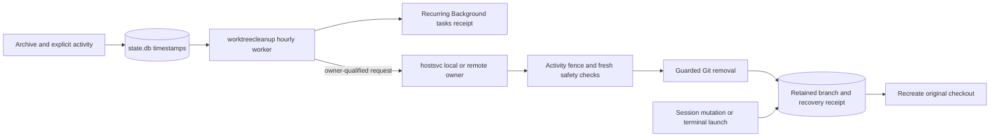

Ocman automatically removes eligible managed worktree checkouts seven days after
their sessions are archived. It keeps the sessions, conversation history and
local branches, including unpushed commits. Main checkouts are never removed.

## Timing and activity

Cleanup runs at startup and hourly. Each session's deadline is seven days after
the later of its archive time and last recorded interaction. Sending messages,
running commands, changing session metadata, reading or pinning a session,
changing its queue, and opening or using its managed terminals postpone cleanup.
New activity observed from an agent also starts a fresh seven-day period, using
the owner's or hub's observation time rather than trusting remote clocks.
Background polling and repeated reads of unchanged agent timestamps do not
postpone cleanup.

Open Background tasks through the `bgt` counter to inspect cleanup. Its recurring
entry shows the latest result, hourly cadence, run count and next-check hint.
Progress counts checked checkouts, with counters for removed, retained,
already-removed checkouts and unavailable owners. Retained checkouts are normal
safety decisions, not failed cleanup jobs. Detailed reasons remain in debug logs
and checkout recovery records.

Unarchiving cancels eligibility. Archiving again starts another seven-day
period. Snoozing is not archival for cleanup purposes. When several sessions use
one checkout, every session must qualify. Native child sessions may inherit
their parent's archive, but their own activity and pending work still protect
the checkout. Unknown or orphan worktrees are not swept.

Existing archives receive a fresh seven-day grace period when this feature's
schema is first installed. Deadlines and recovery receipts survive restarts.

## Safety checks

Cleanup retains a checkout when any check fails or cannot be completed:

- An owning session is active, waiting, externally managed, has pending prompts,
  queued messages, or background work. Pending owner-local application tasks also
   defer cleanup. Inline observations of scheduled checks do not count as pending
   executions, so tracking maintenance cannot block cleanup itself.
- A managed terminal or tmux session still uses the checkout.
- Tracked edits, untracked files or ignored local files exist. Ignored
  `node_modules` directories are the only disposable-file exception.
- Git reports a locked worktree, detached HEAD, submodules or an unfinished Git
  operation. Submodule checkouts are retained even when they appear clean.
- The path is not a direct child of the project's managed `.worktrees` directory,
  crosses a symlink, or its branch or HEAD changed during the checks.
- The owner is disconnected, its inventory is incomplete, or its version cannot
  perform guarded cleanup.

Removal uses `git worktree remove` without force. It never runs `git clean`,
deletes branches, or recursively deletes arbitrary directories. The owner
rechecks session inventory under the same mutation fence used by session
delivery, creation, archive changes and terminal launches. External processes
that Ocman does not manage can still race filesystem checks, so avoid running
untracked external workloads in archived worktrees.

## Resuming a cleaned session

The next session mutation or terminal launch recreates its checkout at the
original path from the retained branch. No new session is created. Ocman refuses
to overwrite an existing path or recreate a missing or changed branch. Such
recovery failures block the operation instead of silently switching directories
or losing history.

Cleanup attempts retain their latest removal failure in the application's
`worktree_cleanup_checkout` records and write structured debug logs for skipped
checkouts. Unsafe checkouts are retried on later sweeps.

## Implementation

`internal/worktreecleanup` owns the joined worker, activity observations and
recovery receipts. `internal/state` owns archive persistence and the mutation
fence. `internal/hostsvc/local` performs owner-side filesystem and terminal
checks through `internal/git`. Dedicated authenticated gRPC operations preserve
that boundary for remote owners and fail closed on older versions.
