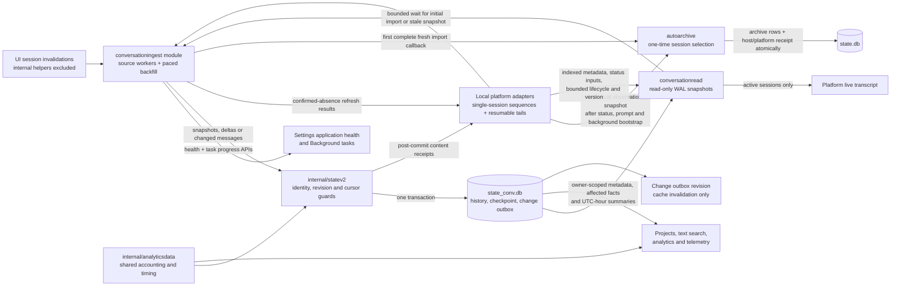
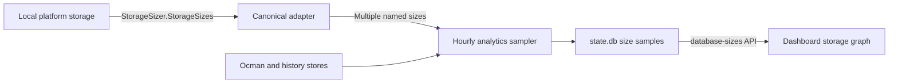
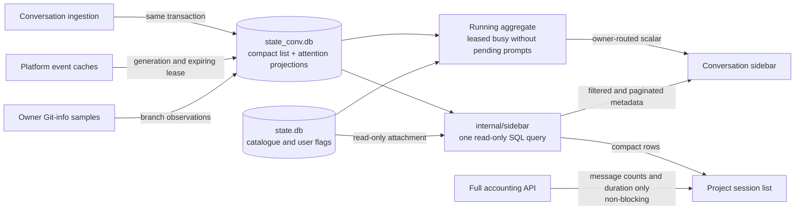
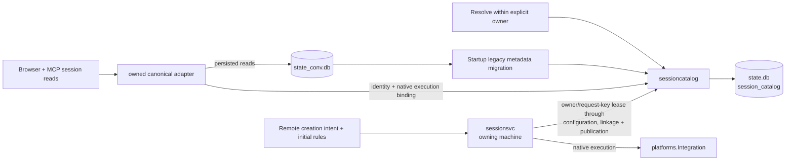
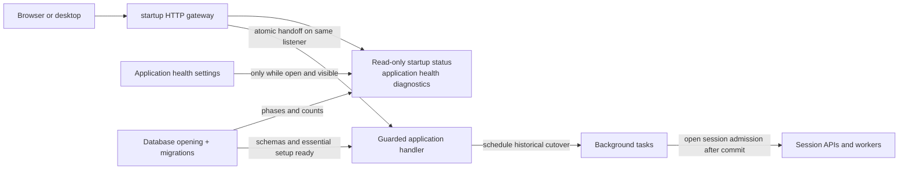
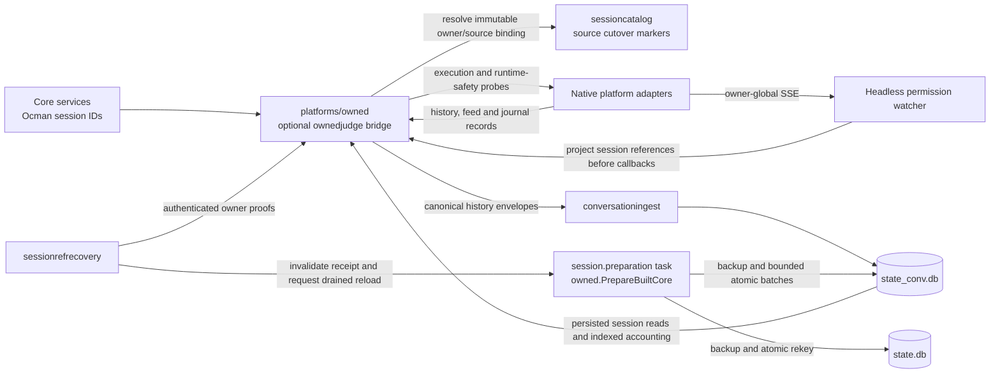
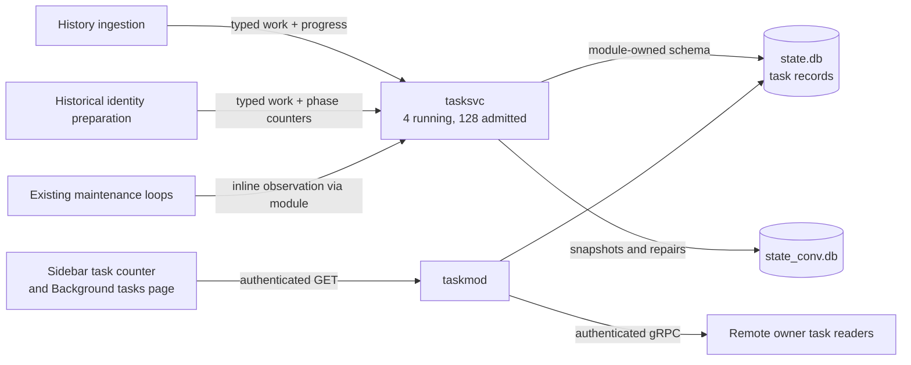

Part of the [architecture overview](architecture.md).

## Statev2 history ingestion

Each owning instance imports its own local platform history. Analytics and
settled conversation browsing always read Ocman history. There are no feature
flags or legacy read fallback. Runtime actions and live streaming remain
platform-owned.

- Platform type and platform instance are separate. Native session identities
  belong to an immutable source instance, so identical IDs cannot cross sources.
- Session lists and conversation status enrichment batch canonical catalogue
  lookups, including the parent map used for nested live prompts. Query count
  does not grow with the retained inventory. Every batch still validates owner,
  platform, publication and purge state; identities are not cached across reads.
- Stable discovery inventories of at least 32 sessions validate metadata and
  both parent graphs from one transaction-local catalogue snapshot. Changed,
  unfinished, purged or inconsistent rows use the normal atomic repair path.
  The snapshot is capped at twice the input size so partial inventories do not
  load an unbounded source. No inventory cache survives the transaction.
- Conversation-stream ancestor checks use `SessionMetadata`, including the
  owner-routed remote `Call` operation. Unsupported older peers retain the
  summary fallback; disconnects never fall back to local data. Event status
  reads combine one indexed stored status row with the integration's port-fenced
  lifecycle cache, without accounting, native history or a source-wide parent map.
  Accounting queries select their session scope before visiting facts. Family
  traversal uses indexed ID and parent lookups for each recursive frontier.
- Content and ingestion progress commit together before upstream acknowledgment
  or outward publication. Conflicting repair writes fail instead of overwriting
  another ingestion revision.
- Historical imports share one active background slot and default to a 20%
  work/rest duty cycle. They yield between snapshots without holding database
  transactions during the pause. Requested conversation reads interrupt the
  background wait and bypass its budget; live updates are not CPU-throttled.
  Shutdown cancels the wait, preserving each completed snapshot's checkpoint.
- Source deletion never removes retained history.
  A missing snapshot requires a complete source inventory to confirm absence;
  failed or deferred inventories cannot turn a read failure into a deletion.
  Confirmed absence resolves captured refresh tickets as not-found, rather than
  successful content validation, without acknowledging newer requests. Feed
  batches continue past individual failures and retry only unapplied events,
  preserving deletion flags and sequences. Ocman's temporary naming and judge
  helpers do not produce UI activity callbacks; the history feed still imports
  their content independently.
- A fresh source records first-import eligibility before writing content. Only
  a complete successful import invokes the server-injected archive callback.
  Existing histories opt out; interrupted imports retain their eligibility.
  The callback keeps sessions active in the last 24 hours and the latest 20
  visible sessions, plus pinned and live sessions. Archive rows and a once-per-
  host/platform receipt commit together in `state.db`. Native data is unchanged.
  Inactivity maintenance waits for a clean import and does not override the
  first-import selection during its first 24 hours. The normal configured
  inactivity policy applies afterward.
  Readiness-deferred startup sweeps retry after one minute instead of losing
  the startup pass until the next day. First-import selection uses the owning
  adapter's canonical observation snapshot, including cached native prompts,
  bubbled child prompts and canonical background tasks. An incomplete live
  bootstrap leaves the one-time cleanup pending.
  Prompt bootstrap receipts name the port and its current generation. Clearing
  a port invalidates those receipts; re-registering a scope or failing its
  replacement fetch cannot reuse an older successful snapshot.
- Unresolved creation reservations defer affected identities, not the entire
  import. Partial inventories never authorize deletion or complete verification.
  Claude supervisor discovery failures return available transcript/runtime rows
  with the same incomplete-inventory fence, so unrelated transcripts still sync.
  Claude agent task starts register read-only runtime children before their first
  events are exposed. Owner-local identity probes use that metadata before a
  transcript exists; ingestion stores their forwarded messages under the same
  canonical identity later used by the transcript. Child task completion,
  failure and cancellation settle independently of the parent's run state.
  Transcript discovery watches nested workflow directories beneath `subagents/`.
  Ingestion confirms committed message IDs and part-content digests to the owning
  supervisor. Settled child views are reclaimed only when every retained content
  entry has a matching receipt; partial or stale receipts cannot drop newer text.
  Runtime metadata and terminal status survive this memory reclamation.
  Subagent completion hooks use `HistoryFamilyReader` to discover newly created
  child files beneath their native root, then read only new, changed or directly
  invalidated sessions. Unknown hook identities request version-hint discovery,
  not full repairs of unchanged history. A transcript removed during refresh is unavailable,
  not an ingestion-worker panic.
  Analytics keeps reading atomic committed projections from initialized local
  sources even when another session fails. Responses identify partial scope in
  a diagnostic header; charts do not display a warning or use native fallback
  readers. Ingestion retries silently. Settings → System → Application health
  shows history sync and backend status, with details in Background tasks.
  Neither import toasts nor startup pages interrupt the application shell.
- History is not live execution authority. Future collectors must keep runtime
  freshness and idempotent action reconciliation separate from historical replay.
- `platforms.HistoryReader` bypasses UI filtering without bypassing owner/platform
  routing. OpenCode reads one source transaction and reuses the v2 converter;
  Claude borrows the browsing index and checks transcript identity/mtime/size
  across each snapshot. Native v2 payloads and unsupported message types survive
  normalization. Missing source inventories never authorize deletions.
- OpenCode v2 is event-driven and does not poll. Its worker follows the machine
  server's `/api/event` firehose, which covers every location and session the
  background service runs, including terminal sessions. A durable session event
  reads only the messages it names and upserts them with `statev2.ApplyStream`,
  advancing that session's applied sequence in the same transaction. Reverts,
  compactions and similar events without message IDs reread their session;
  deletions are retained as source-deleted. The firehose has no replay, so each
  connection first catches up: it compares OpenCode's indexed `event_sequence`
  with the sequences already applied and rereads only sessions that moved. The
  same comparison repeats while the firehose is unavailable. Stored-history
  readiness uses the durable sequence (`seq:N`), not session timestamps, which
  OpenCode v2 does not advance on every message change.
  Targeted hints are deduplicated and bounded; overflow requests durable
  sequence catch-up. Failed and deferred repairs remain pending even when
  their sequence did not change, and retry with a backoff timer independent of
  new feed events. A successful inventory retires repairs for deleted sessions.
  Incremental mutations invalidate full-snapshot digests atomically.
  Live activity hints and replayed events whose sequence is already applied do
  not force full-session reads. Explicit repairs still validate the source.
  A targeted repair reads that session's durable sequence through the optional
  `HistorySequenceReader`, resolving only its canonical identity. OpenCode uses
  an indexed lookup in `event_sequence`; startup and reconnect catch-up still
  list all sequences. Feed adapters without the optional reader retain the
  inventory fallback.
- Claude follows its hook journal (`internal/historyjournal`). Hooks append a
  record pointing at the changed transcript in every session, including
  terminal sessions and while ocman is stopped. At startup the worker compares
  transcript version hints once; afterwards each journal record targets its
  session without rereading completed descendants or a source-wide inventory.
  `platforms.HistoryDeltaReader` resumes conversion at the last message group's
  byte offset, replaying that group to capture appended tool results. The
  transcript cursor and tail upserts commit atomically; detected replacements
  and truncations request full snapshots. The shared Claude index persists its
  own last-group scan state and updates only tail message offsets, usage and
  tool-call rows on append, including after restart. Filesystem events refresh
  only their named file or directory subtree. A five-minute recovery sweep
  covers missed hooks and unhooked external appends; directory watches on macOS
  cannot detect appends to existing files. Parent relinking stays within the
  changed native root. Append continuity checks a hash of the entire retained
  prefix, so a historical edit followed by growth forces a rebuild. JSON parsing
  and row updates stay tail-only; validation still reads older bytes sequentially.
  Cursor hashes are computed inside the snapshot's before/after consistency
  window. The journal offset advances only
  after ingestion succeeds. Checking for records costs one directory read; there is
  no periodic polling or automatic full verification. The journal is
  machine-wide under the XDG data directory; each statev2 store keeps its own
  offsets, and consumed segments are pruned after a week idle.
  Failed startup scans and deferred hook reads retry without needing another
  hook. Journal read errors revoke readiness rather than appearing as no work.
  Writers lock each segment and terminate interrupted tails before appending.
  Translation failures have one task receipt, separate from journal I/O errors.
- Sources with neither (Codex, and OpenCode before its database is migrated) still poll change hints every 30 seconds
  and coalesce event-triggered repairs for one second. Known-session events bypass
  full inventories unless verification is due; unknown sessions still trigger discovery.
  Timer-triggered polls always inventory independently of pending activity, so
  busy sessions cannot starve unrelated discovery or removal detection.
  A polling pass reads only invalidated, new or re-hinted
  sessions. Version hints, content fingerprints and the last verification time
  persist in statev2, so a restart skips unchanged snapshots unless their
  conversation read-format metadata needs upgrading.
  The server joins all source workers before the application closes the database.
- Codex history and live settlement each own a bounded rollout-usage cache.
  Unchanged files are reused; ordinary uncompressed appends validate the complete
  old prefix and parse only new records. Unterminated records force a rebuild on
  growth instead of retaining tentative accounting. Explicit verification bypasses the cache.
  Replacements, truncations and changed compressed rollouts rebuild that file's
  accounting. Native turns and items still come from complete app-server snapshots.
- Messages carry their accounting (agent, provider, cost, token counts, finish,
  error name) as indexed columns, and sessions carry parent and project IDs, so
  analytics can filter and sum without parsing stored JSON. Indexes cover
  message time, model and session parent/project. Projection-era databases
  (schema v5+) upgrade in place. Unsupported earlier or future schemas cause
  startup to fail without dropping tables or discarding history. Re-syncs
  upsert retained sessions, messages and parts; they never empty the store.
- For polled sources, every six hours a verification pass rereads all sessions. It counts content
  that changed under an unchanged hint as drift, logs and repairs it, and reports
  matched, drifted, changed and missing sessions as a background task. It also
  compares each session's stored accounting with totals recomputed from the
  snapshot it just read; a `usage-mismatch` counter means a normalization or
  column mapping bug.
- Analytics queries read retained summaries only. Native fixture rows are
  imported before tests assert totals, filters, pricing and runtime.
- Project totals aggregate stored sessions across local platform instances and
  exclude helpers only from visible session counts. Plugin directory grants
  require ingested project-root evidence; conflicting roots fail closed. Local
  text search reads retained user/assistant text blocks, excluding tool payloads
  and other owners, matching literally with ASCII-only case folding and
  returning UTF-8-safe snippets.
  Project refreshes use committed history while ingestion catches up and use the owner's
  durable history-change watermark to invalidate cached statistics after stored
  commits, even when no native event reaches the application.
- Native event connections and agent/model catalogue transport live in the
  OpenCode adapter. The permission watcher retains reconnect, watchdog and
  completion-drain ordering, and platform projection runs before callbacks.
  Native discovery cache workers start through a platform lifetime capability.
  Judge conversation context comes from statev2; temporary judge-session
  creation, prompting and response collection use the integration's helper
  client. Missing stored context never triggers a native transcript read.
- This is committed-history ingestion, not lossless raw-event capture. Supervisor
  acknowledgments and active streaming stay on their existing paths until direct
  durable event ingestion is implemented. Hub replication is not enabled.

### Completed conversation reads

Settled OpenCode and Claude conversations always use validated statev2
snapshots. No opt-in or legacy opt-out is available.

- Canonical adapters serve every persisted read (lists, summaries, metadata,
  conversation pages, usage, descendants, archive candidates,
  panels and catalogues) from statev2. `internal/conversationread` only
  converts a stored page to the wire format. There is no per-request choice
  between native and stored reads, and no native fallback.
- Running, limited and approval-waiting sessions also read their transcript
  from statev2; live turns reach the browser through platform SSE, and the
  event cache overlays only live fields (status, prompts, connection, notices).
  Directory warnings come from the live integration and only for its current
  physical source.
- A session without a stored snapshot waits, bounded, for ingestion's first
  read of that session, then returns HTTP 503 with
  `X-Ocman-Conversation-Error: history-unavailable`, never a native transcript.
  Successful local reads expose `X-Ocman-Conversation-Source: statev2`; remote
  reads expose `remote`, and the owner fails closed the same way.
- Schema v8 preserves part timestamps, text-field presence and displayable
  message markers. Existing snapshots stay retained but require a background
  metadata refresh before normal browsing. Paging counts backward from the
  newest displayable message and excludes superseded records without deleting
  their audit history. Source-deleted sessions remain readable after validation;
  explicitly purged sessions do not.
- Composer defaults, context tokens, session trees and accounting come from
  Ocman projections. Cost estimates still use current pricing. Full native
  payloads stay stored, but opaque native-only messages do not consume visible
  paging slots.

### Analytics reads

All conversation-derived analytics use the existing `internal/db` calculations
over ingestion-maintained statev2 summaries: overview/stats, daily/hourly activity, model
usage, cost estimates, performance, throughput, request/session/project logs,
concurrency and agent runtime. Each imported batch commits these derived tables
in the same transaction as its history and checkpoint:

- `analytics_session` contains compact metadata and session accounting totals.
- `analytics_hour` groups counts and tokens by source, session, UTC hour, role,
  provider/model, agent and stop reason, with outcome, timing and
  priced/unpriced token sums. Activity/model charts and the metrics dashboard
  summary, series and session/project logs sum these rows instead of messages;
  only partial or calendar-splitting hours read exact facts.
- `analytics_fact` retains normalized per-request values and computed model,
  tool and unknown durations. Metrics rank duration percentiles in SQLite and
  page the request log with LIMIT/OFFSET, without parsing message JSON or
  rereading tool parts.
  Live pricing is applied to summed tokens per model.
- `analytics_question` retains question wait intervals for runtime accounting.
- `analytics_conflict` contains only duplicate native-ID candidates, maintained
  by insert/delete triggers so validation does not scan the whole history.

Full repairs replace the session's summaries. Incremental updates replace only
affected message facts, question timings and old/new UTC-hour buckets, and adjust
session totals by their net change. Human activity uses the persisted subagent
flag for both session and user-message counts. Tool-only changes recompute the
owning message's timing summaries too. Native payloads stay intact.
`internal/analyticsdata` supplies the same metadata and interval-union rules to
both legacy readers and ingestion; there is no second timing engine.

The one-time upgrade builds summaries from stored compact projections, preserving
history, checkpoints and source hints. It does not reimport from
platforms. Startup logs identify this backfill. Failure rolls back the upgrade.

`internal/db.OpenHistoryAnalytics` opens statev2 read-only with bounded pooled
connections and scoped TEMP views installed on every connection. Each response
uses one selected reader for all dates, including today. Filters, pricing,
pagination, subagent rollups and observed permission waits keep their current
calculation logic. Permission decisions, UI usage and database-size history keep
their original sources. Provider/subscription quotas are live platform account
reads, not history estimates. Live streaming and execution remain platform-owned.

Each reader caches up to 16 metrics windows keyed by the snapshot's
`change_outbox` high-water mark, local time zone, directory, day range and
agent/model filters. Repeated dashboard, performance and log requests with no
new ingestion reuse them; a moved cutoff reuses a window only when no request
lies between the two cutoffs. Pricing, session identity and the zero-filled
series are applied per response.

Storage-size sampling also stays behind the platform boundary:

- `platforms.StorageSizer` is optional and returns any number of stable named
  series. Canonical adapters forward it without waiting for history ingestion.
- OpenCode reports logical SQLite bytes, including pages committed in WAL.
  Claude reports raw `.jsonl` transcript bytes under its configured `projects/`
  directory, including nested subagents, without parsing files or using its index.
- The sampler queries the current local platform registry hourly and at startup.
  Remote adapters are excluded. Platform errors do not suppress successful series.
  Existing series keys and samples survive the schema upgrade; the chart renders
  additional series without needing another schema or frontend change.

Summary queries retain exact millisecond cutoffs. Partial UTC hours and local
calendar boundaries that split a UTC hour read only their normalized boundary
facts. This also supports fractional-offset timezones without persisting a
timezone-dependent rollup. Pricing remains dynamic. Request timestamp ties use
native ID as a stable secondary sort key in both readers for pagination.

Native-ID validation checks the sparse conflict markers against active selected
sources, with a per-reader/outbox-revision cache. Imports invalidate
the cache. The mark and collision checks share one read transaction.

Inspect the response headers in the browser's Network panel:

- `X-Ocman-Analytics-Checked-At` gives the oldest successful local source scan.
  Recent/live figures can lag ingestion; the default poll interval is 30 seconds.
- `X-Ocman-Analytics-Error` explains a statev2 availability failure:
  `history-unavailable`, `import-incomplete`, `history-error` or
  `history-scope-error`. These responses are HTTP 503, not legacy results.

The cutover waits for a clean scan of every enabled local history source after
each startup. Remote adapters are excluded from both local ingestion and its
readiness checks; connecting a remote does not block completed local imports.
Unsupported local adapters, failed or deferred reads, accounting
mismatches and scans older than two poll intervals make statev2 analytics
unavailable. Because existing response types and links use native IDs, overlapping
session or message IDs across selected instances fail closed rather
than merging unrelated records. The retained schema remains instance-scoped.
Query errors are returned without retrying against legacy. An empty or partially
hydrated store never produces incomplete totals. Startup requires the history
store to open successfully. While initial imports or repairs are pending,
unavailable readers return HTTP 503 rather than selecting platform history.

Route tests cover conversation analytics filters, pagination and source headers.
They close the native handle to verify that statev2 routes do not query it.
Calculation tests import fixtures into retained history and assert expected
totals, pricing, throughput and question timings. Summary tests cover exact
cutoffs, fractional timezones, repeated DST hours, tool-only repairs, collision
markers and upgrade rollback. There is no native-SQL analytics fallback or
parallel parity implementation. Optional read-only latency tests still measure
the production queries against an explicitly supplied validation snapshot.

## Compact session sidebar

- Sidebar reads do not invoke accounting summaries or platform/supervisor RPCs.
  The projection carries title, project, directory, hierarchy, prompt/completion
  attention timestamps and
  cached branch data. Catalogue joins preserve authoritative owner/source,
  publication, purge and routine/Factory origin checks without copying authority.
- An owner-local worker persists event-cache observations every 500 ms. Runtime
  generations and expiring leases prevent stale busy flags after disconnect or
  restart. Pending prompts and persisted halt receipts use source-scoped native
  ancestor walks, never application worktree links. An idle observation settles
  against the retained outcome rather than replacing waiting/error with done.
- Seen, archive, snooze and pin state join in the same query. Numeric unread
  counts are retired; conversation JSON, message ranges and accounting facts
  are not scanned. Running-count polling uses a dedicated owner-routed aggregate
  over the same generation-fenced observations and prompt ancestors, without
  sorting or returning session rows. Notification polling still reads compact rows.
  Older owners without the aggregate follow the sidebar's partial-owner failure
  policy rather than falling back to full session inventories.
- Numeric unread wire fields remain as zero-valued compatibility keys:
  session `unreadCount`, Inbox `unreadTotal` and push `badgeCount`. Current clients
  ignore these fields. Push carries boolean `badge` state, and app/navigation
  badges request only a dot or platform-defined flag. Seen versions, first-unread
  markers, read filters and notification delivery remain separate from counts.
- Conversation headers reuse already-loaded metadata and totals. Full accounting
  summaries remain separate, for views that actually display them. Cached native
  child prompts bubble to the same root in conversation and sidebar reads.
- Project session lists render compact rows without waiting for accounting.
  Message counts and durations fill in separately, matched by platform and
  session ID with a freshness check. Accounting cannot replace titles, live
  status or archive flags. Both queries retain shared caching and polling.
- Interactive history reads use a separate read-only pool from ingestion's
  serialized writer. A long import cannot reserve their database connection;
  they see a consistent committed WAL snapshot while ingestion is in flight.
  Module finalizers close attached readers after handlers and workers finish,
  including failed startup before workers launch.

## Session identity catalogue

`internal/sessioncatalog` owns an append-only module schema in `state.db` for
`ocm_<uuid>` identities. The store persists creation intent before binding a
native execution. Owner-local creation uses the catalogue before platform side
effects and binds before publication. Public session lists, reads, creation
results and browser events use the same Ocman identity. Native execution and
existing permission/queue/bookkeeping keys remain behind the boundary.

- Request keys deduplicate creation intent within a stable owning machine.
  A cancellable owner/request-key lease serializes creation and recovery through
  native configuration, application linkage and publication. Waiters reread the
  durable receipt after acquiring the lease; independent requests do not block.
  Origin and routine/factory metadata exist before a native session can be
  bound. An uncertain creation outcome remains pending rather than permitting
  another execution.
- Integrations supporting client-chosen IDs expose `SessionCreationPlanner`.
  OpenCode V2 creation persists the planned native binding before HTTP, then
  sends that exact ID through the compatibility transport. An explicit retry
  with the same request key probes that ID, reapplies initial configuration and
  completes application linkage before publication. A retry before allocation
  uses the same native ID, never a replacement. Legacy creates and forks without
  this capability remain pending for explicit reconciliation; startup never
  guesses bindings from titles or timestamps or replays a prompt.
- Native bindings are unique across owner, platform, physical source and native
  ID. Early native announcements defer while creation in their directory is
  unbound, avoiding a second Ocman identity with missing origin metadata.
- Catalogue states describe binding progress, not agent status. Platform
  adapters retain execution authority. See `internal/sessioncatalog/README.md`
  for the remaining creation, remote, routing and history migration work.
- Routine and factory intent travels with worktree creation. Initial rules apply
  on the remote owner, with a response receipt preventing the hub from applying
  them again on replay. Remote disposal uses a dedicated RPC through sessionsvc;
  uncertain creation or cleanup retains the workspace for reconciliation.
- Forks reserve the child and its Ocman parent link before native history copy.
  Startup migration backfills legacy metadata during fenced preparation;
  canonical ingestion adopts later metadata directly. The bootstrap has no
  background runner or change cursor. There is no parallel native-ID HTTP/MCP
  translation mode or background legacy catalogue indexer. Adapter event
  projection still preserves opaque payloads. Migration preserves pin/seen/archive
  associations, and attributes native-only provenance only to the selected
  physical source, never inactive sources with colliding native IDs.
- Source deletion alone does not delete an identity. Pending native announcements use bounded metadata retries and
  overflow to a fenced inventory; healthy source content is never polled.
- Canonical adapters project native events and preserve opaque payloads, stream
  cursors and message/part IDs. Core handlers and feature stores use canonical
  session IDs directly. Legacy browser links canonicalize through the identity
  gateway before opening streams; unknown IDs never fall back to native probing.
  Inactive source bindings return unavailable instead of targeting a new installation.
  The shared `platforms.SessionRegistry` contract requires wrappers to forward
  `CanonicalSessionIDs`, so ownership comes from the catalogue, never the
  registry's reverse cache.
  Raw-adapter lookup fallbacks and native-binding mirroring are removed; legacy
  bookmarks still resolve inside the canonical adapter for the authenticated
  owner and physical source.
- Catalogue v1 is frozen. The append-only v2 upgrade preserves development
  databases, including both intermediate native-parent column spellings.
- Notifications, routine/Factory references, Inbox, artifacts, webhook
  dispatches, sharing and launch results carry canonical session references
  without transport-level JSON rewriting. Task reads retain those references
  until owner selection and annotate each result's platform, never resolving
  native IDs through a cross-owner cache. Push and plugin notice links use the
  same canonical destinations as their durable keys. Startup migrations retain
  existing notification and plugin correlation records.
- Analytics resolves session identities using the physical statev2 instance
  before grouping request/session logs. Titles and directories come from the
  same validated read snapshot, not a native lookup using a public ID.
- Browser adoption migrates session-keyed recovery data without replaying it or
  remounting canonical-route conversations. First-delivery readiness waits for
  uncertain legacy receipts. Adoption receipts prevent source/owner collisions
  and hide retained legacy bookmark copies without deleting recovery data.
  Canonical route loading and first-delivery readiness share one in-flight
  identity lookup and migration through `ensureSessionBrowserState`.
  Failed-send adoption retries missing persisted entries even when complete
  payloads survive only in the browser's memory.

- Definitive create/fork rejection is an explicit adapter guarantee. Provider
  error codes and gRPC `ErrorInfo` preserve it; status codes alone never authorize
  replay. Uncertain outcomes retain their reservations, while definitely rejected
  reservations stop blocking external discovery. Configuring metadata remains
  queued for bounded retry until binding completes.

### Canonical session core

The HTTP listener serves the embedded UI and a read-only `/api/startup` before
opening databases. `internal/startup` reports the phase, elapsed seconds and
phase-local completed/total counts. Updates and five-second heartbeats go to
the logs. Application health settings read this endpoint only while mounted
and visible. There is no app-root startup wrapper, global startup store or
always-on startup polling; authentication remains enforced by `AuthGate`.
The shell, composer state and focus survive backend restarts. The desktop
bootstrap also accepts startup responsiveness. Counts are never presented as
an overall percentage. Initialization failures remain visible in application
health, with full details in server logs.

During database opening and schema migrations normal API calls return 503 with
a retry hint. Once essential setup completes, the same listener dispatches to
the guarded application handler. Authentication, embedded routes, capabilities,
system statistics and authenticated background-task status are available even
while historical identity preparation is unfinished. The persisted sidebar
session list and the project list stay readable so the UI shows existing data;
the sidebar refreshes when the event stream opens. Other session-dependent APIs
return `session_preparing` with a retry hint until cutover and module startup
succeed. The progress endpoint stays available for reloads and contains no
paths, session identifiers or raw errors. Shutdown joins the HTTP server and
heartbeat before database teardown.

`internal/platforms/owned` is the session identity integration boundary.
`app.composeCanonicalSessionCore` builds canonical adapters without historical
inventories. Incomplete cutovers run as a `session.preparation` background task.
The initial cutover conservatively fences all session consumers, including
headless watchers, ingestion, plugin delivery, remote-manager inventory and
authenticated unary/streaming remote calls. Dedicated MCP and hooks use the
same fence; module launchers may use MCP after preparation and module startup.
Native session IDs remain inside integrations and compatibility adapters.

- Execution rejects native caller IDs, unknown Ocman IDs, purged
  sessions and inactive physical bindings. Creation reserves before allocation
  and remains unpublishable until application linkage completes. Receipt hashes
  preserve keyed creation requests written before the cutover.
- Native modules implement `platforms.Integration`: identity, capabilities, a
  runtime inventory for migration and reload safety, live observation, prompts,
  execution and streaming. Only canonical adapters and remote proxies implement
  the browsing half of `platforms.Platform`. `owned.New` requires the statev2
  store, so there is no adapter without it. Session lists, metadata, summaries,
  conversation pages, usage and archive candidates read that
  store. An unknown native ID gets an identity only after the integration's
  `SessionIdentityProbe` proves its source has it; that probe returns binding
  metadata, never transcript content. Info/change panels reuse platform converters with
  stored DTOs; historical catalogue defaults and recents use scoped statev2
  readers. Optional live catalogue calls require an explicit configuration-only
  capability. A missing or closed store never falls back to native history.
- Event caches overlay status, pending prompts, connection state and retry/reset
  observations without replacing persisted titles, directories or accounting.
  Native descendants and user-created worktree links remain distinct, so an idle
  worktree conversation stays visible and its prompts cannot bubble to another
  conversation. Running authority never comes from a stored message guess.
- Retained physical sources remain readable under their owner/platform scope
  after a source disappears or is replaced. Their native IDs cannot borrow live
  observations or execution authority from a different source. Older compatible
  conversation encodings remain readable while ingestion upgrades optional
  project, hierarchy and static-status metadata.
- Publication stores acknowledged creation metadata even before a transcript
  exists. Runtime-only source snapshots are partial and cannot delete retained
  messages or overwrite them with an empty complete snapshot. Ingestion owns the
  bounded first-read wait and refresh acknowledgements. A refresh ticket is
  captured before its source snapshot starts; an earlier in-flight snapshot or
  another session's receipt cannot satisfy it. The native session-list cache
  and its refresher were removed.
- Halt receipts use canonical keys for post-cutover identities. The authenticated
  source's frozen legacy-key policy preserves older receipts and their first
  observation timestamps across prompt replays. Unattributed native receipt keys
  never attach to a newly discovered identity or another physical source.
- History inventory includes hidden helpers. Snapshots and feeds translate
  normalized session references while retaining message/part IDs and opaque
  payloads. Journal conversion preserves byte offsets. Unassociated hooks request
  a source-wide refresh rather than assigning an unverified native ID.
  Canonical startup omits the legacy native indexer. A source-deleted conversation
  retains its validated physical head so settled reads can use retained history
  without falling back to a missing native transcript. Rekeying tests verify
  retained analytics rows without a separate native analytics implementation.
- History rekeying preserves revisions, change-outbox sequences, source-deletion
  state, analytics rows and session-scoped receipts. Core-state
  rekeying covers declared columns, Inbox/control-session JSON, packed unarchive
  keys, conversation-plugin mappings and replacement-baseline map keys. Conflicts roll back without merging or
  dropping durable records. Both stores take restorable backups before mutation.
  Routine run snapshots remain immutable outside rekeying: the transaction saves,
  suspends and restores the original snapshot trigger, including on rollback.
  `owned.PrepareBuiltCore` freezes legacy routine/Factory provenance and inventories
  active and retained local sources before migrating history and core references.
  Discovery/parent reconciliation uses batches of at most 500 metadata rows.
  History mappings are staged durably before any pagination keys change; an
  inventory-complete receipt lets an interrupted cutover resume application
  without interpreting a partly migrated child's canonical parent as native.
  Each rekey transaction applies at most 500 staged identities, and the plan is
  removed only after commit. Core/feature batches share one pre-mutation backup;
  history application takes one backup per attempt, not one per batch.
  Source-less local state resolves only against a
  unique catalogue binding across all physical sources. Active/inactive source
  collisions remain quarantined. Replaying legacy indexing validates canonical
  history keys instead of adopting them as new native execution bindings.
- Catalogue v3 records which sessions need legacy opaque deduplication tokens.
  Existing records retain them; new identities use canonical tokens. Permission
  Inbox hashes are derived inside the adapter, so re-observing a migrated prompt
  can keep its resolved tombstone without exposing a native session ID to Inbox.
  A durable per-source cutover marker freezes which inventoried identities need
  legacy keys. Later startups cannot change modern wire or completion receipt
  identities. Permission notifications, replies and manual rules all request the
  same integration-provided Inbox key, including reply-before-asked tombstones.
- Offline and unattributed legacy associations use `ocref_<uuid>` lookup tokens.
  These are not session identities and cannot execute. Native references stay
  only in `platforms/owned`'s compatibility table. Queues and feature records keep
  their relationships while waiting for an authenticated owner to supply an
  `ocm_<uuid>` identity. Unknown owners are never inferred to be local. Repeating
  migration preserves the same tokens, and resolved tokens cannot be rebound.
  The restoration helper resolves batches through the authenticated owner gateway,
  persists immutable bindings before rekeying state, and reuses them without
  contacting the owner on replay. It requires quiescent state users.
  The canonical-only `sessionrefrecovery` module polls connected canonical owners
  for unresolved proofs. It persists bindings without rekeying live application
  tables, then requests a reload gated by the authoritative idle check. Unlike a
  platform-settings change, it does not fence new sessions or turns; a busy
  machine applies the bindings at the next natural idle point or restart.
  A graceful backend reload applies those bindings through the fenced background task
  and rebuilds caches and workers. Held quarantine queues remain durable and do
  not block the reload. Saving unchanged platform settings cannot cancel it.
- `sessionsvc` supports adapter-owned creation/configuration followed by a
  canonical linkage callback and explicit commit before publication. Replayed
  completed local creations do not repeat linkage or publication. Canonical
  reconciliation errors retain worktrees just like earlier uncertain outcomes.
- Native-link and old-receipt handling now lives in `platforms/owned`'s gateway.
  Canonical HTTP/MCP request paths retain the Ocman ID, and pending feature
  references lose their executable links without losing the surrounding record.
  Catalogue v4 mirrors remote canonical metadata without a native binding on the
  hub. Production negotiation requires protocol v12 (v9 plus the removal of
  the unused webhook-inbox and `Owns` RPCs and the generic `Call` RPC). Raw compatibility servers
  advertise v8; canonical managers reject them before publishing either their
  platform adapters or host execution routes.
  Declared v9 mutation contracts reject native and pending session references
  before side effects. Canonical peer responses are checked before caching
  ownership, including offline snapshots; uncertain creation replies remain
  non-replayable even when their payload is malformed.
  Read, ownership, usage, policy and per-session stream RPCs also validate session
  references before invoking adapters. Owner-global streams remain supported.
  The remote stream receiver validates complete declared event frames and rejects
  native, malformed or pending session references without allocating identities
  or applying the public-view link-clearing policy. Opaque provider data and
  native message/part/request IDs retain their wire representation.
  Local event projection includes diff and compaction notifications. Unpublished
  creation frames are withheld without disconnecting an owner-global stream or
  suppressing a ready sibling's events; unrelated projection failures stay fatal.
- The headless OpenCode watcher projects named and directory-wrapped events before
  application callbacks. Adapter bridges preserve port-generation fencing, native
  prompt/status caches, instance discovery and session-cache refreshes. Prompt
  snapshot callbacks run outside the prompt lock so canonical discovery can read
  session metadata without deadlocking. Opaque prompt metadata is unchanged.
  Host discovery hooks also survive wrapping. Parent/directory/title lookups,
  artifact and stream descendant checks, and git refresh hints now use adapter
  metadata/relationship capabilities rather than querying native session keys in
  the server. Canonical and explicitly remote references cannot fall back to a
  local raw database adapter.
  The wrapper preserves authoritative reload-idle checks and isolated title
  helpers. OpenCode judge callbacks adopt helper identities before entering
  application state while prompt execution and cleanup retain native IDs inside
  the judge integration. The typed `ownedjudge` decorator preserves other
  platforms' fallback judges without exposing their raw adapters.
  Runtime-replacement candidate scans and persisted lifecycle evidence also use
  canonical adapter methods. Hidden rows remain visible to the stop fence;
  unattributed in-flight creations fail closed instead of disappearing from the
  candidate inventory. Minimal identity scans cannot erase catalogue metadata.
  Recovery scans carry unfiltered title and parent metadata, so hidden helpers
  never depend on the display-filtered summary reader for identity adoption.
  Optional host runtime, worktree naming, hook and MCP-listener services survive
  wrapping. Claude's headless watcher projects session references before permission
  callbacks, preserving native prompt IDs and its joined shutdown lifetime.
  Live-only conversation heads need no transcript fingerprint. Settled heads
  still require the immutable physical source. Claude config fingerprints resolve
  existing physical ancestors so first-run directory creation does not change them.
- The plugin store has a separate backed-up, atomic migration under the preparation fence for
  `session.v1` mappings, run results and completion outbox references. Fingerprints,
  unsettled admission fences, delivery sequence numbers and operation keys stay
  unchanged. Source-less run receipts use only the same plugin's unambiguous
  durable mappings, otherwise they remain quarantined. Platform-owned compatibility
  projection preserves legacy run-result/completion wire correlations and notice
  deduplication prefixes without using them for execution or public links.
  Quarantined completions pause without consuming their retry budget. Fenced
  migration also applies owner proofs saved before a reconnect-triggered reload.
  Restored remote wire/deduplication correlations come from the same scoped,
  immutable proof store. No native execution binding is mirrored onto the hub,
  and ambiguous correlations fail rather than changing receipt identity.
  An unavailable identity projection pauses completion delivery without spending
  attempts. Only calls that reach the plugin broker consume the retry budget.
- The app coordinator constructs wrapped adapters and canonical routing before
  historical work, preserving fallback judge capabilities. Session consumers
  start only after core and plugin migrations succeed. Unavailable selected sources remain fail-closed
  adapters and their legacy references stay quarantined. Runtime-owned reload
  idleness remains authoritative even when browsing is unavailable. Disposable-home
  startup tests cover creation, streaming, prompts and supervisor recovery.
  Existing databases are backed up and migrated after startup or a drained
  reload, never by a live rekey of active core services. Failed tasks remain
  visible and keep session admission closed; restarting retries unfinished work.
  Completion receipts in both stores bind the owner, physical-source selection
  and history database together. Ordinary restarts check indexed receipts rather
  than repeating retained-conversation scans, native inventories or parent walks.
  Indexed pending-local-reference checks still detect bindings discovered after
  cutover, so a completed receipt cannot suppress later recovery.
  New reference proofs invalidate the core receipt atomically. Newly imported
  legacy history invalidates the history receipt. Replacing/restoring either
  store cannot reuse the other store's mismatched receipt.

## Background task status

`internal/tasksvc` runs bounded owner-local work inside Ocman's process.
`internal/taskmod` exposes authenticated, read-only list and detail APIs at
`/api/background-tasks`. A compact `bgt` counter beside total active sessions
links to the Background tasks page instead of a main navigation entry. Its
`view=active-count` request counts queued/running rows without loading task
payloads or applying list limits. Both counter and page pause polling while hidden.

- Records distinguish queued, running, succeeded, failed, cancelled and interrupted
  work. A restart interrupts unfinished records instead of replaying closures.
  Shutdown cancels and joins admitted work before databases close.
- Producers report a phase, completed units, optional total and named counters.
  Unknown totals show indeterminate progress. Finishing a scan does not imply
  success if any session failed. History tasks count imported, unchanged, skipped,
  purged, failed and source-deleted sessions without deleting retained history.
  Polls with nothing to read are not recorded, and a repeated inventory failure
  is recorded once until it changes or recovers.
- Active keys deduplicate work within a task kind. The latest 1,000 terminal records
  are retained, plus recurring receipts with a nonzero next-check hint, even when overdue.
  Reads return at most 200 records, active work first, then recurring receipts
  before ordinary receipts within each status rank. The hub
  aggregates owner-local tasks over authenticated gRPC, omitting remote readers
  that fail. Explicit owner queries fail closed, and local read failures remain
  errors even during aggregation.
- History ingestion and initial session identity preparation use the bounded manager.
  Producers own durable resume checkpoints; task records do not replay closures.
- `module.Every` observes scheduled iterations through a lifetime-context observer.
  Manual timer loops use the same `module.Scheduled` or `module.RunScheduled` seam.
  `tasksvc.ObserveSchedule` runs work synchronously outside executor slots and keeps
  one stable owner-local receipt per job. Optional JSON metadata carries cadence,
  run count and a next-check hint through local HTTP and remote gRPC readers.
  Existing timers, domain locks, cancellation and subscriptions remain authoritative.
  Completed observations never cancel descendant subscriptions. Shutdown joins
  admitted observations after their caller lifetimes are cancelled.
  Receipt-storage failures log separately and run maintenance without a reporter;
  in-memory overlap guards and shutdown joining still apply.
- Loop exit and restart clear stale next-check hints. Cleanup admission counts real
  queued/running executions but excludes inline schedule observations. Detailed
  tracked jobs and excluded internal timers are listed in
  [Scheduled maintenance](../features/scheduled-maintenance.md).
- Agent execution, permission handling and queue delivery keep their domain-owned
  records and recovery. Connection watchers need health and last-success status,
  not percentage completion. There is no HTTP command-execution or retry endpoint.
