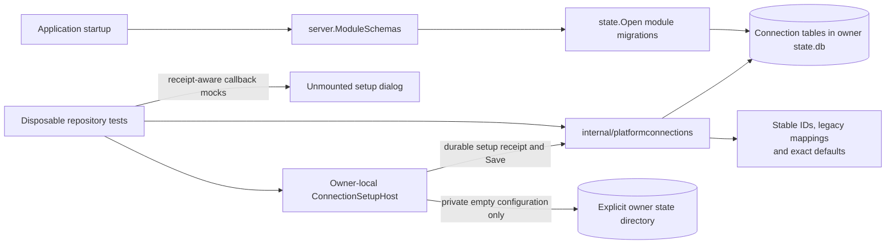

Named connections are under development. The UI components are not mounted in
live Settings or onboarding. Only the connection schema is registered at startup;
no production code initializes or mutates the collection yet. Current platform
selection and runtime behavior are unchanged.

- `internal/platformconnections` owns the append-only module schema and queries.
  It stores connection kind, immutable configuration metadata, display name,
  enabled intent, removal tombstones and collection onboarding state. It does
  not store credentials, persist setup readiness or launch agents.
- `hostsvc.ConnectionSetupHost` is the optional owner seam for setup preparation,
  Save and cancellation. Its local implementation requires an explicitly
  injected store and integration policy; neither is wired in production yet.
  It allocates private empty configuration directories without copying account
  data. Preparing a directory does not prove credential isolation or readiness.
- Durable setup receipts pin a configuration and preassign the connection ID
  before preparation. Retry uses the same directory after restart. Save consumes
  the receipt transactionally; repeats return the current connection without
  creating a duplicate or undoing later edits. Cancellation retains possible
  credentials and frees only pending capacity.
- The unmounted dialog includes an owner-issued receipt in Check again and Save
  callbacks. It retains the receipt through Back, name edits and request retries,
  but invalidates it for configuration changes. A changed or missing receipt in
  a subsequent owner response blocks Save. There is no live API controller yet;
  abandoned-reservation cleanup and browser-reload recovery remain to be wired.
- The atomic initializer takes a snapshot from the owner. New installations
  start empty with onboarding incomplete; existing installations skip onboarding
  and retain mappings from old platform kinds to opaque connection IDs. An
  initialized empty collection is not reseeded. Installation detection and
  startup activation remain future work.
- Connection IDs do not change platform IDs, physical source keys or canonical
  session IDs. Legacy mappings survive removal so a replacement account cannot
  acquire the old account's references. Renaming cannot retarget configuration.
- Removal records a disabled tombstone. It does not delete native directories,
  credentials or retained history. Disabled and removed defaults stay selected
  in storage, but default lookup returns an error rather than another account.
- Before exposing the store through Settings, owner-local services must enforce
  setup checks and removal draining. Connection-scoped runtime routing, remote
  inventory and account isolation are still required before enabling multiple
  accounts of the same kind.
