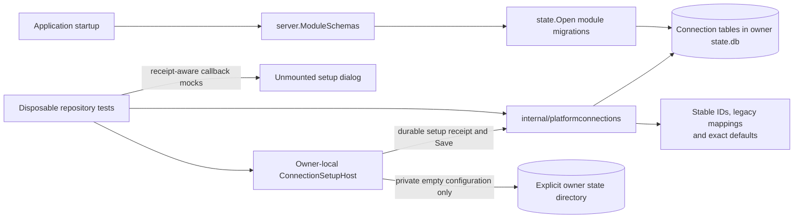
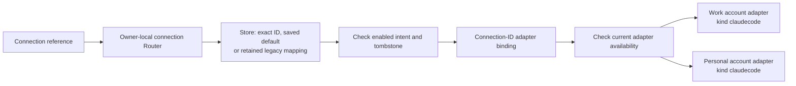
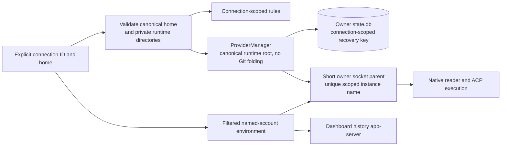

Named connections are under development. The UI components are not mounted in
live Settings or onboarding. Only the connection schema is registered at startup;
no production code initializes or mutates the collection yet. Current platform
selection and runtime behavior are unchanged.

- `internal/platformconnections` owns the append-only module schema and queries.
  It stores connection kind, immutable configuration metadata, display name,
  enabled intent, removal tombstones and collection onboarding state. It does
  not store credentials, persist setup readiness or launch agents.
- `hostsvc.ConnectionSetupHost` is the optional owner seam for setup preparation,
  Save and cancellation. Its local implementation requires an explicitly
  injected store and integration policy; neither is wired in production yet.
  It allocates private empty configuration directories without copying account
  data. Preparing a directory does not prove credential isolation or readiness.
- Durable setup receipts pin a configuration and preassign the connection ID
  before preparation. Retry uses the same directory after restart. Save consumes
  the receipt transactionally; repeats return the current connection without
  creating a duplicate or undoing later edits. Cancellation retains possible
  credentials and frees only pending capacity.
- The unmounted dialog includes an owner-issued receipt in Check again and Save
  callbacks. It retains the receipt through Back, name edits and request retries,
  but invalidates it for configuration changes. A changed or missing receipt in
  a subsequent owner response blocks Save. There is no live API controller yet;
  abandoned-reservation cleanup and browser-reload recovery remain to be wired.
- The atomic initializer takes a snapshot from the owner. New installations
  start empty with onboarding incomplete; existing installations skip onboarding
  and retain mappings from old platform kinds to opaque connection IDs. An
  initialized empty collection is not reseeded. Installation detection and
  startup activation remain future work.
- Connection IDs do not change platform IDs, physical source keys or canonical
  session IDs. Legacy mappings survive removal so a replacement account cannot
  acquire the old account's references. Renaming cannot retarget configuration.
- Removal records a disabled tombstone. It does not delete native directories,
  credentials or retained history. Disabled and removed defaults stay selected
  in storage, but default lookup returns an error rather than another account.
- Before exposing the store through Settings, owner-local services must enforce
  setup checks and removal draining. Connection-scoped runtime routing, remote
  inventory and account isolation are still required before enabling multiple
  accounts of the same kind.

## Shared connection routing

`platformconnections.Router` is the shared owner-local selection seam. It binds
already configured adapters by connection ID, not platform kind. Multiple Claude
or Codex adapters can therefore coexist without changing their `Platform.ID()`
or native protocol. Application startup and session services do not use it yet.

- A reference contains either a connection ID or a legacy platform kind. An
  empty reference uses the explicit saved default. Ambiguous references fail.
  Display names and native session IDs are not connection routing keys.
- Defaults and metadata are read on every resolution. Disabled, removed,
  missing, unbound and unavailable selections return an error, never a sibling.
  A legacy reference stays pinned to its original mapping after removal.
- Binding verifies that the adapter's kind matches the stored connection. A
  second binding for the same ID fails rather than silently replacing it. The
  composition layer must drain and retire a router before replacing its adapters.
- Each router belongs to one owner's store. Owner resolution remains outside
  this module; a disconnected explicit remote must not fall back to this owner.
- A resolved route carries both connection metadata and the unchanged platform
  adapter. It is not a credential-isolation proof or a revocable operation lease.
  Callers must resolve at each admission, persist the selected connection ID and
  coordinate removal with draining. Existing-session execution still needs a
  durable connection binding separate from its physical history identity.

`platform_connection_session` now supplies that durable owner-local binding.
`Router.AdmitSession` pins a canonical session before native side effects;
`ResolveSession` requires the pinned connection on later operations. A retry
without an explicit selection keeps its account even after a default change.
Reassignment conflicts, and disabled/removed accounts do not fall back. These
methods do not establish session-catalogue owner/source authority themselves;
the session integration must verify it before using them. Production creation,
import and session routing still need to consume this seam.

## Explicit Codex runtime configuration

The Codex constructor accepts an optional named connection with an immutable ID
and an explicit existing home. Application startup does not supply it yet. Nil
keeps the legacy machine account and its existing launch identity unchanged.

- The account home remains the physical native-history source key. No canonical
  session IDs or platform kinds are rewritten by this constructor.
- Named runtime roots are owner-allocated directories, not project directories.
  `ProviderManager.CanonicalRoots` prevents their accidental collapse to a Git
  checkout and refuses aliases introduced before a later ensure or recovery.
  Default project-supervisor normalization remains unchanged. These checks do
  not contain another process running as the same user.
- Rules and recovery roots are scoped to the connection ID. Socket/spool
  directories keep the short owner-wide parent, with the scoped root hash in
  each unique instance name. The owner's MCP listener and credential path remain
  owner-wide.
- Named readers and execution omit known inherited account-authentication,
  identity, endpoint and billing overrides and receive exactly one pinned
  `CODEX_HOME`. Legacy machine connections retain their environment behavior.
- Fake agents verify simultaneous same-kind accounts and restart without
  cross-account writes or supervisor replacement. Installed-version checks,
  account probes and registry/session routing remain required before exposing
  this configuration in live Settings.

## Claude child environment

`claudeprovider.Options.ConnectionAccount` adds an opt-in provider boundary, not
an application-level named constructor. Before opening the transcript index,
the provider validates and canonicalizes the selected configuration directory.
Session spawning and provider-owned account/catalog probes then share
`claudecli.AccountEnvironment`. It removes inherited Anthropic overrides and
Claude cloud-service/OAuth selectors while retaining the SDK markers, session
working directory, `HOME` and unrelated tool environment. Default machine
construction is unchanged.

Native settings and profile fallback can still affect authentication. Setup
account inspection, account-scoped persistence and project recovery, and
transport-level helper/plugin wiring remain required. No production caller opts
into the policy yet.
