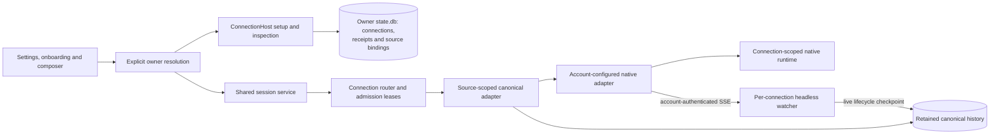

Named connections separate the configuration selected by a user from the native
platform kind and physical history source. Two Claude, Codex or OpenCode accounts
can use the same project without sharing execution state.

## Identity and routing

- `cnx_<uuid>` is an immutable owner-local connection ID. Names are presentation
  only. Native kinds remain `opencode`, `claudecode` and `codex`.
- Registry entries retain their connection key separately from `Platform.ID()`.
  Remote routing keys are owner-qualified, such as `r-owner:cnx_<uuid>`; native
  model references retain their original platform namespace.
- Each local OpenCode registry entry gets its own headless watcher, using that
  account's discovery and authenticated transport. Status, prompt, queue and
  title events retain the connection routing key. The watcher fills the native
  lifecycle cache that feeds the compact sidebar, independently of open browser
  tabs. Remote owners run their own watchers; retained offline adapters cannot
  start one. Shutdown joins every connection's watcher before stores close.
- Physical source keys and canonical `ocm_<uuid>` session IDs are not rewritten.
- Durable session flags keep their owner/native-kind/canonical-ID keys. Routing
  aliases are normalized at state reads and writes, never persisted as new flag
  namespaces. Grouped sidebar SQL projects each connection key from its frozen
  source scope while joining flags on the native kind, without per-row catalogue
  lookups. Conflicting source scopes fail closed.
  Routine and Factory associations may explicitly pin a connection and retain
  that routing identity, with compatibility for migrated native-key associations.
  Source provenance selects an exact account, never the first account of a kind.
- Creation receipts atomically pin the retry key, generated canonical ID and
  connection before native side effects. Forks inherit their parent's account.
  Changing a default cannot retarget an existing session or retry.
- Defaults are explicit. Disabled, removed, missing, unavailable and disconnected
  selections fail closed, without borrowing another account or owner.

## Persistence and lifecycle

`internal/platformconnections` owns the append-only module schema in each
owner's `state.db`. It stores immutable configuration metadata, enabled intent,
defaults, onboarding state, setup/creation receipts, canonical session bindings,
physical source provenance and connection-scoped provider runtime records. It
stores no credentials and does not persist readiness as authorization.

`Router.Begin` leases new-turn/creation admission through native effects and
checks native readiness. Disable/removal fences new admissions and drains active
work before changing intent. Prompt replies and abort remain possible while
draining. Failed persistence or cancellation restores admission.

Removed connections retain tombstones and history/source mappings. Read-only
canonical adapters reconstruct retained history without launching native tools.
They cannot authorize execution. Named aggregate reads are source-scoped, so
registering two accounts does not duplicate their histories across both entries.

Activation requests safe composition reload because ingestion sources are fixed
for a running generation. Activation is idempotent; a failure retains the saved
identity and receipt rather than allocating another connection on retry.

## Startup compatibility

Saved-collection startup captures installation state before native side effects.
Initialization happens once. Existing installations keep legacy mappings,
enabled intent and exact default preference; new installations start empty with
onboarding incomplete. An intentionally empty collection is never reseeded.

Explicit `-platforms` remains a legacy CLI composition override. It does not
rewrite the saved collection, register duplicate aliases or advertise named
onboarding for that run. Original migrated machine configurations retain their
legacy environment, physical source and recovery behavior.
Their inventory readiness also follows that proven migration provenance; it does
not claim the strict isolation verification required for newly added accounts.

## Native isolation

The native adapters accept explicit connection configuration instead of changing
process-global environment variables or `HOME`. Constructors, history readers,
execution, helper commands and recovery use the selected account consistently.

| Native tool | Named configuration | Verified inspection modes |
| --- | --- | --- |
| Claude Code | Explicit canonical `CLAUDE_CONFIG_DIR`; scoped index, rules, ownership, usage, launch file and plugin marketplace | Claude 2.1.268+ within the 2.1 series; initialized native configuration and subscription login |
| Codex | Explicit canonical `CODEX_HOME`; scoped rules and supervisor state | Codex 0.164.x/0.165.x; file-stored native ChatGPT login |
| OpenCode | Explicit database and separate config/data/state/cache/runtime paths; private native server and API authentication | Verified OpenCode 2.1.x active saved key/OAuth metadata |

Unknown versions, authentication modes and effective configuration overrides fail
closed. These version ranges are conservative validation gates, not statements
that other native versions cannot support isolation.

### Claude Code

Named sessions and helpers use filtered authentication environments and user-only
native settings. `apiKeyHelper`, authentication overrides and ambiguous managed
or remote policies are unsupported. Inspection requires an initialized
`.claude.json`: the native status command can create it otherwise, so setup asks
the user to sign in rather than silently initializing it during inspection.

Supervisor records are keyed by connection ID, native platform and project root.
Owner-wide short socket parents, MCP bearer tokens and child/helper slot budgets
remain shared. Naming, judging and plugin commands select the same account as
the session they support.

### Codex

History app-server, supervisor reader and ACP execution share the pinned home
and filtered environment. Private runtime roots do not fold to a surrounding Git
checkout and are rejected if retargeted before ensure/recovery.

Inspection uses effective native configuration layers and account metadata with
token refresh disabled. Profiles, custom providers, keyring storage and unknown
layers are unsupported. Actual project `.codex/config.toml` overrides are rejected
before backend create, resume or send. Named runtime identities replace older
supervisors that lack this policy.

### OpenCode

Named connections never adopt the default registered background service. Only the
original migrated machine integration may reuse its matching service. Named
HTTP/SSE clients, catalogue and dialect caches, prompt-request bindings and live
discovery/status registries are account-private.

Inspection uses `/api/info` and `/api/integration`, not the credential-secret
endpoint. It follows the verified native active-first credential ordering and
rejects environment/external authentication. Pre-save inspection can initialize
the selected private database using a uniquely named no-model metadata server.
An ephemeral filtered store and bounded cancellation cleanup stop only the
process launched for that inspection.

## Owner API and browser

`/api/platform-connections?remoteId=<owner>` resolves an explicit owner. Localhost
mutation guards protect setup, Save, default/enable/rename, cancellation, removal
and onboarding. A bare Host without injected configuration and lifecycle policy
reports unsupported rather than presenting an empty working setup.

The owner commits a durable `stp_<uuid>` receipt before directory preparation.
Private preparation rejects symlinks and permissive directories and copies no
credentials. Check, retry, Back and browser reload retain that receipt. Save
consumes its preassigned connection identity transactionally. Cancel retains
possible credentials and cannot delete a configuration after a lost successful
Save. Login instructions and shell-quoted commands come from the owner, not the
browser. The application does not perform interactive login for the user.

Settings and onboarding share the same controller and dialog. Loading, errors,
unsupported owners and successfully empty inventory remain distinct. The
composer's model picker uses named-account tabs from the explicit owner's
inventory. Tab changes update the draft's connection route and prepare only
that account's catalog. Picking a model preserves that account; unavailable
tabs are disabled, and the connection is frozen after the first submission.

## Remote trust

Authenticated `ConnectionPlatforms` metadata carries exact routing keys, native
kind, display/default/selection metadata and physical source proof. Source paths
remain backend-only and are not published through frontend capabilities.
Legacy-peer fallback applies only to original non-connection platform keys.

The authenticated backend-only `sourceKeys` set records retained read provenance,
including the active source. It does not grant execution authority. Mutations
still require the exact active source and connection admission; historical
sources cannot borrow the active runtime. Singular-source peers remain supported.

Uncached canonical remote identities are authenticated by their owner before the
hub mirrors them. Single/batch lookups and restart routing retain native kind in
the catalogue and select the exact physical source, including when the caller
omits a platform scope. Disconnected explicit owners never fall back locally.

Tests use disposable stores, fake agents and private runtimes. Setup readiness is
a local native login/configuration snapshot, not proof of network access, model
availability or quota.
