## Introduction

Ocman is a single Go binary that serves a React SPA and acts as a control
plane for coding-agent sessions. The main diagrams cover the system context
(what ocman talks to), the backend composition (the Go packages), the
session/event data flow, frontend composition, and plugin action flow. Detail
lives in the text below each diagram.

### Cross-machine conversation sharing

Ocman can publish a shared conversation through the standalone `ocman-relay`
binary. The relay stores only AES-256-GCM ciphertext in a directory tree
through `share.DiskStore` (`Put`/`Get`/`List`/`DeletePrefix`). The per-share
key stays in the URL fragment, so it never reaches the relay.

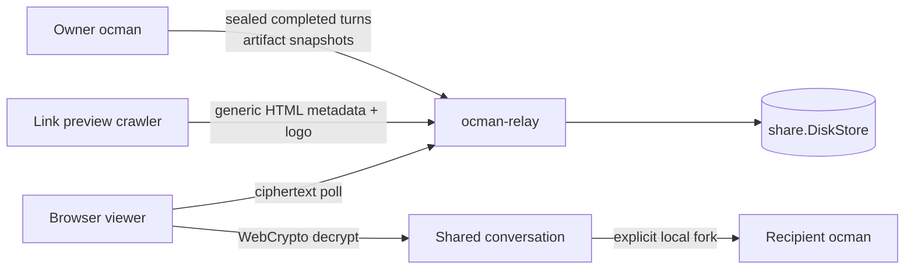

- Chunk zero is a complete snapshot; later chunks contain the latest
  completed turn and the viewer merges them as id-keyed upserts.
- The owner allocates sequence numbers. Nonces derive from those sequence
  numbers, and the share id plus sequence is authenticated as GCM AAD.
- Revocation deletes the relay prefix. The relay stores only a hash of its
  append/delete token and needs no database.
- Viewer HTML includes generic Open Graph and Twitter summary metadata with
  an ocman logo. Previews never contain conversation text, artifact titles or
  decryption keys. Behind a TLS-terminating proxy, enable `-trust-proxy` and
  have the proxy overwrite `X-Forwarded-For` and `X-Forwarded-Proto` so image
  and page URLs use the public HTTPS scheme. Relay `robots.txt` allows known
  preview crawlers to fetch only the viewer and logo; search engines remain
  disallowed and viewer responses carry `X-Robots-Tag: noindex, nofollow`.
- Forking fetches and decrypts in the recipient's authenticated local ocman
  UI, lets the recipient choose a local project, and parks the transcript as
  an unsent composer draft. Imported text never runs automatically.
- Artifact shares reuse the relay but are written once: chunk zero is a sealed
  manifest (title, links, file list) and later chunks are the sealed file
  bytes. Ocman checks the relay's per-share byte and chunk limits before
  uploading, and deletes a half-written share on failure. See
  [Artifacts](../features/artifacts.md).

### Native permissions and ocman review

Native platform approvals and ocman's auto-approval judge are separate controls.
Claude Code 2.1.299 or newer exposes native Auto through the session permission
menu. OpenCode keeps its existing permission rules and ocman reviewer; it does
not advertise a native classifier mode.

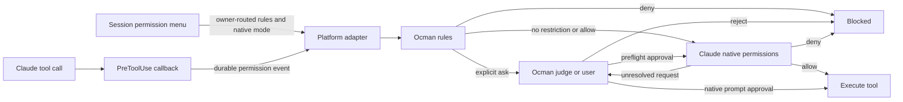

- Native mode is persisted with Claude session ownership, independently of the
  ocman ruleset and the per-session judge toggle. Mode changes never replace
  ocman rules. Idle children resume with the saved mode; running children use an
  acknowledged `set_permission_mode` control request. Without a child the UI
  marks Auto as pending for the next turn. Model/provider eligibility
  remains authoritative in Claude, and rejected changes are shown to the user.
- New Claude children register a pre-execution SDK callback before the first
  prompt. Ocman evaluates restrictions before Claude's native classifier or
  configured approvals. An unrestricted or approved callback returns an empty
  hook result, not a native allow, so Claude's own denials remain effective.
- Preflight callbacks use the existing durable push-only permission/reply flow.
  Missing ocman rules fail closed. An unanswered callback kills its child after
  30 minutes, before Claude's one-hour hook timeout could allow execution to
  continue; shutdown kills children with unresolved preflight callbacks before
  closing their control pipes.
- Claude's reported permission mode is retained, including fallback to Default
  after an unsupported model switch. The menu refreshes on session changes and
  window focus. Capability checks hide native Auto on older owners and OpenCode.
- Rules still apply to tool requests rather than sandboxing commands. An allowed
  shell command has the host user's filesystem and network access.

## 1. System context

### Browser resource boundaries

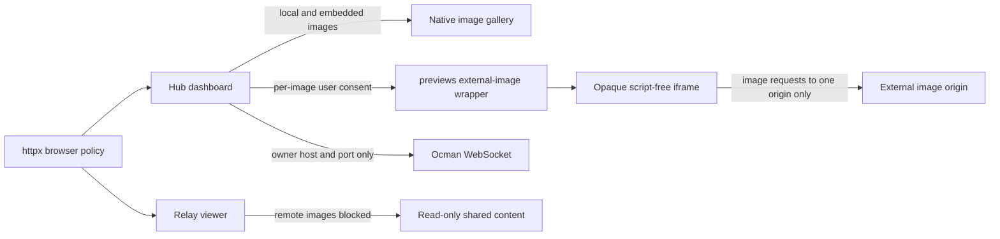

- `internal/httpx` owns the shared browser CSP and validates URL authorities
  before adding origin-scoped WebSocket sources. Forwarded headers cannot widen
  the browser's connection policy. Hub and relay responses block external images
  by default; local, data and blob images remain available.
- `internal/previews` serves an authenticated, stateless external-image HTML
  wrapper after frontend consent. It performs no server-side fetch. The frame
  has no script or same-origin grant, sends no referrer, and its own CSP allows
  images only from the selected origin. The UI warns about IP/cookie disclosure
  and does not persist consent. Public shares disable this private-endpoint path.
- Inert HTML file responses use a separate default-deny CSP, including for
  external subresources and forms. Interactive artifact previews retain their
  existing script-only sandbox and documented self-navigation limitation.

### Agent-generated conversation results

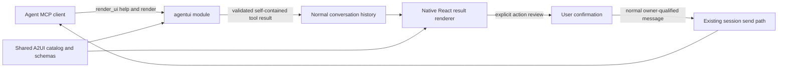

- `internal/agentui` contributes the `render_ui` MCP tool and validates the
  restricted A2UI v0.9.1 result catalog. It has no database tables, network fetches
  or session-mutation endpoints. Each call is an independent snapshot.
- The browser revalidates retained tool output against the same schemas using
  Ajv, then renders shared Ocman controls, tables and an accessible bar chart.
  The catalog allows no generated code or external resources. Graph validation
  bounds recursion and rendered node counts on both sides.
- Action callbacks are scoped by `OcmanRuntimeProvider` to the owning platform
  and session. User confirmation sends a normal message through the existing
  send path. Shared, disconnected and ownerless views have no action callback;
  session changes discard unsent UI interactions.

### Session PR workflow

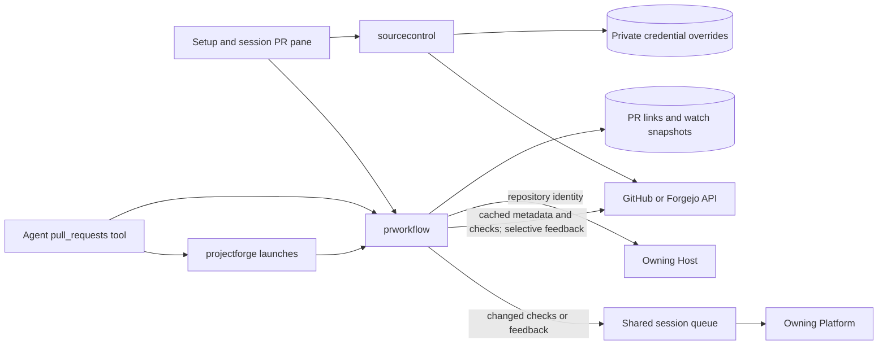

- `sourcecontrol` owns privileged setup routes, verified per-host tokens and
  live credential resolution for project PR operations, Factory and watches.
  Saved tokens override CLI/environment discovery without altering Git auth.
- `prworkflow` owns session-qualified links, feedback-task drafts and its joined
  two-minute watch worker. It persists snapshots and pending notices separately
  from conversations. The hub reads forge metadata; owner disconnection never
  routes checkout or session work to another machine.
- Watch reads reuse GitHub's credential-scoped one-minute transport cache with
  sidebar and preview reads. Head/metadata timestamps gate feedback pagination,
  with a ten-minute safety reread. Quiet settled PRs slow to five-minute due
  times on the two-minute worker. Provider rate limits pause the host without
  exhausting a watch's read-failure allowance. Terminal PRs skip checks/feedback.
- Its `pull_requests` MCP tool reuses fixed session HTTP handlers and an injected
  `projectforge` PR-only handler. MCP authentication precedes dispatch; existing
  owner checks and validation still apply. Draft actions return prompts without
  sending them, and cross-fork fetch confirmation remains dashboard-only.
- Watches are opt-in, deduplicate changes and queue follow-ups rather than
  running an agent polling loop. Stop/unlink serializes with delivery. Merging
  and session archival remain explicit user decisions. See
  [Pull requests](../features/pull-requests.md).

Everything external that the ocman process touches.

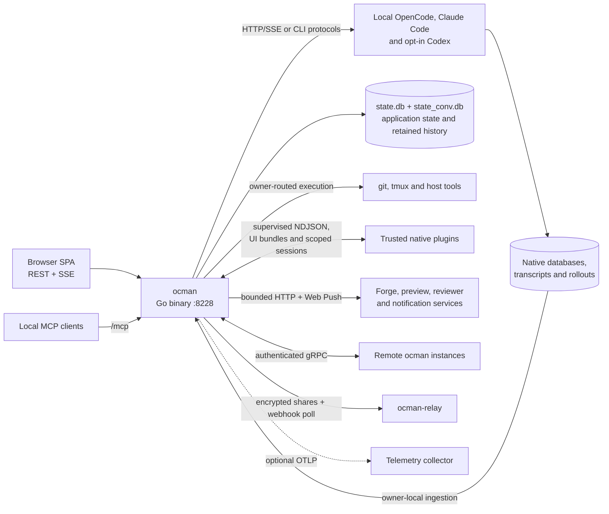

- **Prepared source sessions.** Plugins may prepare source under their private
  model workspace and request a read-only session with the separately approved
  `session.source` grant. The owner resolves a contained subpath and pins exact
  file-read permissions before creation and prompt delivery. Other tools remain
  denied. Creation receipts, platforms and the completion outbox are reused;
  the host does not interpret the source or its output schema.
- **Browser SPA.** The only UI. It talks REST/SSE to the hub, never to
  remotes directly. `:8228` is the production `-addr` default; in dev the
  Vite server on :8228 proxies `/api` to the air backend on :8229.
  The composer accepts text and attachments. Voice input belongs to external
  tools; ocman does not capture microphones or provide transcription endpoints.
  Answer read-aloud uses browser speech synthesis independently.
  Hub-local plugins may add in-app UI: the SPA imports their checksum-verified
  bundle from `/api/plugins/ui/bundle`, and the bundle shares the SPA's React,
  router, query client and `@ocman/plugin-ui` through `/plugin-shared/` entries
  (ADR 0009).
- **Conversation PR previews.** Showing a card or switching sessions revalidates
  PR metadata, checks and review status. The browser bundles simultaneous lookups
  by owner, deduplicates identical requests, and cancels a shared request only
  after its last reader leaves. `/api/previews/resolve` accepts up to 32 lookups
  per batch with independent results. Provider calls still use bounded concurrency,
  grant budgets and backoff. GitHub also retains its credential-scoped request
  budget; batching browser requests does not bypass GitHub's limits or turn REST
  reads into one upstream call. Other provider metadata keeps its normal cache.
- **Public web pages.** The hub reads Open Graph metadata on delayed markdown
  link hover and proxies preview images. Provider-specific cards take priority.
- **Browser push services.** Opt-in device subscriptions receive encrypted Web
  Push alerts even with the page closed. The browser service worker displays
  session-context notifications and opens an owner-qualified session route on click.
- **Telemetry collector.** Optional OTLP/HTTP export of traces, metrics,
  and batched Logrus logs through `internal/telemetry`. Logs retain structured
  fields and span context, console output stays enabled, and shutdown flushes
  all three signals. The bundled LGTM stack routes logs to Loki.
- **UI usage.** Authenticated browsers send active foreground intervals once
  a minute and on focus/visibility changes. The hub unions overlapping tabs
  and devices in one state.db transaction, retains two minutes of deduplication
  history, and stores UTC daily totals. Newly committed seconds increment
  `ocman.ui.active_time` through the existing OTel exporter without client or
  date attributes. Dashboard graphs read SQLite, so collector outages cannot
  erase their history. Five minutes without interaction stops counting; long
  timer gaps do not count sleep. This is installation-wide, not named-user data.
- **opencode.db.** Foreign data, opened read-only. The one exception is the
  user-started maintenance job (`internal/ocmaint`, Settings → Maintenance).
  It stops the managed instances, refuses while any other process holds the
  file, and moves old `summary.diffs` patches into a restorable dump. Only this
  opt-in maintenance operation uses lsof to check file holders; missing lsof
  makes maintenance fail closed, not application startup.
  On an OpenCode v2 machine each connection gets TEMP views named `session`,
  `message` and `part` over v2's `session_v2`/`session_message` tables, so
  every query keeps its v1 SQL (`internal/db/v2views.go`).
- **state.db.** Ocman's own state: archive flags, routines and run history,
  permission approval provenance, live session commit observations, settings,
  Factory records, Inbox items, artifact metadata, remote tokens, and canonical
  session identity bindings. Artifact file bytes sit beside it in a
  SHA-256 content-addressed `artifacts/blobs/` directory. Inbox sends are owner-local and persist until recalled or archived
  by the user. Legacy `workflow_*` rows remain inert for manual recovery.
- **state_conv.db.** `internal/statev2` owns a separate
  conversation schema with immutable platform-instance identities, historical
  sessions/messages/parts, ingestion checkpoints and a change outbox. Storage, ingestion and historical reads are always enabled;
  development targets in the Makefile use isolated paths. The file sits beside
  `state.db` unless `-conversations-db` or `OCMAN_CONVERSATIONS_DB` names another
  path. `-statev2-db` and `OCMAN_STATEV2_DB` remain compatibility aliases.
  Owner-local ingestion supplies settled conversations, project statistics,
  plugin project-directory evidence, local text search and analytics. Native
  reads belong to platform ingestion or live execution, never application
  fallback readers. Agent and model catalogues are live configuration and go
  through platform capabilities rather than native database queries.
  The persisted project-list cache lives here too, not in application state.
  On first use of this filename, startup preserves an adjacent `statev2.db`
  through a SQLite-consistent snapshot, retaining the original. A per-path
  adoption marker in `state.db` prevents a later explicit reset from importing
  the retired file again. An existing destination always wins.
  Source deletion retains history. Supported upgrades apply append-only migrations;
  unsupported schema versions fail closed and never reset stored history.
  Database-size analytics include this store as a separate conversation-history
  series, including while its initial import is pending.
- Application analytics and background token/cost metrics use validated
  statev2 snapshots. Startup no longer creates or syncs `analytics-cache.db`;
  existing cache files are unused and left untouched. Database-size sampling
  measures Ocman's state and conversation stores plus the local platforms that
  advertise `StorageSizer`, as described below.
- **Claude Code** (`-platforms claudecode`). Ocman reads the transcripts under
  `~/.claude/projects` (or `$CLAUDE_CONFIG_DIR`) into the disposable
  `claude-index.db` beside state.db and drives sessions it starts or adopts by
  spawning the user's own `claude` binary with pipes (stream-json and the
  control protocol), so every call runs under the user's own account. Ocman
  installs or refreshes its hook plugin at startup with `claude plugin`.
  History hooks journal transcript changes in every session; status hooks run
  ocman only for the injected `OCMAN_MANAGED=1` marker. Hooks have a 1 s
  timeout and always exit 0.
  Sending to an external root session records
  ownership and resumes its transcript through its project supervisor. Owner
  observations are shared as advisory files under `claude-external` beside
  state.db; they produce non-blocking session warnings, not admission locks.
  See [Claude Code](../features/claude-code.md).
- **Codex** (`-platforms codex`, opt-in). A separate read-only app-server supplies
  native history and catalogs for ingestion. A machine-wide tmux supervisor
  hosts another app-server for live thread operations; it starts on first use.
  Only rollout token accounting reads native files. Execution uses the user's
  own Codex login. Browsing uses retained history after ingestion, just like
  other platforms. See [Codex](../features/codex.md).
- **Provider usage.** `/provider-usage` reads OpenCode's local OAuth credentials
  server-side for normalized quota windows. V2 reads the configured OpenCode
  database through `internal/db`, selecting the active credential or, for
  legacy rows without a selection, the newest account. It never falls back to
  stale `auth.json` credentials. V1 still reads `auth.json`. OpenCode remains
  responsible for token refresh; ocman only reads credentials.
  `/api/provider-usage` also reads
  the analytics-owned `provider_usage` ledger in state.db. The server injects
  a recorder into auto-approve so keyed requests to TypeSafe's hosted System
  One API retain only model, timestamp, token counts and estimated USD. The
  page shows a rolling seven-day local estimate at the documented Jev 1.13/1.14
  input price, not account-wide billing. Unknown prices or missing counts stay
  unpriced, not zero. Other apps and pre-update requests cannot be backfilled.
  Old records expire on the next recorded request. Provider tokens and account
  identifiers never reach the browser. The old `/subscription-usage` page path
  remains an alias for bookmarks.
- **Custom reviewer APIs.** `internal/autoapprove` can send permission judgments
  directly to a user-configured OpenAI-compatible chat-completions or
  TypeSafe-compatible System One endpoint instead of a temporary OpenCode
  session. The endpoint's own Bearer key stays in this instance's `state.db`
  and is never returned by settings reads. These calls use a separate HTTP
  client from OpenCode authentication, reject redirects, bound response sizes,
  and fall through to human review on failures. Cached safe verdicts include
  the endpoint configuration used by the original judgment.
- **Native plugin executables.** Startup and explicit rescans describe direct
  executables from the local plugin directory. Each describe has a fresh token,
  minimal environment, bounded output, and a fifteen-second deadline. Duplicate
  identities conflict; changed binaries lose approval. Discovery itself executes
  trusted code. Grants minimize brokered context, not operating-system access.
  `ui.v1` plugins stream an approved browser bundle over the same NDJSON
  connection; the hub serves it only for its own installations.
  See [Plugins](../features/plugins.md) for installation and operations.
- **Remote ocman instances.** The hub dials remotes over gRPC and re-exposes
  their sessions and hosts transparently. Unary JSON operations share one
  generic `Call` RPC dispatched by method name on the owner; typed RPCs remain
  for the handshake, typed session reads and streams. The owning remote enriches session
  detail with its persisted approvals and tees synthetic approval events into
  the gRPC event stream before the hub forwards them to the browser.
  Plugin catalog, management, health, actions and artifact reads use the same
  authenticated connection. Each machine discovers its own binaries and stores
  its own configuration and secrets. The hub never installs remote binaries.
- **Project identity.** Each owner enriches its project snapshot with Git fetch
  remotes inside the existing singleflight refresh. Loaded snapshots return
  immediately while background discovery runs; inventory projection reuses the
  enriched rows without running Git. Per-directory discovery also coalesces
  concurrent callers and caches successful results for five minutes. A failed
  refresh preserves the previous keys and snapshot and can retry immediately.
  Credential-free upstream keys normalize SSH and HTTP
  transport syntax, `.git` suffixes, host casing and default ports. The hub assigns
  a shared `projectKey` to checkouts connected by any common upstream, including
  chains through a checkout with multiple remotes. `/api/projects` keeps each
  owner's checkout row, counts and archive state. The browser groups those rows
  and their sessions by `projectKey`; project detail includes sessions from every
  matching host. Actions still target a specific owner and directory. Repositories
  without network remotes fall back to owner-scoped directories, with the existing
  worktree folding. Local filesystem remotes never identify cross-host projects.
  The dashboard's merge action saves owner-qualified source-checkout to target-checkout mappings in
  the hub's `state.db` setting `projects.merges`. `/api/projects` applies it after
  upstream grouping, resolving the checkouts' current keys so Git remote changes
  do not undo saved merges, and includes the selected target checkout for display.
  Dashboard totals, sidebar groups and project session lists share this identity.
  Merge chains follow the final target, and a transaction rejects cycles.
  Upstream memberships and saved checkout edges form connected components, so
  crossed upstream groups keep all saved merge members together. If a component
  has multiple saved destinations, the lowest stable checkout key selects its
  display representative independently of inventory order.
  Session directories, owners and transcripts stay intact. Successful merges
  publish `ocman.projects.changed` so other browsers refresh their project list.
- **Encrypted webhooks.** Providers submit plaintext to the relay's ingestion
  URL, where ocman encrypts a versioned age X25519 envelope. The relay
  persists ciphertext plus visible size/timing metadata; the owning local or
  remote ocman decrypts it, durably accepts it in `state.db`, claims routine
  dispatches, then acknowledges the relay. A lost acknowledgment is retried
  without duplicate scheduling. Successful delivery polls renew the inbox's
  30-day inactivity window, including when empty. Separate plaintext receipt
  timestamps let the relay expire unacknowledged ciphertext after 48 hours;
  acknowledgment removes ciphertext and its timestamp immediately.

Remotes advertise enabled local platform ids in `Hello`. The hub registers
one adapter per platform under `r-<instanceId>:<platform>`, sharing one host
adapter and connection. Older remotes without the list remain OpenCode-only.
Duplicate instance ids are rejected for the whole remote, even when the
advertised platforms differ.

### Statev2 history ingestion

Each owning instance imports its own local platform history. Analytics and
settled conversation browsing always read Ocman history. There are no feature
flags or legacy read fallback. Runtime actions and live streaming remain
platform-owned.

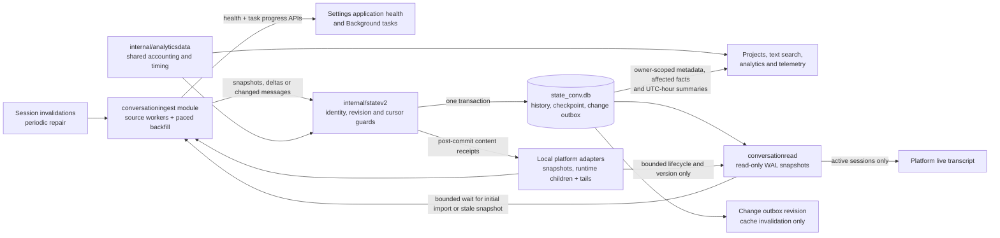

- Platform type and platform instance are separate. Native session identities
  belong to an immutable source instance, so identical IDs cannot cross sources.
- Session lists and conversation status enrichment batch canonical catalogue
  lookups, including the parent map used for nested live prompts. Query count
  does not grow with the retained inventory. Every batch still validates owner,
  platform, publication and purge state; identities are not cached across reads.
- Content and ingestion progress commit together before upstream acknowledgment
  or outward publication. Conflicting repair writes fail instead of overwriting
  another ingestion revision.
- Historical imports share one active background slot and default to a 20%
  work/rest duty cycle. They yield between snapshots without holding database
  transactions during the pause. Requested conversation reads interrupt the
  background wait and bypass its budget; live updates are not CPU-throttled.
  Shutdown cancels the wait, preserving each completed snapshot's checkpoint.
- Source deletion never removes retained history.
- Unresolved creation reservations defer affected identities, not the entire
  import. Partial inventories never authorize deletion or complete verification.
  Claude supervisor discovery failures return available transcript/runtime rows
  with the same incomplete-inventory fence, so unrelated transcripts still sync.
  Claude agent task starts register read-only runtime children before their first
  events are exposed. Owner-local identity probes use that metadata before a
  transcript exists; ingestion stores their forwarded messages under the same
  canonical identity later used by the transcript. Child task completion,
  failure and cancellation settle independently of the parent's run state.
  Transcript discovery watches nested workflow directories beneath `subagents/`.
  Ingestion confirms committed message IDs and part-content digests to the owning
  supervisor. Settled child views are reclaimed only when every retained content
  entry has a matching receipt; partial or stale receipts cannot drop newer text.
  Runtime metadata and terminal status survive this memory reclamation.
  Subagent completion hooks request inventory discovery for newly created child
  files before targeted reads. A transcript removed during refresh is unavailable,
  not an ingestion-worker panic.
  Analytics keeps reading atomic committed projections from initialized local
  sources even when another session fails. Responses identify partial scope in
  a diagnostic header; charts do not display a warning or use native fallback
  readers. Ingestion retries silently. Settings → System → Application health
  shows history sync and backend status, with details in Background tasks.
  Neither import toasts nor startup pages interrupt the application shell.
- History is not live execution authority. Future collectors must keep runtime
  freshness and idempotent action reconciliation separate from historical replay.
- `platforms.HistoryReader` bypasses UI filtering without bypassing owner/platform
  routing. OpenCode reads one source transaction and reuses the v2 converter;
  Claude borrows the browsing index and checks transcript identity/mtime/size
  across each snapshot. Native v2 payloads and unsupported message types survive
  normalization. Missing source inventories never authorize deletions.
- OpenCode v2 is event-driven and does not poll. Its worker follows the machine
  server's `/api/event` firehose, which covers every location and session the
  background service runs, including terminal sessions. A durable session event
  reads only the messages it names and upserts them with `statev2.ApplyStream`,
  advancing that session's applied sequence in the same transaction. Reverts,
  compactions and similar events without message IDs reread their session;
  deletions are retained as source-deleted. The firehose has no replay, so each
  connection first catches up: it compares OpenCode's indexed `event_sequence`
  with the sequences already applied and rereads only sessions that moved. The
  same comparison repeats while the firehose is unavailable. Stored-history
  readiness uses the durable sequence (`seq:N`), not session timestamps, which
  OpenCode v2 does not advance on every message change.
  Targeted hints are deduplicated and bounded; overflow requests durable
  sequence catch-up. Failed and deferred repairs remain pending even when
  their sequence did not change, and retry with a backoff timer independent of
  new feed events. A successful inventory retires repairs for deleted sessions.
  Incremental mutations invalidate full-snapshot digests atomically.
  Live activity hints and replayed events whose sequence is already applied do
  not force full-session reads. Explicit repairs still validate the source.
- Claude follows its hook journal (`internal/historyjournal`). Hooks append a
  record pointing at the changed transcript in every session, including
  terminal sessions and while ocman is stopped. At startup the worker compares
  transcript version hints once; afterwards each journal record targets its
  session and retained descendants without a source-wide inventory.
  `platforms.HistoryDeltaReader` resumes conversion at the last message group's
  byte offset, replaying that group to capture appended tool results. The
  transcript cursor and tail upserts commit atomically; detected replacements
  and truncations request full snapshots. The shared Claude index can still
  reindex the changed transcript for metadata. The journal offset advances only
  after ingestion succeeds. Checking for records costs one directory read; there is
  no periodic polling or automatic full verification. The journal is
  machine-wide under the XDG data directory; each statev2 store keeps its own
  offsets, and consumed segments are pruned after a week idle.
  Failed startup scans and deferred hook reads retry without needing another
  hook. Journal read errors revoke readiness rather than appearing as no work.
  Writers lock each segment and terminate interrupted tails before appending.
  Translation failures have one task receipt, separate from journal I/O errors.
- Sources with neither (OpenCode v1) still poll change hints every 30 seconds
  and coalesce event-triggered repairs for one second. A pass reads only invalidated, new or re-hinted
  sessions. Version hints, content fingerprints and the last verification time
  persist in statev2, so a restart skips unchanged snapshots unless their
  conversation read-format metadata needs upgrading.
  The server joins all source workers before the application closes the database.
- Messages carry their accounting (agent, provider, cost, token counts, finish,
  error name) as indexed columns, and sessions carry parent and project IDs, so
  analytics can filter and sum without parsing stored JSON. Indexes cover
  message time, model and session parent/project. Projection-era databases
  (schema v5+) upgrade in place. Unsupported earlier or future schemas cause
  startup to fail without dropping tables or discarding history. Re-syncs
  upsert retained sessions, messages and parts; they never empty the store.
- For polled sources, every six hours a verification pass rereads all sessions. It counts content
  that changed under an unchanged hint as drift, logs and repairs it, and reports
  matched, drifted, changed and missing sessions as a background task. It also
  compares each session's stored accounting with totals recomputed from the
  snapshot it just read; a `usage-mismatch` counter means a normalization or
  column mapping bug.
- Analytics queries read retained summaries only. Native fixture rows are
  imported before tests assert totals, filters, pricing and runtime.
- Project totals aggregate stored sessions across local platform instances and
  exclude helpers only from visible session counts. Plugin directory grants
  require ingested project-root evidence; conflicting roots fail closed. Local
  text search reads retained user/assistant text blocks, excluding tool payloads
  and other owners. `internal/textsearch` shares literal matching and UTF-8
  snippet rules with integration diagnostics.
  Project refreshes use committed history while ingestion catches up and use the owner's
  durable history-change watermark to invalidate cached statistics after stored
  commits, even when no native event reaches the application.
- Native event connections and agent/model catalogue transport live in the
  OpenCode adapter. The permission watcher retains reconnect, watchdog and
  completion-drain ordering, and platform projection runs before callbacks.
  Native discovery cache workers start through a platform lifetime capability.
  Judge conversation context comes from statev2; temporary judge-session
  creation, prompting and response collection use the integration's helper
  client. Missing stored context never triggers a native transcript read.
- This is committed-history ingestion, not lossless raw-event capture. Supervisor
  acknowledgments and active streaming stay on their existing paths until direct
  durable event ingestion is implemented. Hub replication is not enabled.

#### Completed conversation reads

Settled OpenCode and Claude conversations always use validated statev2
snapshots. No opt-in or legacy opt-out is available.

- Canonical adapters serve every persisted read (lists, summaries, metadata,
  conversation pages, usage, unread counts, descendants, archive candidates,
  panels and catalogues) from statev2. `internal/conversationread` only
  converts a stored page to the wire format. There is no per-request choice
  between native and stored reads, and no native fallback.
- Running, limited and approval-waiting sessions also read their transcript
  from statev2; live turns reach the browser through platform SSE, and the
  event cache overlays only live fields (status, prompts, connection, notices).
  Directory warnings, such as duplicate OpenCode servers, come from the live
  integration and only for its current physical source.
- A session without a stored snapshot waits, bounded, for ingestion's first
  read of that session, then returns HTTP 503 with
  `X-Ocman-Conversation-Error: history-unavailable`, never a native transcript.
  Successful local reads expose `X-Ocman-Conversation-Source: statev2`; remote
  reads expose `remote`, and the owner fails closed the same way.
- Schema v8 preserves part timestamps, text-field presence and displayable
  message markers. Existing snapshots stay retained but require a background
  metadata refresh before normal browsing. Paging counts backward from the
  newest displayable message and excludes superseded records without deleting
  their audit history. Source-deleted sessions remain readable after validation;
  explicitly purged sessions do not.
- Composer defaults, context tokens, session trees and accounting come from
  Ocman projections. Cost estimates still use current pricing. Full native
  payloads stay stored, but opaque native-only messages do not consume visible
  paging slots.

#### Analytics reads

All conversation-derived analytics use the existing `internal/db` calculations
over ingestion-maintained statev2 summaries: overview/stats, daily/hourly activity, model
usage, cost estimates, performance, throughput, request/session/project logs,
concurrency and agent runtime. Each imported batch commits these derived tables
in the same transaction as its history and checkpoint:

- `analytics_session` contains compact metadata and session accounting totals.
- `analytics_hour` groups counts and tokens by source, session, UTC hour, role
  and provider/model. Activity/model charts sum these rows instead of messages.
- `analytics_fact` retains normalized per-request values and computed model,
  tool and unknown durations. Metrics/logs retain request-level percentiles and
  live pricing without parsing message JSON or rereading tool parts.
- `analytics_question` retains question wait intervals for runtime accounting.
- `analytics_conflict` contains only duplicate native-ID candidates, maintained
  by insert/delete triggers so validation does not scan the whole history.

Full repairs replace the session's summaries. Incremental updates replace only
affected message facts, question timings and old/new UTC-hour buckets, and adjust
session totals by their net change. Human activity uses the persisted subagent
flag for both session and user-message counts. Tool-only changes recompute the
owning message's timing summaries too. Native payloads stay intact.
`internal/analyticsdata` supplies the same metadata and interval-union rules to
both legacy readers and ingestion; there is no second timing engine.

The one-time upgrade builds summaries from stored compact projections, preserving
history, checkpoints and source hints. It does not reimport from
platforms. Startup logs identify this backfill. Failure rolls back the upgrade.

`internal/db.OpenHistoryAnalytics` opens statev2 read-only with bounded pooled
connections and scoped TEMP views installed on every connection. Each response
uses one selected reader for all dates, including today. Filters, pricing,
pagination, subagent rollups and observed permission waits keep their current
calculation logic. Permission decisions, UI usage, database-size history and
provider/subscription quotas keep their original sources. Live streaming and
execution remain platform-owned.

Storage-size sampling also stays behind the platform boundary:

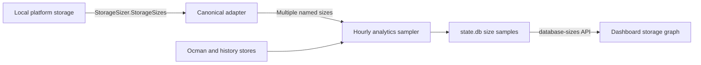

- `platforms.StorageSizer` is optional and returns any number of stable named
  series. Canonical adapters forward it without waiting for history ingestion.
- OpenCode reports logical SQLite bytes, including pages committed in WAL.
  Claude reports raw `.jsonl` transcript bytes under its configured `projects/`
  directory, including nested subagents, without parsing files or using its index.
- The sampler queries the current local platform registry hourly and at startup.
  Remote adapters are excluded. Platform errors do not suppress successful series.
  Existing series keys and samples survive the schema upgrade; the chart renders
  additional series without needing another schema or frontend change.

Summary queries retain exact millisecond cutoffs. Partial UTC hours and local
calendar boundaries that split a UTC hour read only their normalized boundary
facts. This also supports fractional-offset timezones without persisting a
timezone-dependent rollup. Pricing remains dynamic. Request timestamp ties use
native ID as a stable secondary sort key in both readers for pagination.

Native-ID validation checks the sparse conflict markers against active selected
sources, with a per-reader/outbox-revision cache. Imports invalidate
the cache. The mark and collision checks share one read transaction.

Inspect the response headers in the browser's Network panel:

- `X-Ocman-Analytics-Source: statev2` means the cutover is active.
- `X-Ocman-Analytics-Checked-At` gives the oldest successful local source scan.
  Recent/live figures can lag ingestion; the default poll interval is 30 seconds.
- `X-Ocman-Analytics-Error` explains a statev2 availability failure:
  `history-unavailable`, `import-incomplete`, `history-error` or
  `history-scope-error`. These responses are HTTP 503, not legacy results.
  `X-Ocman-Activity-Source` remains an alias for the source header.

The cutover waits for a clean scan of every enabled local history source after
each startup. Remote adapters are excluded from both local ingestion and its
readiness checks; connecting a remote does not block completed local imports.
Unsupported local adapters, failed or deferred reads, accounting
mismatches and scans older than two poll intervals make statev2 analytics
unavailable. Because existing response types and links use native IDs, overlapping
session or message IDs across selected instances fail closed rather
than merging unrelated records. The retained schema remains instance-scoped.
Query errors are returned without retrying against legacy. An empty or partially
hydrated store never produces incomplete totals. Startup requires the history
store to open successfully. While initial imports or repairs are pending,
unavailable readers return HTTP 503 rather than selecting platform history.

Route tests cover conversation analytics filters, pagination and source headers.
They close the native handle to verify that statev2 routes do not query it.
Calculation tests import fixtures into retained history and assert expected
totals, pricing, throughput and question timings. Summary tests cover exact
cutoffs, fractional timezones, repeated DST hours, tool-only repairs, collision
markers and upgrade rollback. There is no native-SQL analytics fallback or
parallel parity implementation. Optional read-only latency tests still measure
the production queries against an explicitly supplied validation snapshot.

### Compact session sidebar

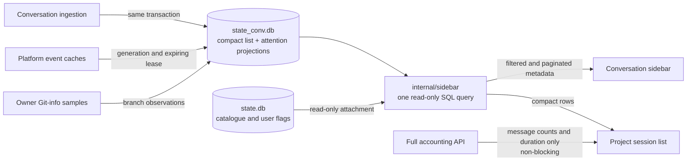

- Sidebar reads do not invoke accounting summaries or platform/supervisor RPCs.
  The projection carries title, project, directory, hierarchy, prompt/completion
  attention timestamps and
  cached branch data. Catalogue joins preserve authoritative owner/source,
  publication, purge and routine/Factory origin checks without copying authority.
- An owner-local worker persists event-cache observations every 500 ms. Runtime
  generations and expiring leases prevent stale busy flags after disconnect or
  restart. Pending prompts and persisted halt receipts use source-scoped native
  ancestor walks, never application worktree links. An idle observation settles
  against the retained outcome rather than replacing waiting/error with done.
- Seen, archive, snooze and pin state join in the same query. Unread ranges use
  a covering timestamp index; conversation JSON and accounting facts are not
  scanned. Running-count and notification polling use the compact path as well.
- Conversation headers reuse already-loaded metadata and totals. Full accounting
  summaries remain separate, for views that actually display them. Cached native
  child prompts bubble to the same root in conversation and sidebar reads.
- Project session lists render compact rows without waiting for accounting.
  Message counts and durations fill in separately, matched by platform and
  session ID with a freshness check. Accounting cannot replace titles, live
  status or archive flags. Both queries retain shared caching and polling.
- Interactive history reads use a separate read-only pool from ingestion's
  serialized writer. A long import cannot reserve their database connection;
  they see a consistent committed WAL snapshot while ingestion is in flight.
  Module finalizers close attached readers after handlers and workers finish,
  including failed startup before workers launch.

### Session identity catalogue

`internal/sessioncatalog` owns an append-only module schema in `state.db` for
`ocm_<uuid>` identities. The store persists creation intent before binding a
native execution. Owner-local creation uses the catalogue before platform side
effects and binds before publication. Public session lists, reads, creation
results and browser events use the same Ocman identity. Native execution and
existing permission/queue/bookkeeping keys remain behind the boundary.

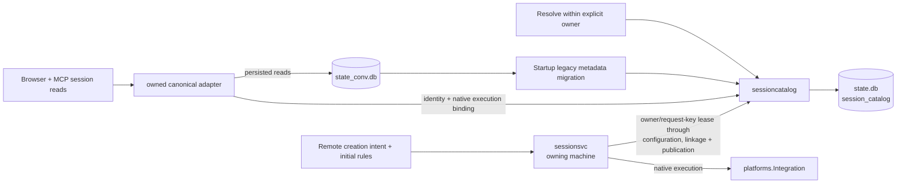

- Request keys deduplicate creation intent within a stable owning machine.
  A cancellable owner/request-key lease serializes creation and recovery through
  native configuration, application linkage and publication. Waiters reread the
  durable receipt after acquiring the lease; independent requests do not block.
  Origin and routine/factory metadata exist before a native session can be
  bound. An uncertain creation outcome remains pending rather than permitting
  another execution.
- Integrations supporting client-chosen IDs expose `SessionCreationPlanner`.
  OpenCode V2 creation persists the planned native binding before HTTP, then
  sends that exact ID through the compatibility transport. An explicit retry
  with the same request key probes that ID, reapplies initial configuration and
  completes application linkage before publication. A retry before allocation
  uses the same native ID, never a replacement. Legacy creates and forks without
  this capability remain pending for explicit reconciliation; startup never
  guesses bindings from titles or timestamps or replays a prompt.
- Native bindings are unique across owner, platform, physical source and native
  ID. Early native announcements defer while creation in their directory is
  unbound, avoiding a second Ocman identity with missing origin metadata.
- Catalogue states describe binding progress, not agent status. Platform
  adapters retain execution authority. See `internal/sessioncatalog/README.md`
  for the remaining creation, remote, routing and history migration work.
- Routine and factory intent travels with worktree creation. Initial rules apply
  on the remote owner, with a response receipt preventing the hub from applying
  them again on replay. Remote disposal uses a dedicated RPC through sessionsvc;
  uncertain creation or cleanup retains the workspace for reconciliation.
- Forks reserve the child and its Ocman parent link before native history copy.
  Startup migration backfills legacy metadata during fenced preparation;
  canonical ingestion adopts later metadata directly. The bootstrap has no
  background runner or change cursor. There is no parallel native-ID HTTP/MCP
  translation mode or background legacy catalogue indexer. Adapter event
  projection still preserves opaque payloads. Migration preserves pin/seen/archive
  associations, and attributes native-only provenance only to the selected
  physical source, never inactive sources with colliding native IDs.
- Source deletion alone does not delete an identity. Pending native announcements use bounded metadata retries and
  overflow to a fenced inventory; healthy source content is never polled.
- Canonical adapters project native events and preserve opaque payloads, stream
  cursors and message/part IDs. Core handlers and feature stores use canonical
  session IDs directly. Legacy browser links canonicalize through the identity
  gateway before opening streams; unknown IDs never fall back to native probing.
  Inactive source bindings return unavailable instead of targeting a new installation.
  The shared `platforms.SessionRegistry` contract requires wrappers to forward
  `CanonicalSessionIDs`, so ownership comes from the catalogue, never the
  registry's reverse cache.
  Raw-adapter lookup fallbacks and native-binding mirroring are removed; legacy
  bookmarks still resolve inside the canonical adapter for the authenticated
  owner and physical source.
- Catalogue v1 is frozen. The append-only v2 upgrade preserves development
  databases, including both intermediate native-parent column spellings.
- Notifications, routine/Factory references, Inbox, artifacts, webhook
  dispatches, sharing and launch results carry canonical session references
  without transport-level JSON rewriting. Task reads retain those references
  until owner selection and annotate each result's platform, never resolving
  native IDs through a cross-owner cache. Push and plugin notice links use the
  same canonical destinations as their durable keys. Startup migrations retain
  existing notification and plugin correlation records.
- Analytics resolves session identities using the physical statev2 instance
  before grouping request/session logs. Titles and directories come from the
  same validated read snapshot, not a native lookup using a public ID.
- Browser adoption migrates session-keyed recovery data without replaying it or
  remounting canonical-route conversations. First-delivery readiness waits for
  uncertain legacy receipts. Adoption receipts prevent source/owner collisions
  and hide retained legacy bookmark copies without deleting recovery data.
  Canonical route loading and first-delivery readiness share one in-flight
  identity lookup and migration through `ensureSessionBrowserState`.
  Failed-send adoption retries missing persisted entries even when complete
  payloads survive only in the browser's memory.

- Definitive create/fork rejection is an explicit adapter guarantee. Provider
  error codes and gRPC `ErrorInfo` preserve it; status codes alone never authorize
  replay. Uncertain outcomes retain their reservations, while definitely rejected
  reservations stop blocking external discovery. Configuring metadata remains
  queued for bounded retry until binding completes.

#### Canonical session core

The HTTP listener serves the embedded UI and a read-only `/api/startup` before
opening databases. `internal/startup` reports the phase, elapsed seconds and
phase-local completed/total counts. Updates and five-second heartbeats go to
the logs. Application health settings read this endpoint only while mounted
and visible. There is no app-root startup wrapper, global startup store or
always-on startup polling; authentication remains enforced by `AuthGate`.
The shell, composer state and focus survive backend restarts. The desktop
bootstrap also accepts startup responsiveness. Counts are never presented as
an overall percentage. Initialization failures remain visible in application
health, with full details in server logs.

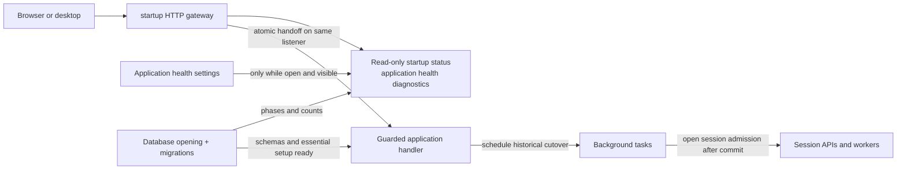

During database opening and schema migrations normal API calls return 503 with
a retry hint. Once essential setup completes, the same listener dispatches to
the guarded application handler. Authentication, embedded routes, capabilities,
system statistics and authenticated background-task status are available even
while historical identity preparation is unfinished. Session-dependent APIs
return `session_preparing` with a retry hint until cutover and module startup
succeed. The progress endpoint stays available for reloads and contains no
paths, session identifiers or raw errors. Shutdown joins the HTTP server and
heartbeat before database teardown.

`internal/platforms/owned` is the session identity integration boundary.
`app.composeCanonicalSessionCore` builds canonical adapters without historical
inventories. Incomplete cutovers run as a `session.preparation` background task.
The initial cutover conservatively fences all session consumers, including
headless watchers, ingestion, plugin delivery, remote-manager inventory and
authenticated unary/streaming remote calls. Dedicated MCP and hooks use the
same fence; module launchers may use MCP after preparation and module startup.
Native session IDs remain inside integrations and compatibility adapters.

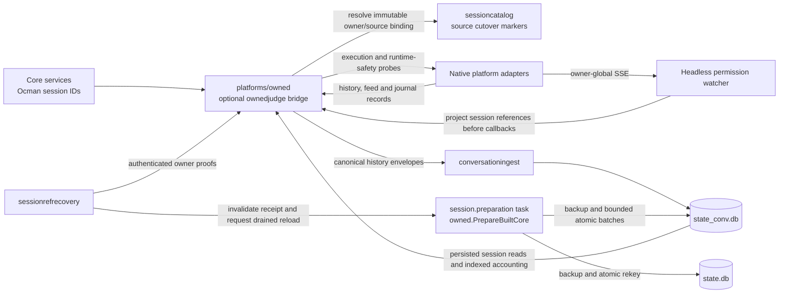

- Execution rejects native caller IDs, unknown Ocman IDs, purged
  sessions and inactive physical bindings. Creation reserves before allocation
  and remains unpublishable until application linkage completes. Receipt hashes
  preserve keyed creation requests written before the cutover.
- Native modules implement `platforms.Integration`: identity, capabilities, a
  runtime inventory for migration and reload safety, live observation, prompts,
  execution and streaming. Only canonical adapters and remote proxies implement
  the browsing half of `platforms.Platform`. `owned.New` requires the statev2
  store, so there is no adapter without it. Session lists, metadata, summaries,
  conversation pages, usage, unread counts and archive candidates read that
  store. An unknown native ID gets an identity only after the integration's
  `SessionIdentityProbe` proves its source has it; that probe returns binding
  metadata, never transcript content. Info/change panels reuse platform converters with
  stored DTOs; historical catalogue defaults and recents use scoped statev2
  readers. Optional live catalogue calls require an explicit configuration-only
  capability. A missing or closed store never falls back to native history.
- Event caches overlay status, pending prompts, connection state and retry/reset
  observations without replacing persisted titles, directories or accounting.
  Native descendants and user-created worktree links remain distinct, so an idle
  worktree conversation stays visible and its prompts cannot bubble to another
  conversation. Running authority never comes from a stored message guess.
- Retained physical sources remain readable under their owner/platform scope
  after a source disappears or is replaced. Their native IDs cannot borrow live
  observations or execution authority from a different source. Older compatible
  conversation encodings remain readable while ingestion upgrades optional
  project, hierarchy and static-status metadata.
- Publication stores acknowledged creation metadata even before a transcript
  exists. Runtime-only source snapshots are partial and cannot delete retained
  messages or overwrite them with an empty complete snapshot. Ingestion owns the
  bounded first-read wait and refresh acknowledgements. A refresh ticket is
  captured before its source snapshot starts; an earlier in-flight snapshot or
  another session's receipt cannot satisfy it. The native session-list cache
  and its refresher were removed.
- Halt receipts use canonical keys for post-cutover identities. The authenticated
  source's frozen legacy-key policy preserves older receipts and their first
  observation timestamps across prompt replays. Unattributed native receipt keys
  never attach to a newly discovered identity or another physical source.
- History inventory includes hidden helpers. Snapshots and feeds translate
  normalized session references while retaining message/part IDs and opaque
  payloads. Journal conversion preserves byte offsets. Unassociated hooks request
  a source-wide refresh rather than assigning an unverified native ID.
  Canonical startup omits the legacy native indexer. A source-deleted conversation
  retains its validated physical head so settled reads can use retained history
  without falling back to a missing native transcript. Rekeying tests verify
  retained analytics rows without a separate native analytics implementation.
- History rekeying preserves revisions, change-outbox sequences, source-deletion
  state, analytics rows and session-scoped receipts. Core-state
  rekeying covers declared columns, Inbox/control-session JSON, packed unarchive
  keys, conversation-plugin mappings and replacement-baseline map keys. Conflicts roll back without merging or
  dropping durable records. Both stores take restorable backups before mutation.
  Routine run snapshots remain immutable outside rekeying: the transaction saves,
  suspends and restores the original snapshot trigger, including on rollback.
  `owned.PrepareBuiltCore` freezes legacy routine/Factory provenance and inventories
  active and retained local sources before migrating history and core references.
  Discovery/parent reconciliation uses batches of at most 500 metadata rows.
  History mappings are staged durably before any pagination keys change; an
  inventory-complete receipt lets an interrupted cutover resume application
  without interpreting a partly migrated child's canonical parent as native.
  Each rekey transaction applies at most 500 staged identities, and the plan is
  removed only after commit. Core/feature batches share one pre-mutation backup;
  history application takes one backup per attempt, not one per batch.
  Source-less local state resolves only against a
  unique catalogue binding across all physical sources. Active/inactive source
  collisions remain quarantined. Replaying legacy indexing validates canonical
  history keys instead of adopting them as new native execution bindings.
- Catalogue v3 records which sessions need legacy opaque deduplication tokens.
  Existing records retain them; new identities use canonical tokens. Permission
  Inbox hashes are derived inside the adapter, so re-observing a migrated prompt
  can keep its resolved tombstone without exposing a native session ID to Inbox.
  A durable per-source cutover marker freezes which inventoried identities need
  legacy keys. Later startups cannot change modern wire or completion receipt
  identities. Permission notifications, replies and manual rules all request the
  same integration-provided Inbox key, including reply-before-asked tombstones.
- Offline and unattributed legacy associations use `ocref_<uuid>` lookup tokens.
  These are not session identities and cannot execute. Native references stay
  only in `platforms/owned`'s compatibility table. Queues and feature records keep
  their relationships while waiting for an authenticated owner to supply an
  `ocm_<uuid>` identity. Unknown owners are never inferred to be local. Repeating
  migration preserves the same tokens, and resolved tokens cannot be rebound.
  The restoration helper resolves batches through the authenticated owner gateway,
  persists immutable bindings before rekeying state, and reuses them without
  contacting the owner on replay. It requires quiescent state users.
  The canonical-only `sessionrefrecovery` module polls connected canonical owners
  for unresolved proofs. It persists bindings without rekeying live application
  tables, then requests the existing admission drain and authoritative idle check.
  A graceful backend reload applies those bindings through the fenced background task
  and rebuilds caches and workers. Held quarantine queues remain durable and do
  not block the reload. Saving unchanged platform settings cannot cancel it.
- `sessionsvc` supports adapter-owned creation/configuration followed by a
  canonical linkage callback and explicit commit before publication. Replayed
  completed local creations do not repeat linkage or publication. Canonical
  reconciliation errors retain worktrees just like earlier uncertain outcomes.
- Native-link and old-receipt handling now lives in `platforms/owned`'s gateway.
  Canonical HTTP/MCP request paths retain the Ocman ID, and pending feature
  references lose their executable links without losing the surrounding record.
  Catalogue v4 mirrors remote canonical metadata without a native binding on the
  hub. Production negotiation requires protocol v12 (v9 plus the removal of
  the unused webhook-inbox and `Owns` RPCs and the generic `Call` RPC). Raw compatibility servers
  advertise v8; canonical managers reject them before publishing either their
  platform adapters or host execution routes.
  Declared v9 mutation contracts reject native and pending session references
  before side effects. Canonical peer responses are checked before caching
  ownership, including offline snapshots; uncertain creation replies remain
  non-replayable even when their payload is malformed.
  Read, ownership, usage, policy and per-session stream RPCs also validate session
  references before invoking adapters. Owner-global streams remain supported.
  The remote stream receiver validates complete declared event frames and rejects
  native, malformed or pending session references without allocating identities
  or applying the public-view link-clearing policy. Opaque provider data and
  native message/part/request IDs retain their wire representation.
  Local event projection includes diff and compaction notifications. Unpublished
  creation frames are withheld without disconnecting an owner-global stream or
  suppressing a ready sibling's events; unrelated projection failures stay fatal.
- The headless OpenCode watcher projects named and directory-wrapped events before
  application callbacks. Adapter bridges preserve port-generation fencing, native
  prompt/status caches, instance discovery and session-cache refreshes. Prompt
  snapshot callbacks run outside the prompt lock so canonical discovery can read
  session metadata without deadlocking. Opaque prompt metadata is unchanged.
  Host discovery hooks also survive wrapping. Parent/directory/title lookups,
  artifact and stream descendant checks, and git refresh hints now use adapter
  metadata/relationship capabilities rather than querying native session keys in
  the server. Canonical and explicitly remote references cannot fall back to a
  local raw database adapter.
  The wrapper preserves authoritative reload-idle checks and isolated title
  helpers. OpenCode judge callbacks adopt helper identities before entering
  application state while prompt execution and cleanup retain native IDs inside
  the judge integration. The typed `ownedjudge` decorator preserves other
  platforms' fallback judges without exposing their raw adapters.
  Runtime-replacement candidate scans and persisted lifecycle evidence also use
  canonical adapter methods. Hidden rows remain visible to the stop fence;
  unattributed in-flight creations fail closed instead of disappearing from the
  candidate inventory. Minimal identity scans cannot erase catalogue metadata.
  Recovery scans carry unfiltered title and parent metadata, so hidden helpers
  never depend on the display-filtered summary reader for identity adoption.
  Optional host runtime, worktree naming, hook and MCP-listener services survive
  wrapping. Claude's headless watcher projects session references before permission
  callbacks, preserving native prompt IDs and its joined shutdown lifetime.
  Live-only conversation heads need no transcript fingerprint. Settled heads
  still require the immutable physical source. Claude config fingerprints resolve
  existing physical ancestors so first-run directory creation does not change them.
- The plugin store has a separate backed-up, atomic migration under the preparation fence for
  `session.v1` mappings, run results and completion outbox references. Fingerprints,
  unsettled admission fences, delivery sequence numbers and operation keys stay
  unchanged. Source-less run receipts use only the same plugin's unambiguous
  durable mappings, otherwise they remain quarantined. Platform-owned compatibility
  projection preserves legacy run-result/completion wire correlations and notice
  deduplication prefixes without using them for execution or public links.
  Quarantined completions pause without consuming their retry budget. Fenced
  migration also applies owner proofs saved before a reconnect-triggered reload.
  Restored remote wire/deduplication correlations come from the same scoped,
  immutable proof store. No native execution binding is mirrored onto the hub,
  and ambiguous correlations fail rather than changing receipt identity.
  An unavailable identity projection pauses completion delivery without spending
  attempts. Only calls that reach the plugin broker consume the retry budget.
- The app coordinator constructs wrapped adapters and canonical routing before
  historical work, preserving fallback judge capabilities. Session consumers
  start only after core and plugin migrations succeed. Unavailable selected sources remain fail-closed
  adapters and their legacy references stay quarantined. Runtime-owned reload
  idleness remains authoritative even when browsing is unavailable. Disposable-home
  startup tests cover creation, streaming, prompts and supervisor recovery.
  Existing databases are backed up and migrated after startup or a drained
  reload, never by a live rekey of active core services. Failed tasks remain
  visible and keep session admission closed; restarting retries unfinished work.
  Completion receipts in both stores bind the owner, physical-source selection
  and history database together. Ordinary restarts check indexed receipts rather
  than repeating retained-conversation scans, native inventories or parent walks.
  Indexed pending-local-reference checks still detect bindings discovered after
  cutover, so a completed receipt cannot suppress later recovery.
  New reference proofs invalidate the core receipt atomically. Newly imported
  legacy history invalidates the history receipt. Replacing/restoring either
  store cannot reuse the other store's mismatched receipt.

### Background task status

`internal/tasksvc` runs bounded owner-local work inside Ocman's process.
`internal/taskmod` exposes authenticated, read-only list and detail APIs at
`/api/background-tasks`. A compact `bgt` counter beside total active sessions
links to the Background tasks page instead of a main navigation entry. Its
`view=active-count` request counts queued/running rows without loading task
payloads or applying list limits. Both counter and page pause polling while hidden.

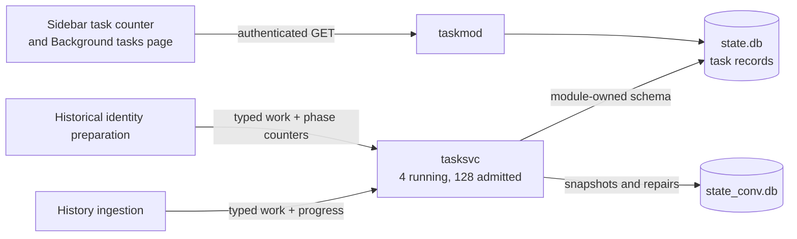

- Records distinguish queued, running, succeeded, failed, cancelled and interrupted
  work. A restart interrupts unfinished records instead of replaying closures.
  Shutdown cancels and joins admitted work before databases close.
- Producers report a phase, completed units, optional total and named counters.
  Unknown totals show indeterminate progress. Finishing a scan does not imply
  success if any session failed. History tasks count imported, unchanged, skipped,
  purged, failed and source-deleted sessions without deleting retained history.
  Polls with nothing to read are not recorded, and a repeated inventory failure
  is recorded once until it changes or recovers.
- Active keys deduplicate work within a task kind. At most 1,000 terminal records
  are retained. Reads return at most 200 records, active work first. Remote task
  queries fail closed; hub aggregation is not implemented.
- History ingestion and initial session identity preparation use the manager.
  Producers own durable resume checkpoints; task records do not replay closures.
  Other candidates are
  project inventory refreshes, database cleanup and
  restore, artifact/share publishing, auto-archive and attachment cleanup, and
  plugin discovery or reconciliation. These can report rows, checkouts, named
  steps, files/bytes, items or deliveries, respectively. Integration must preserve
  their existing locks, authorization and retry rules.
- Agent execution, permission handling and queue delivery keep their domain-owned
  records and recovery. Connection watchers need health and last-success status,
  not percentage completion. There is no HTTP command-execution or retry endpoint.

## 2. Backend composition

Server shutdown cancels and joins its owned background loops before returning,
so closing the databases cannot race a pending refresh.

The Go package graph, collapsed to the seams that matter.

```mermaid
flowchart TD
    Main[main.go<br/>embedded skills + build version] --> App[internal/app<br/>startup + composition]
    App --> Server
    App --> Registry
    Server[internal/server<br/>HTTP, SSE, handlers] --> Registry[platforms.Registry<br/>session seam]
    Server --> Router[hostsvc.Router<br/>host/dir + runtime seam]
    Server --> AutoApprove[internal/autoapprove<br/>session rules, safe-command cache + Judge seam]
    Browser -->|/permissions: session policy + request history| AutoApprove
    AutoApprove -->|per-permission backend selection| Judge[OpenCode judge, else<br/>claude -p haiku judge]
    Server -->|"modules(): routes, Start, Launch, Run, Close, Finalize, tools, Bus"| Modules[feature modules<br/>autoapprove, queuemod, factorymod, pluginsmod, routines, sessiontitles, webhook, artifacts, inbox, sharing, notifications, snooze, tmuxmod, filesystem, projectforge, previews, analytics, termmod, ocmaint, gitmod, remotesmod, platformsettings]
    Modules --> Lifecycle[internal/sessionlifecycle<br/>prepare, start + direct actions]
    Lifecycle -->|mutations + first delivery callback| Sessions[internal/sessionsvc<br/>shared agent mutations]
    Modules -->|"queuemod: bounded preparation, then admitted delivery"| Sessions
    Lifecycle -->|creation, streamed attachments, restart + reload| Router
    Server --> Recovery[internal/sessionrecovery<br/>interruption history + replacement fences]
    Recovery -->|owner-local lifecycle reads| Registry
    Recovery --> State
    Modules --> Routines[internal/routines<br/>saved prompts + schedules]
    Modules -->|"factorymod: routes, tools, launchers, control sessions"| Factory[internal/factory<br/>YAML workflows + Issue dispatch]
    Factory --> FactoryModel[internal/factory/model<br/>shared persistence records]
    Factory -->|graph + action Inbox reconciliation| State
    State --> FactoryModel
    Factory --> Registry
    Factory --> Router
    Factory -->|Project Delivery validation + merge observation| Forge
    Routines --> Registry
    Routines --> Router
    Modules -->|"tmuxmod, termmod, gitmod: tmux, terminals, git + worktrees via Host"| Router
    Routines --> State
    Server --> MCP[internal/mcp<br/>MCP tools]
    Modules -->|module tools| MCP
    Modules --> Inbox[internal/inbox<br/>state + owner routing]
    Modules -->|notifications: subscriptions + durable delivery receipts| State
    Modules -->|snooze: archive deadlines + atomic wake-up| State
    MCP --> Registry
    MCP -->|existing-session direct send| Sessions
    Registry --> OC[platforms/opencode/provider + internal/db<br/>adapter and read-only queries]
    Registry --> ClaudePlatform[platforms/claude/transport<br/>native-session runtime bindings]
    ClaudePlatform --> Provider[platforms/provider<br/>per-instance socket adapter]
    Provider -->|providerprotocol: HTTP + SSE over unix socket, leased snapshot + replay| Supervisor[providersupervisor<br/>sequenced spool, ack, drain]
    Local -.->|ocruntime.BackendRuntime in tmux, one per project| Supervisor
    Modules -->|idleprojects: idle timeout through hostsvc.IdleProjectRuntime| ClaudePlatform
    Supervisor --> Claude[platforms/claude/provider + launch<br/>index, converter, SDK-compatible claude children]
    Registry --> CodexPlatform[platforms/codex/transport<br/>machine-wide supervisor + history app-server]
    CodexPlatform -->|execute, probe ownership, drain and seal idle owners| Provider
    Supervisor --> Codex[platforms/codex/provider + appserver<br/>ACP execution, native history + converter]
    Registry -->|SessionEventSink: status + idle| Server
    Modules -->|Factory + routine usage via platforms.UsageReader| OC
    Modules -->|"analytics: Stats/Usage reads, size samples, OTel gauges"| OC
    Registry -->|session detail, summary, lifecycle + usage reads| RP[internal/remote<br/>platform adapter + owner RPCs]
    Router --> Local[hostsvc/local + composerattachments<br/>host operations, canonical roots + attachments]
    Modules -->|platform setup: local-only check/install| Router
    Router -->|streamed attachment writes on owner| RP
    Server --> State[internal/state<br/>state.db]
    Modules --> HistoryImport[internal/conversationingest<br/>owner-local import + repairs]
    HistoryImport --> HistoryStore[internal/statev2<br/>state_conv.db]
    Inbox --> State
    Inbox -.->|remote RPC| Router
    Server --> Forge[forge + integrations<br/>GitHub/Forgejo clients]
    Modules -->|"projectforge: PR/issue lists, checks, handle via owner Host"| Forge
    Modules -->|"previews: forge credentials only (Deps.Forges)"| Forge
    State -.->|registration types| Plugins[sdk/protocol<br/>protocol, supervision, capability brokers]
    Modules -->|"pluginsmod: routes, supervision, conversation + session outboxes"| Plugins
    Plugins -->|token-bound NDJSON + private configuration fd| PluginExec[External plugin process]
    Modules -->|owner-routed PluginOperation RPC| RP
    Modules -->|"remotesmod: /api/remotes CRUD, remote-access settings, inventory loop"| RP
    PluginSDK[sdk/plugin<br/>public Go SDK module] -->|canonical DTO aliases + validators| Plugins
```

- **internal/app.** Application startup owns flags, database selection,
  authentication, logging, platform registration and HTTP/desktop composition.
  The root entrypoint only supplies embedded skills and the build version.
- **platforms/claude/transport.** The Claude adapter composes the browsing and
  per-project supervisors, routes session operations by native session ID, and
  recovers/drains project runtimes. Creation chooses a project runtime; after
  binding, SSE, sends and prompt replies use the same session-to-supervisor
  association, even when the working directory changes. Recovery discovers
  active native IDs from process-owned status, never shared transcript listings,
  and rejects conflicting active claims or incomplete discovery. Failed probes
  permit recovery only when an independent check proves the tracked supervisor
  is dead. Local deadlines never authorize fallback execution. Verified
  corrections persist under the shared ownership lock without changing session
  metadata, so restarts keep the
  corrected association. Correcting a binding ends that session's
  old stream so it reconnects. Its constructor receives skills and the MCP address
  explicitly. Provider and hook subcommands live in the same module.
- **platforms/opencode/provider.** Creation or a successful native-ID probe pins the
  session's runtime port. Reconstruction checks the native session identity before
  using a runtime; directory metadata alone cannot select an SSE or mutation
  target. Both platforms retain the owner/source-scoped Ocman-to-native mapping
  in `platforms/owned`; a project change never allocates another identity.
- **platforms/codex.** `platforms/codex/appserver` is a JSON-RPC client for
  `codex app-server` over stdio, with an in-process fake in
  `appserver/codextest`. `platforms/codex/provider` converts Codex thread items
  into v1 messages and parts through one converter shared by stored and live
  items. Its supervisor drives a shared installed `codex-acp` process through
  `platforms/acp` by default. Native app-server connections supply history and
  account metadata and persist title changes. They never resume ACP-owned threads
  for execution. ACP chunks
  preserve native item IDs, seed the native reply group and reconcile the final
  stored turn and rollout accounting before idle. Approvals and scoped form
  questions use Ocman's prompt lifecycle; their resolution is spooled before
  the ACP callback returns. Steering opts into `promptRequired`, preventing an
  idle steer from starting an untracked turn. Failed events and terminal writes
  retain admission until durable publication recovers. `codex/transport` still
  registers the opt-in `codex` platform, launches its machine-wide supervisor
  through `ocruntime.BackendRuntime` and reattaches after dashboard restarts.
  Browsing uses a separate native reader and never starts execution. All paths
  share the captured canonical Codex home; `CODEX_PATH` selects the same CLI.
  Adapter executable, home, CLI, backend identity and MCP listener form the
  supervisor launch identity. Changing them drains and replaces it while prompt
  replies and abort remain routed to the old supervisor. ACP offers no raw shell,
  fork-at-message or native loaded-writer probe. Those capabilities are disabled,
  not implemented through a second native writer. Native execution routes,
  notifications and loaded-writer recovery have been removed. Other owners,
  including older Ocman supervisors, are never stopped. Adapter errors never
  trigger native execution fallback or automatic prompt replay.
- **internal/server.** The HTTP mux, SSE broadcast and fanout, around 60
  handler files, plus tmux launcher and terminal host wiring. Its session paths (SSE tee,
  notify, permission replies) still drive the auto-approve pipeline. It is the
  composition root for feature modules.
- **Feature modules** (`internal/module`). Auto-approve (`internal/autoapprove`:
  per-session toggle, approved-permission notices, judge settings, judge-delay
  seed and the headless watcher), follow-up delivery (`internal/queuemod`:
  queue routes, native inbox coordination, idle flush and sweep workers,
  model quota cooldown, continuation notices and fallthrough settings), Factory (`internal/factorymod`),
  plugins (`internal/pluginsmod`), the `/api/tmux` controls (`internal/tmuxmod`:
  sessions and launches through the owner's `hostsvc.Host`, client list and
  switch on this machine's tmux), the browser terminals (`internal/termmod`:
  window controls and the WebSocket bridge, attached through the owner's
  `hostsvc.Host`), OpenCode database maintenance
  (`internal/ocmaint`: `/api/maintenance/opencode-db` routes and the job
  runner; the server's launch gate asks it `LaunchBlocked`, and its `Run`
  holds the worker join until a running job finishes), remote management
  (`internal/remotesmod`: `/api/remotes` CRUD + reconnect, this instance's
  `/api/settings/remote-access` status and token reveal, and the inventory
  refresh loop among the joined workers; the `remote.Manager`, its gRPC
  transport and `Start`/`Stop`, the registry, the host router and owner
  resolution stay core), routines, webhooks,
  artifacts, the Inbox, conversation sharing and read-only file browsing
  (`internal/filesystem`: directory picker, signed `/api/file/` embeds,
  owner-routed repository file reads), link previews (`internal/previews`:
  `/api/previews/*`, link rules and sign-in apps; it
  sees the hub forge clients only as credentials through `Deps.Forges`, and
  app access through `Deps.Access`), git and worktrees
  (`internal/gitmod`: status, branches, checkout, diffs and worktree
  list/base ref/remove/create-and-launch through the owner's `hostsvc.Host`;
  permission inheritance and the first send are injected server paths) each own
  their routes, background loops, MCP tools and event subscriptions. The
  server lists them once in `modules()` and hands each narrow `Deps` (store,
  guards, lookups); modules never import the server or each other. Webhooks
  dispatch to routines through an interface. Modules are built once on first use via
  the server's generic `lazy[T]` field. Sharing and Factory's dispatch
  wake-up react to the typed, synchronous `module.Bus` `SessionIdle` event.
  `sessionsvc` publishes `FirstPromptAdded` once after a new conversation's
  first successful input. `sessiontitles` handles it only on the owning machine:
  Claude's adapter runs a tool-free, non-persisted Haiku helper, then a guarded
  rename updates the title without adding a turn or overwriting a manual name.
  The server launches Factory once the MCP listener is up, because its
  sessions verify their ocman MCP connection, and closes it after the HTTP and
  MCP listeners stop. Analytics (`internal/analytics`) owns
  the Stats/Usage endpoints, UI-usage recording, provider usage and its cost ledger, and the
  database-size sampler, stats gauges and LLM-turn scanner, all joined in its
  `Run`. Accounting reads use statev2 projections through `internal/db`.
  The session snapshot, client-activity demand leases, `/api/system/stats` and the
  server's own OTel instruments stay in core.
- **Platform settings** (`internal/platformsettings`). Selecting Codex in Settings
  first checks prerequisites through the local host's optional
  `hostsvc.PlatformSetupManager`. Localhost-guarded setup/install routes delegate
  to `hostsvc/local`; only an explicit install POST runs the fixed pinned adapter
  command, with a timeout, bounded output and serialized installation. The modal
  rechecks on dismissal and enables the toggle only when prerequisites pass.
  Settings saves
  the local startup selection in state.db. Application startup reads it before
  opening the OpenCode database or registering adapters; an explicit
  `-platforms` flag takes precedence. Saving fences new local turns while active
  turns, pending prompts and existing queues drain. `internal/app.reloadBackend`
  then rebuilds the backend on the same address and process, including databases,
  analytics and prompt watchers. The desktop window stays open; browser SSE
  reconnection refreshes capabilities and session data.
  HTTP/SSE and inbound gRPC contexts belong to that composition; listener cleanup
  is joined before its databases close. Explicit or generated OpenCode credentials
  are resolved once per process and reused by every replacement composition.
  Claude's `platforms.ReloadIdleReader` checks project supervisors independently
  of best-effort browsing, including persisted supervisors still recovering.
- **Idle projects** (`internal/idleprojects`). An owner-local module holds the
  configurable idle timeout and minute sweep. It checks archive state, live
  sessions, queued messages, and active background work before calling
  `hostsvc.IdleProjectRuntime` on the provider adapter. Membership uses the
  launch resolver, including arbitrary linked worktrees and subdirectories.
  Deleted session directories use historical identity in the existing
  `claude-sessions.json` ownership snapshot; unmanaged retained transcripts
  cannot disable cleanup for unrelated projects.
  Only Claude supervisors are stopped. OpenCode v1 lacks atomic idle draining;
  v2 is machine-wide, so both are excluded. Claude fences new turns with
  `/drain-idle` before stopping its supervisor. Token-scoped rollback and
  recovery preserve replacement drains if cleanup is cancelled.
  Routine dispatch already ensures its runtime before creating or reusing a
  session, so future schedules do not keep idle projects running.
- **Snooze** (`internal/snooze`). Owns `POST /api/session/snooze` and a joined
  minute-interval worker that wakes expired conversations immediately on startup
  and during operation. Validation and SSE broadcasting are injected from core.
  Archive rows, snooze deadlines and auto-archive protection remain in
  `internal/state`, shared with manual archive and unarchive operations.
- **Project forge** (`internal/projectforge`). The PRs & Issues pane:
  `/api/project/{upstreams,prs,issues,pr-checks,pr-mergeability,forge-user,
  handle}` and `/api/settings/prompt-templates`. Every `/api/project/*` route
  takes an explicit owner, resolved by the server's `resolveOwner` (503 `remote_not_connected`
  for a disconnected remote); the owner's `hostsvc.Host` detects upstreams and
  fetches cross-fork heads, while the hub classifies remotes and calls the
  forge with its own clients (`ResolveForge`, `KnowsForgejo`, read at call
  time). The module keeps the bounded, collapsed upstream-detection cache and
  launches through the shared session path on the owner's compound platform.
  Prompt templates stay hub-wide settings, not owner-scoped. Project archive,
  quick settings stay in the server. Session start belongs to `internal/sessionlifecycle`.
- **Session lifecycle** (`internal/sessionlifecycle`). Owns prepare/start,
  progress broadcasts, first delivery, attachment uploads, direct mutations,
  reload and confirmed restart. Preparation reads catalogs without launching;
  creation validates the owner and backend before launch and applies permission
  defaults before publication or delivery. Host operations use the owning
  `hostsvc.Host`; shared mutations stay in `sessionsvc`. Direct send is an
  injected callback, shared with the queue. The server retains list/detail/SSE
  transport, auth, owner resolution, permission/question audit orchestration and
  queue/cooldown/idle ordering. Compatibility handler wrappers delegate to the
  module, whose routes are registered through `modules()`.
- **Conversation stream** (`internal/convstream`). Serves
  `GET /api/session/{id}/stream`, the Ocman conversation event (OCE) stream
  from `spec/conversation-events/design.md`. One `Hub` keeps one upstream per
  session for every subscriber, a bounded and compacted replay log with an
  `epoch:seq` cursor, and the live overlay that `stream.hello` restates. It
  settles idle edges through `LifecycleReader`, derives `waiting` and turn
  edges, and resets slow consumers. It is the only per-session browser stream.
  Until native sources exist, its live source runs the owner pipeline:
  `ProxyEvents` through the auto-approve tee and sinks, then
  `internal/convevents/v1map`. Remote sessions are bridged on the hub from the
  owner's forwarded bytes, where the hub also observes git command hints.
  Sequence admission occurs before mapping, once per source frame. Mapper
  anchors keep bounded UTF-16 lengths rather than full conversation text. A
  cursorless refresh is display-only; unpositioned deltas wait for an ordered
  upstream upsert. Descendant prompts resolve through the owning platform's
  metadata, never the hub's local database. Reconnect seeds invalidate pending
  settle generations before opening the new epoch, and
  every browser write/flush has a deadline. Upstream failures are visible even
  when browser keepalives continue. Every non-resumed hello, including the first,
  triggers fenced recovery. The browser replaces REST-owned history, preserves
  the separate stream-owned live content and prompt/task ledger, and replays
  events received after the request fence. Failed history reads retry with
  exponential backoff capped at 15 seconds, retaining the recovery fence until
  success. Authentication and permanent client errors require explicit retry.
  A busy conversation with no content events for five seconds reconciles history
  even if transport keepalives continue. Content resets this timer; waiting and
  terminal states stop it. These repairs only read history, never resend input.
  Stored history is ingested after the live stream, so the browser-facing hub
  composes conversation reads; the browser never merges the two by guesswork:

  ```mermaid
  flowchart LR
      Source[Live source] --> Hub[convstream hub]
      Hub --> Ledger[Unconfirmed ledger]
      Ingest[History ingestion] --> History[(state_conv.db)]
      History -->|commit observer| Owner[Owner stream:<br/>ocman.history.committed]
      Owner --> Hub
      History --> Read[GET /api/session/id]
      Ledger --> Read
      Read -->|snapshot + stream.cursor| Browser
      Hub -->|events after cursor, history.committed| Browser
  ```

  - The hub's per-session ledger holds streamed messages and parts that history
    has not stored. It survives idle edges, source restarts and detaching. A
    turn's entries settle at its idle edge, terminal status, an idle reconnect
    seed, a settled lifecycle read or detach. Stream removals leave tombstones;
    rewrites discard ended turns.
  - Streamed values are kept once and appended in place, with their UTF-16
    length tracked, so a chunk costs constant work. Each ledger caps settled
    parts and messages by count. All ledgers share a 64 MB budget counting
    messages and parts: ended message groups go first (confirmed ones, then
    sessions nobody streams, oldest first). Running turns are evicted only past
    a hard ceiling of twice the budget. Ten minutes without change is a
    backstop expiry for content no read confirms.
  - `GET /api/session/{id}` (newest page) begins a read before querying history,
    lays the ledger over the stored read and returns `stream.cursor`, the hub
    position it covers, and `stream.composedMessageIds`. Older-history paging
    offsets count only messages a read returned as stored history. Only the
    cursor is read under the session lock; merging runs on a ledger capture,
    and only entries unchanged since the capture are confirmed.
  - A read that stores a settled entry at least as completely, or stores its
    message as completed, confirms it. History only moves forward, so reads
    that begin later skip confirmed entries, reads that began earlier still
    overlay them, and they leave once no earlier read is open. Tombstones clear
    the same way once a read no longer holds the row, so history can re-add it.
    No timer is involved. A settled message missing from a read that stores
    later messages is forgotten, not tombstoned, since ingestion order is not
    guaranteed. Remote owners return history uncomposed; the hub that streams
    the session composes it once.
  - `statev2.DB.OnCommitted` notifies the owner after each commit. Owner session
    streams forward a coalesced `ocman.history.committed` synthetic frame,
    mapped to `history.committed`, including through remote tunnels.
  - Every browser read replays only the content events after its cursor, so
    older stream copies never overwrite newer stored metadata. Metadata, child
    and status events always replay; the read does not compose them. A settled conversation rereads
    on `history.committed`, which backfills content the stream missed.
- **Session recovery** (`internal/sessionrecovery`). A workerless service owns
  interruption history, replacement membership, admission and stop fences, and
  confirmed-stop reconciliation. Runtime hooks and history reads call it through
  thin server adapters. Persistence stays in `internal/state`; callbacks resolve
  the current local host and platform. OpenCode v1/v2 replacement uses this
  service; Claude supervisor recovery stays in `platforms/claude/transport`.
- **autoapprove.Judge.** The safe-command cache runs before backend selection.
  Each uncached permission selects a judge through `Deps.SelectJudge`, defaulting
  to the registered OpenCode adapter's port discovery. When no OpenCode instance is reachable and
  `claudecode` is enabled, `autoapprove.ClaudeJudge` runs `claude -p --model
  haiku` with no tools. With neither, an explicit `needs-user` verdict leaves the
  prompt unanswered.
- **Session approval rules.** `/permissions` reads request history and edits
  Ocman-only allow/ask/deny patterns through the auto-approve module. Rules are
  keyed by platform and session in state.db, apply to native nested subagents,
  and precede native-mode auto-approvals, cached verdicts and the AI judge.
  A final reply check serializes with saves so an older judge cannot bypass a
  newly saved ask/deny. Remote platform adapters forward policy reads and writes
  to the owner over `SessionPermissionPolicy` RPC. Rules and rule-based replies
  never enter native agent settings or worktree permission inheritance.
- **Session summary reads.** Pinned sessions outside the recent window use
  `platforms.SummaryReader`, served from the statev2 list projection. Remotes
  return the owner-local row through `SessionSummary` and stamp its compound
  platform on the hub. Older owners fall back to session detail. Session-list
  SSE invalidations trail by 150 ms with a 500 ms maximum wait, finish existing
  reads before refreshing, and retain one follow-up when another event arrives
  during the refresh.
- **Factory usage.** `/api/factory/epics/{id}/usage` joins durable attempt
  identities to `platforms.UsageReader`. Canonical adapters sum descendant
  usage from statev2 and reuse token and pricing calculations.
  The Factory module deduplicates owner-qualified session IDs for Epic phase totals,
  retains retry history per Attempt, and flags unavailable reads as incomplete.
  Epic and Queue views poll these totals every ten seconds.
- **Owner-local session usage.** Both Factory and routine statistics read
  `platforms.UsageReader`. Remote adapters forward to the owner's `SessionUsage`
  operation over the existing token-authenticated connection, returning the
  owner's recorded and estimated costs keyed by session ID, including
  descendants. Owners that answer Unimplemented report
  usage unsupported without falling back to hub-local sessions. Routine stats
  retain all-run counts and average duration and refresh billing at most every
  30 seconds while their tab is open.
- **Follow-up queue.** `internal/queuemod` owns delivery coordination over
  `internal/queuesvc`, which drains one held message per turn. Queueing remains
  an explicit composer gesture. Native backend inboxes are preferred only when
  no durable hub backlog exists; uncertain native sends are surfaced without
  replaying into the hub queue. Direct send and runtime recovery are injected
  server functions shared with the other session paths.
  Each decision uses `platforms.LifecycleReader` for settled status and the
  latest message identity. The local adapter reads one session and its newest
  message, without parts, tree or costs. Remotes settle on the owner and return
  that same bounded DTO through `SessionLifecycle`. Older owners without the
  RPC fall back to session detail. A guarded sweep reads lifecycle under the
  session lock and checks guard generation before reusing that read.
  Idle-edge flushes still trust the edge regardless of the status read.
  The server records model-provider cooldown through the module before admitting
  a flush and publishing `module.SessionIdle` to ordered bus subscribers. A
  continuation consumes that edge so held follow-ups wait for its turn to end.
  Retry resets and notices use compound platform/session identities. The module's
  `Run` stops admission on cancellation and joins accepted sends and the worker
  dispatcher, allowing durable dequeue receipts to finish before state.db closes.
  Owner-side cooldown reads run outside the admission mutex with a lifetime-bound
  deadline. Shutdown joins admitted idle handlers before closing the dispatcher;
  a cancelled read leaves its queued payload held for recovery.
  Sweep iteration and pre-send lifecycle/model reads stay cancellable and bounded.
  Only actual admitted delivery and durable dequeue/failure receipts detach
  cancellation, so a stalled owner read cannot hold shutdown open indefinitely.
  `sessionsvc.PrepareSendMessage` resolves the adapter, model and first-prompt
  metadata before returning a mutation-only delivery callback. Shared runtime
  recovery still reads through the preparation lifetime, including before retry.
  Project model settings and provider cooldown persistence retain their existing
  state tables; the combined project-defaults route invalidates the module cache.
- **platforms.SessionEventSink.** The registry installs status and idle callbacks
  on lifecycle-producing adapters, including adapters registered later. OpenCode's
  watcher feeds the same server callbacks. Adapters update their live view before
  calling the sink; idle means a completed turn. A `limited` session carries
  `resetsAt` in Unix milliseconds and stays non-idle for queue sweeps, routine
  completion and plugin replies. The status patch updates the browser's list and
  header without a new protocol or polling loop.
- **platforms/provider.** The generic adapter negotiates capabilities and protocol
  versions through `/hello`. Shared DTOs in `internal/providerprotocol` define the
  socket contract. Each adapter owns its session, live-status and pending-prompt
  caches; `WatchEvents` replays sequenced v1 events and feeds the shared status and
  idle sinks even without a browser. Runtime management owns the watch context.
- **providersupervisor / ocruntime.BackendRuntime.** A supervisor wraps a
  platform backend and serves it on a private unix socket. Claude browsing
  runs inside the ocman process, one per machine. Sessions ocman launches run
  in `ocman provider claudecode`, which `ocruntime.BackendRuntime` hosts in
  tmux, one per repository root, persisted in `managed_provider` and re-probed
  with `/hello` on recovery, so turns and prompts survive an ocman restart.
  Out-of-range versions stop new turns through `/drain` and are replaced only
  after all sessions settle. Each outbound event is appended and synced to its
  session spool before publication. The headless watcher acknowledges completed
  turns; browser snapshots pin replay cursors until their stream attaches, so
  truncation cannot erase the REST-to-SSE gap.
- **platforms/claude/provider.** The `claudecode` platform's backend. The in-process
  browsing supervisor indexes `<CLAUDE_CONFIG_DIR or ~/.claude>/projects`
  into the disposable `claude-index.db` beside `state.db` (path, mtime and size
  keys; list projection, per-message byte offsets, subagent links), kept current
  by directory watches plus a 5 s mtime sweep. Detail pages read only their byte
  range through the single Claude to v1 converter; subagents are child sessions
  linked from their Task/Agent part. Sessions ocman launches are driven by pooled
  `claude` children in the project supervisors (pipes, cap 4 across the
  machine, 10 min idle, `--resume` on the next send)
  started with `--permission-prompt-tool stdio`: each `can_use_tool` becomes a v1
  `permission.asked`/`question.asked`, decided first by the adapter's ocman-side
  `provider.Rules` store, then by the autoapprove pipeline and the user. Their
  children initialize before the first prompt and acknowledge model/interrupt
  controls. `internal/platforms/claude/launch` supplies the shared Agent SDK environment to
  sessions and helpers. Their status follows Claude's foreground session-state
  and result events, independently of delegated background tasks;
  terminal sessions use the transcript tail settled by
  `db.SettleSessionStatus`.
- **sdk/protocol.** External wire DTOs, bounded NDJSON, version negotiation,
  handshake and stream-order validation, executable discovery, and description
  validation. It lives in the public `github.com/ocman/ocman/sdk` module (nested
  in `sdk/`, standard library only, tagged `sdk/vX.Y.Z`); the host imports it
  directly, so the protocol has a single definition. `internal/pluginsmod` mounts it: its `Start` scans once (right
  after auto-approve seeds the judge delay, before the other modules); `RescanPlugins` repeats the scan and records identities, checksums,
  and conflicts in state. Its `Run` drives the conversation reply pump and
  reconciliation; the server stops its processes after the listeners and
  Factory close, before workers are joined. The module supervises
  one serve process per enabled local plugin from its private data directory, with
  bounded calls/output, cancellation, restart cutoff and process-group shutdown.
  Process health is durable; sensitive stderr stays bounded in local memory.
  Authenticated management routes expose catalog, health, grant approval and
  revocation, configuration validation/update, restart/retry, and data removal.
  Mutations and redacted stderr reads require localhost and safe browser origins.
  Configuration reaches the child on a private inherited descriptor before
  readiness; failed activation restores the last working public and secret values.
  Authenticated action list/invoke/download endpoints use the action broker. It
  filters context by each action's approved grants, requires host-issued confirmation
  tokens when declared, and returns only typed results. Grant changes serialize with
  dispatch and are checked again before results or artifact bytes are returned. See the
  [wire contract](https://forgejo.nousefreak.be/dries/ocman/src/branch/main/sdk/protocol/README.md).
  The remote `PluginOperation` RPC accepts a closed set of host operations, never
  raw stdio messages. Both transports use the same lifecycle and action broker.
  Catalog identities are `(ownerId, description.id)`; nested capabilities and
  instances inherit that owner. Management and artifact endpoints take `ownerId`.
  Project-scoped workspace homepages read typed documents for known projects.
  Plugin-local homepages instead list configurations with one owner-routed read,
  without enumerating projects. Editors reuse the app project picker for
  owner-local multi-project fields; plugin responses remain data, never UI code.
  Action requests distinguish the installation `ownerId` from `context.ownerId`.
  Project/session listings combine the owner's owner-scoped actions with the hub's
  hub-scoped actions. Owner-scoped actions run on the owner; hub-scoped actions run
  only on the hub. Global placements always resolve to the hub. Explicit disconnected
  project owners fail closed. Remote secret updates pass through without hub
  persistence, and responses contain secret presence only.
  Configuration writes are capped at 1 MiB of canonical JSON; catalog responses
  are capped at 16 MiB on both transports.
- **sdk/plugin.** Optional public Go lifecycle and action helpers reuse the canonical
  protocol DTOs and validators. `sdk/plugin/conformance` runs black-box executable
  tests, including host-broker grant checks. `sdk/examples/ocman-plugin-fixture` is the
  deterministic executable used by the supervisor integration tests. Plugins in
  other languages can implement the same NDJSON contract directly.
- **Plugin persistence.** `internal/state` stores discovered identities, capability
  instances, enablement, grants, health and public configuration in schema v91.
  Schema v92 adds operation receipts committed before action dispatch, preventing
  replay after a host restart even when the original outcome is unknown.
  Secret snapshots use separate `0600` files beside the configured database;
  plugin-owned data uses its own directory. Configuration checkpoints restore
  public values and secret references together. Disable and removal retain data;
  permanent deletion is explicit. Catalog reads expose secret-presence flags only.
- **internal/factory.** The independent Software Factory boundary. It stores
   Epics, Mols, typed Issues, dependencies, attempts, Formula revisions,
   Plan revisions, approvals, and materialization provenance in `state.db`.
   YAML Formulas declare named steps with prompts, configuration, and `needs`.
   They compile to canonical JSON; historical TOML revisions remain readable.
   Poured steps keep their frozen definitions in `factory_workflow_step`.
   Implementation is a group whose required children must succeed before checks
   or later approvals can proceed. Verification and delivery expand per changed
   project; dependent steps wait for every project instance of each prerequisite.
   A Plan session is instructed not to
   modify files, but its configurable permission rules may allow shell commands
   for research; approval of an exact revision automatically materializes the
   proposed Implementation Issues and dependencies atomically. As defined by
   [ADR 0008](https://forgejo.nousefreak.be/dries/ocman/src/branch/main/docs/adr/0008-coordinate-factory-work-across-projects.md), an Epic
   owns an admitted local project set, each executable Issue targets one project,
   and each project has an independent shared branch, checkpoint, and Delivery
   lineage. Ready Issues launch configured worktree sessions in their target
   project. Each implementation handoff records the clean, pushed commit in its
   Attempt result; the next Attempt for that project freezes the checkpoint and
   target branch in its policy. Workflow Project Deliveries follow the declared
   checks and approvals before publishing each project's PR. Legacy revisions
   create deliveries progressively as their required project work completes.
   Forge observations satisfy merge-gated cross-project dependencies; a recorded
   merge makes later work create a successor instead of refreshing the Delivery.
   Delivery retries preserve completed implementation Issues.
   Each Epic has one read-only control session that receives every new
   decision Factory needs. Its `factory_control` MCP tool only records proposals
    for planning, plan decisions, recovery, permission and project gates, graph
    mutation, pause, resume, delivery, and stop. The user's Confirm on the
    rendered card runs them over REST. Stop aborts workers before atomically
    cancelling unfinished work and closing the Epic, preserving partial files.
    Confirmed controls reconcile the action Inbox and retire stale alternatives.
    Existing control sessions receive new protocol instructions once on their
    next opening or Factory update. Implementation agents can also pause behind a
   durable project-admission gate; human REST approval adopts the local project,
   records execution acknowledgement, and launches an additive scoped Plan,
   while rejection resumes the same session with feedback. The browser uses REST
   while agents use MCP.
   Routines are not involved.
- **Factory persistence.** Native `factory_*` tables own the graph and its
   provenance in `state.db`; they do not reference or alter routine tables.
- **internal/factory/model.** Dependency-neutral persistence records shared by
  `internal/factory` and `internal/state`. Factory owns their meaning; state
  only stores them, which avoids making Factory depend on its SQLite adapter.
- **platforms.Registry.** The session-scoped seam. One adapter per platform;
  remotes register as compound-ID platforms so handlers can't tell local from
  remote. `platforms/identity` holds built-in IDs without depending on adapters
  or databases; the compound-ID helpers and `ErrRemoteOffline` live in
  `internal/platforms`, so modules never import the gRPC client to parse one.
- **hostsvc.Router.** The directory-scoped seam (git, worktrees, tmux,
  projects and forge-repository detection/fetch). It resolves the owning host
  and delegates, the same transparency
  trick as the registry. Create requests carry a platform, defaulted from
  `platform.default` independently of the model. Routines and Factory Epics
  persist that choice. `EnsureRuntime(ctx, platform, dir)` selects the
  owner's runtime; adapters can implement `hostsvc.RuntimeEnsurer` for
  non-OpenCode runtimes. Optional `hostsvc.RuntimeAvailability` reports native
  launch prerequisites separately from browsing. Claude requires its resolved
  CLI and tmux; missing either leaves transcript browsing available.
  `EnsureRuntimeResult` carries an endpoint and an
  opaque `ocruntime.Instance`; `Port()` is empty for non-TCP endpoints.
  OpenCode worktrees still share one project instance, or the v2 machine
  server, with a per-session working directory. There is no process per
  worktree. The old `EnsureProjectOpencode` gRPC method remains an OpenCode
  alias for one release. Only tracked instances are reused; persisted entries
  must pass an API identity probe after restart. The only external instance
  adopted is OpenCode v2's registered background service, and only when reading
  the default database. Ocman authenticates it using the service configuration's
  password unless credentials were explicitly configured. Authentication rejection
  returns an error without launching a competing server; a busy service is awaited.
  The service is never persisted, stopped or restarted by ocman.
  The local Host probes at startup and every minute, with four concurrent
  probes and a two-second deadline per instance. Inventory reads use the validated
  in-memory routing map without network probes. Definite failures revoke routing
  but retain cleanup handles; inconclusive probes preserve warm authorization.
  Launches and routing changes invalidate discovery immediately through the
  Host's `RuntimeInventoryChanged` hook (`internal/tmux` knows nothing about
  the adapter), and stale scans cannot repopulate an invalidated port cache.
  Discovery state is an `opencode.Discovery` owned by each OpenCode adapter,
  so a backend reload's new adapter starts with no stale ports or affinity. The server joins the health worker
  before closing databases. `RestartProjectOpencode` stops and relaunches the tracked
  instance. Owner-local replacement callbacks use the read-only
  `ManagedRootReader.ManagedOpencodeRoot` view of that same main-checkout
  identity, so external linked worktrees share membership and nested independent
  repositories do not. This view neither launches a server nor requires a new RPC.
  `ReloadOpencode` requires a readable, matching server-default v2
  location directory for managed servers. The registered service uses its
  registration and credentials instead, since ocman did not choose its launch
  directory. Reload calls the owning machine's v2
  `/api/location/reload` endpoint through the same Host/gRPC seam, retaining
  the process and running turns while refreshing configuration and the owner's
  cached catalogs. Pending permission and question prompts are cancelled.
  Terminal hook installation and removal target the local Host through the
  optional `HookPluginManager` seam; hook status events still reach the platform.
- **internal/composerattachments.** Owner-local attachment cache storage and
  seven-day cleanup. HTTP uploads stream through `Host.SaveComposerAttachment`;
  remote owners receive a metadata packet followed by bounded byte chunks over
  gRPC, avoiding the unary message limit. Only the owner writes the file, and
  its returned path is referenced in the prompt. Interrupted/oversize uploads
  remove their partial file; multipart bodies are not spooled on the hub.
- **internal/ocruntime.** The runtime abstraction behind the managed launch
  path. A `Runtime` interface (`Launch`/`Probe`/`Stop`) hides how a project's
  opencode is hosted; the native-tmux implementation runs headless
  `opencode serve --port N` on `tmux -L ocman-agents -f /dev/null`,
  isolated from the user's tmux server and configuration. V1 runs one server
  per project; v2 uses one per machine, kept up by `RunMachineSupervisor`,
  preferring the registered service on the default database. A managed launch
  whose health probe stays inconclusive is retained and probed again, not killed.
  The runtime uses an ocman-allocated loopback port and
  probes authenticated `GET {endpoint}/config` for health. It is where the container runtime (epic
  #375) plugs in as a second implementation.
- **platforms/opencode/apiv2.** OpenCode v2 compatibility. `ocapi.Auth.Transport` wraps
  every OpenCode HTTP client in `ocv2.Wrap`. On a machine whose `opencode` is v2,
  the wrapper answers v1 routes (sessions, messages, prompts, permissions,
  questions as v2 forms, catalogs, `/event` and `/global/event`) with v2
  `/api/*` calls. The SSE translator re-projects v2's typed events into v1
  `message.*`/`session.*` events. `ConvertMessage` is the single v2→v1 message
  converter: the HTTP layer, the event translator and `internal/db`'s TEMP
  views over `session_v2`/`session_message` all use it, so part ids agree
  everywhere. v1 servers are never probed.
- **platforms/opencode.** Wraps the read-only DB queries (`internal/db`) plus
  an HTTP client that attaches to managed instances or the registered v2 service.
  The local Host supplies the tracked runtime inventory after API identity
  validation; other external processes are never scanned or adopted.
  One process-wide `/global/event` stream
  per instance keeps pending permission and question state in memory across
  all session directories. The same live stream captures completed bash parts
  containing Git commit summaries and stores immutable observations in
  `state.db`; transcript reads never trigger capture.
- **internal/routines.** Validates and stores manual, timeout, one-time and
  cron routines. Manual and scheduled dispatch share the durable occurrence
  claim, launch a fresh managed session through `hostsvc.Router` and
  `sessionsvc`, and leave the run active until platform-neutral session status
  reports success or failure. Startup resumes observation of linked runs.
  Timeout schedules become an absolute due time when saved. Cron schedules
  use a five-field expression and IANA timezone. Webhook polling is an
  independent owner-local/remote delivery loop.
- **internal/notifications.** Authenticated, same-origin push subscription routes
  and joined observation/delivery workers. Slow sends do not stall snapshots;
  failed or stale owner reads preserve the baseline. It reuses the server's notification projection,
  identifies completions by the bounded platform lifecycle read, and persists
  VAPID keys, subscriptions and delivery receipts under its module schema.
  `webpush-go` handles encryption and signing. Known browser push-service hosts
  are allowlisted, redirects are refused, and transient sends have bounded retries.
  The page confirms server subscription state before suppressing local alerts.
  Shared notification snapshots and push payloads update the installed app's
  numeric attention badge. Notification routes carry an explicit owner and reveal
  the conversation even when a mobile overlay was already open.
  The owner's `ListPermissions` RPC annotates cloned prompts with its judge
  deferral decision, so the hub does not guess remote notification eligibility.
  See [Notifications](../features/notifications.md).
- **Legacy Workflow storage.** The `workflow_*` tables remain in `state.db` as
  inert historical data. No API, MCP tool, UI, or scheduler reads them. A DAG
  cannot be converted losslessly to one routine prompt, so recovery is a
  manual read-only SQLite export.
- **internal/mcp.** The MCP server exposes read-only session inspection,
  session creation, existing-session messaging and `embed_file`, plus the tools
  modules contribute:
  action-based `factory` and proposal-only `factory_control` (Factory),
  `inbox`, `webhooks`, `routines` and `artifacts`. File embedding uses signed tokens
  whose key is persisted in `state.db`; `internal/filesystem` mints and serves
  them. Session messaging resolves the recipient's canonical identity or
  unambiguous platform, then uses the shared `sendNow` and `sessionsvc` path.
  It never creates a session or touches the held queue.
- **Inbox.** The `inbox` MCP tool is deliberately limited to `help`, `send`, and
  `recall`. Sends write the owning host's `state.db`; remote sends and recalls
  cross the owner-routed gRPC seam. The browser alone lists, reads, and
  archives Inbox state through REST. Messages carry Permission, Factory, Routine,
  or Primary categories. The headless permission watcher creates owner-local
  actionable messages even when auto-approval is disabled. Successful replies,
  including TUI and automatic replies, archive them; a periodic reconciliation
  handles missed events and aborted requests. Permission replies use the existing
  session service with an explicit platform, including remote compound IDs.
  Routine completion writes its notification in the same transaction as the run
  outcome, and Factory deliveries explicitly use the Factory category.
  After dispatch, Factory reconciles outstanding human actions into durable,
  deduplicated Inbox items and archives resolved ones. The browser's shared
  Inbox query polls in the background for new Factory actions, displaying
  in-app toasts and opt-in system notifications without replaying its initial
  snapshot.
- **internal/opencodeskills.** Extracts binary-embedded ocman skills into
  XDG data and installs only ocman-owned symlinks for OpenCode discovery.
  Retirement unlinks only the exact verified symlink and preserves extracted data.
- **internal/state.** Ocman's writable SQLite store: migrations, settings,
  routines and their immutable run snapshots, legacy inert Workflow rows,
  and the independent native Factory Issue graph. `Open` runs two batches.
  The core sequence (`schema_version`, append-only, v1 onwards) covers every
  table whose queries live in this package, including the tables of today's
  feature modules. Each module's own tables use a `state.ModuleSchema` and the
  `module_schema_version (module, version)` ledger. The server lists these
  schemas in `ModuleSchemas()`. Each batch is transactional and fails closed.
  An existing database is backed up once per `Open` before anything changes:
  module migrations reuse the core batch's backup when it ran and take their
  own only when the core schema was already current. A fresh database gets
  none.
- **forge and integrations.** Forge-agnostic types in `internal/forge`, per-forge
  HTTP clients in `internal/forge/{github,forgejo}`. PR/Issue handlers obtain repository
  identity from the owner Host, then use the hub clients for metadata.
- **internal/previewauth.** Machine-level credentials for private link
  previews. ocman is a personal tool, so every token and grant belongs to the
  hub machine (one fixed viewer ID, `machine`, keyed by this instance's ID),
  usable by any request with app access (auth cookie, or a direct un-proxied
  loopback client when auth is off). Personal tokens are pasted in Settings
  (`POST /api/previews/token`), checked with the provider's identify call and
  stored without expiry; OAuth sign-in (Slack, Jira, or any provider with an
  app) uses a one-time state, PKCE when supported, one exact redirect URI
  (`<public base>/api/previews/oauth/callback`) and same-origin return paths.
  Client secrets stay server-side; tokens are AES-GCM sealed per
  owner/provider/workspace with the row key as associated data, refreshed
  under a per-grant singleflight, and deleted on `invalid_grant`, a 401 or
  removal.
- **Preview ownership across remotes.** The hub holds every credential and
  makes every provider call, also for a remote's sessions; nothing is routed
  to the remote. An explicit `remoteId` that is not connected fails closed
  with a bare 503 before any credential or cache is touched.
- **internal/linkpreview.** Normalized previews behind
  `POST /api/previews/resolve` (text in, `Preview` list out; TS mirror in
  `frontend/src/lib/previews.ts`). Only *configured* providers register a
  `Resolver`; resolvers recognize known direct URLs and custom link rules
  carrying a `provider` (the rule's replacement link stays the client-side
  fallback), deduped by resource and capped at 20 per text. Metadata fetches go
  through `linkpreview.API`: the resolver's fixed API hosts, validated path
  segments, the stored token, no redirects, 1 MiB bodies, 10 s timeouts.
  Results are cached per owner/provider/workspace/resource with in-flight
  dedup, 4 concurrent fetches, a 60/min per-grant budget and `Retry-After`
  backoff. With several workspaces for one provider the service tries each
  and returns the first that previews. `GET /api/previews/providers` is the
  browser's whole view: each supported provider, whether it is configured,
  its link hosts, account display names, and the rule patterns routed to a
  configured provider. `useProviderPreviews` only posts text with a link on
  a configured host or a routed-rule match, so unconfigured links never cost
  a request. Explicit markdown-link hover requests can also resolve public
  Open Graph metadata, as described below. Cards carry no connect flow; Settings → Link previews manages
  tokens and sign-ins, and `ocman:preview-auth-changed` reloads previews.
- **Open Graph hover previews.** Markdown links wait 500 ms on hover or keyboard
  focus, then resolve through the same endpoint with `openGraph: true`. A rich
  provider result wins; otherwise one public HTTP(S) page supplies `og:title`,
  `og:description`, `og:site_name` and `og:image`. This explicit fallback requires
  app access and shares the metadata cache, aggregate fetch budget and concurrency
  limit. Upstream backoff is origin-scoped and honors bounded `Retry-After` values.
  Its credential-free client validates DNS addresses before dialing and on every
  redirect, rejects private networks and nonstandard ports, and bounds HTML to
  1 MiB. Images go through `/api/previews/image`, with the same address checks,
  a 2 MiB limit and raster-only responses. The browser never fetches the image
  host directly. Missing metadata leaves the original link alone.
- **Forge previews** (`linkpreview.Forge`, `internal/previews/forges.go`).
  GitHub, every https Forgejo host (tea logins, saved-token hosts and app
  hosts) and GitLab hosts (`gitlab.com`, saved-token and app hosts) resolve
  PR/issue/commit links. A saved token or sign-in wins; without one the
  resolver is a `linkpreview.Fallback` with the machine's env/CLI token
  (anonymous for GitLab), which previews private repositories for any
  request with app access (`WithOwnerAccess`) and public ones otherwise
  (repository visibility is checked before the resource is read).
  GitHub/Forgejo PR metadata includes `headSha`. A resolve request with
  `checksSha` accepts exactly one recognized PR URL and a validated SHA,
  then uses the same forge checks clients as the sidebar with the preview's
  selected credential and redirect-disabled HTTP client. These checks calls
  use the clients' 8 MiB response bound instead of `linkpreview.API`'s 1 MiB.
  The preview service caches checks for 15 seconds and retains its per-grant
  budget, concurrency limit and rate-limit backoff.
  Visible unfinished checks poll every 5 seconds with a cache bypass.
  Explicit refresh reloads PR metadata and bypasses the checks snapshot for
  its current head while retaining grant and
  rate controls. Checks HTTP 401 and ordinary 403 retain their status for token revocation
  and denial classification, and provider retry deadlines reach the backoff.
  Quota/secondary-limit 403 responses are classified as rate limits instead.
- **Slack previews** (`linkpreview.Slack`, opt-in via
  `OCMAN_SLACK_PREVIEW_CLIENT_ID/_SECRET`). A dedicated OAuth app yields a
  machine-wide *user* token (`user_scope`, bot tokens refused); conversation.v1
  bot tokens and grants are never used. `/archives/{channel}/p{ts}` links
  (plus `thread_ts` replies) resolve only when `auth.test`'s workspace URL
  matches the link host, and channels Slack reports private/DM/MPIM are
  denied before any message is read. Slack `ok:false` codes map onto the
  shared 401 (grant forgotten) / 403 / 404 / 429 handling.
- **Notion previews** (`linkpreview.Notion`, opt-in via
  `OCMAN_NOTION_PREVIEW_CLIENT_ID/_SECRET`). A public connection
  (`owner=user`, JSON token/revoke bodies with Basic auth) stores one grant
  per Notion workspace (or an internal integration token, identified via
  `GET /v1/users/me`); the shared pages are the whole permission model. Page links on notion.so / notion.com / app.notion.com /
  `*.notion.site` resolve by page ID to the API-returned URL; routed ticket
  identifiers run `POST /v1/search` and match titles by whole token. Several
  matches become `Choices` (state `ambiguous`), none is `not_found`. An
  unshared page is a 404 once the cache expires; a removed connection is a
  401 and forgets the grant.
- **Linear previews** (`linkpreview.Linear`, opt-in via
  `OCMAN_LINEAR_PREVIEW_CLIENT_ID`). Authorization code + PKCE with the
  `read` scope; the rotating refresh token is stored per Linear organization; a
  personal API key (`lin_api_…`, sent without `Bearer`) works without an app. One GraphQL query returns the organization and the issue;
  a link whose workspace `urlKey` differs from the grant's is `not_found`.
  GraphQL error codes (`AUTHENTICATION_ERROR`, `FORBIDDEN`, `RATELIMITED`,
  often on HTTP 400) map onto the shared 401 / 403 / 429 handling.
- **Jira previews** (`linkpreview.Jira`, opt-in via
  `OCMAN_JIRA_PREVIEW_CLIENT_ID`). Atlassian 3LO authorization code with
  `read:jira-work read:me offline_access`; one grant per
  Atlassian account (one rotating refresh token spans its sites). Each fetch
  lists `oauth/token/accessible-resources` and calls
  `api.atlassian.com/ex/jira/{cloudid}` for the site matching the link host,
  which is never contacted itself. An identifier found on several sites
  becomes `Choices`.
- **GitLab previews** (`linkpreview.GitLab`; `gitlab.com` by default, other
  hosts once they have a token or an `OCMAN_GITLAB_PREVIEW_APPS` app). One provider `gitlab:<host>` per instance
  (authorization code + PKCE, `read_api`), so grants never cross instances.
  Project paths are sent as one `%2F`-escaped segment
  (`API.WithEncodedSlashes`). Public projects preview anonymously after a
  visibility check; every call dials through a resolve-once, address-checked
  dialer (no loopback/link-local; no private ranges for gitlab.com).

### Platform package dependencies

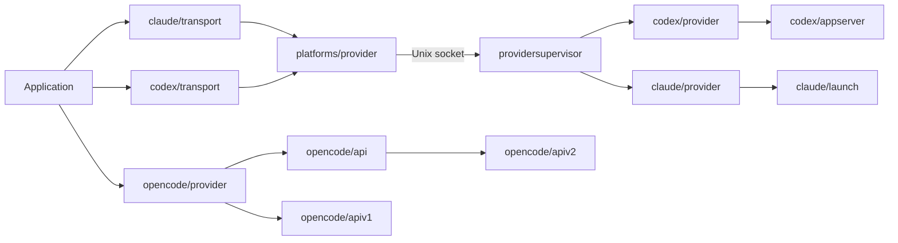

- Platform-specific packages live under `internal/platforms/claude`,
  `internal/platforms/codex` or `internal/platforms/opencode`. The platform IDs
  are `claudecode`, `codex` and `opencode`; persisted identities, commands and
  wire formats are unchanged.
- Codex's transport has no per-project routing: one supervisor serves every
  directory, and its history reads go to Codex directly, not through the socket.
- Claude's transport selects the owning backend and retains session routing,
  runtime recovery and history-ingestion orchestration. The provider owns native
  child execution and transcript indexing. Shared socket serving and durable
  event replay stay in the generic protocol packages.
- OpenCode's provider uses `apiv1` for bounded HTTP operations and error decoding.
  Shared authentication in `api` composes the v2 compatibility transport from
  `apiv2`. The v2 translator is not a standalone replacement client.
- Shared runtime operations still go through `ocruntime` and the owning Host.
  Native data access supplies ingestion and live execution; application browsing
  reads continue to use the canonical history store.

Codex uses the shared ACP execution transport inside its existing supervisor:

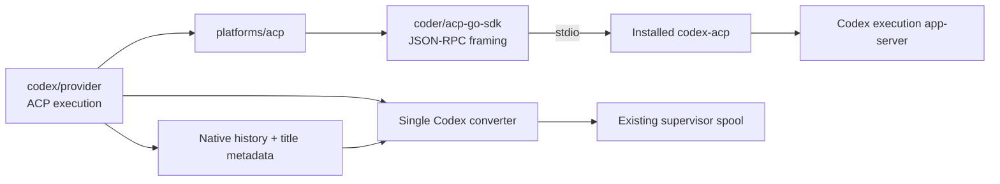

- `platforms/acp` launches an explicit executable, negotiates capabilities and
  supports new/load/resume, prompts and cancellation. It preserves native IDs.
- Its event callback must finish recording each update before returning. A failed
  callback disconnects execution; permissions fail closed without a handler.
- The wire dispatcher retains session/tool fields on form elicitation requests
  that the SDK's generated form union omits. Questions cannot borrow another
  session's context. Only supported, non-secret form fields reach the UI.
- The client does not register a platform, install adapters, ingest history or
  replace owner routing and supervisor recovery. Codex retains these native
  integrations; OpenCode and Claude execution are unchanged. Tests use the
  disposable `codex/acptest` peer and native history fixture.

## 3. Session and event data flow

See [Session and event data flow](../architecture-events/) for the sequence
diagram covering session reads, SSE activity updates, remote streams, and
routine dispatch. Sidebar activity updates arrive over global SSE without
changing row order. Terminal status events fetch the owner-qualified session's
durable completion timestamp, which ranks rows newest first.
Session list/detail responses carry `factoryAttemptId` from a single state.db
attempt lookup. The sidebar filters these tagged rows and their descendants
without requesting `/api/factory/epics`. Only tagged conversations mount Factory
recovery queries. On mobile, closed drawers disable sidebar list/git/stats reads
and unmount the closed mobile details drawer. Document visibility pauses reads
without unmounting open panes or recovery controls, preserving fullscreen diffs,
pagination, expanded previews and unsent guidance. Resuming refreshes the visible
content, including the artifact pages already opened by the user.
Conversation archive and keyboard navigation load their candidates on demand
when the mobile sidebar is closed, without restarting sidebar polling. Archive
changes broadcast to every client and close the affected open conversation;
browser reloads preserve the archive instead of treating it as a reopen. Artifact
pagination and resume refreshes share a serialized read chain.
Settled agent bash commands also produce `ocman.git.command` refresh hints for
the owning project's PR/Issue pane.

## 4. Frontend composition

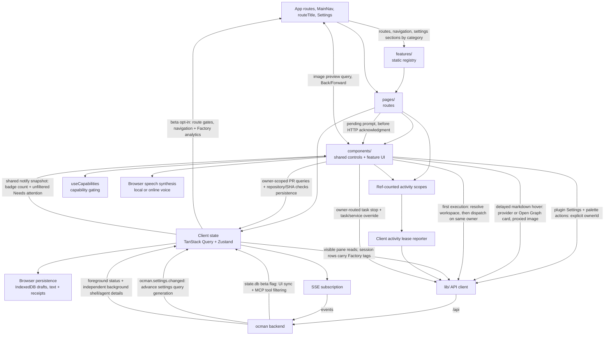

- **Shared query cache.** PR checks and review status use the application
  QueryClient for request deduplication, polling and last-reader cancellation.
  Inactive rows unsubscribe; poll deadlines survive viewport and tab changes.
  Settled checks retain the bounded repository/SHA localStorage cache. Project
  settings use owner/project/generation query keys, so invalidation cannot let
  an older in-flight read restore stale settings.
- **Session attention.** The app badge and the sidebar's Needs attention group
  share the notify snapshot and one owner-qualified eligibility rule. Notification
  metadata renders directly without loading individual conversations or widening
  the recent-history query. Attention rows bypass history filters and collapsed
  projects. Sessions already visible in ordinary rows are not repeated; hidden
  rows leave the group when the shared snapshot acknowledges or resolves them.
- **Feature registry.** `src/features/index.tsx` is a static list in which
  Factory, routines and artifacts contribute their routes, with layout tier and
  header titles, plus their main-nav link. Plugins, auto-approve, sharing and
  webhooks contribute Settings sections alongside the core sections. Each declares
  its category and stays mounted either always or only while its category is active.
  Settings has seven categories with visible section headings; legacy tab links map
  to their new category, and search opens the category before revealing the row.
  `App`'s routes, `MainNav`, `routeTitle` and `SettingsTab` iterate the registry at
  fixed slots between their core entries. The registry is static, while heavy
  Factory pages use `lazyComponent` to defer their imports. Backend plugins remain separate and reach the UI
  only through plugin panes and palette actions. The command palette and the
  session right-panel tabs still keep their own lists.
- **Beta features.** Settings under App & notifications includes a default-off
  Factory toggle persisted instance-wide in state.db as `beta.factory`, served
  by `/api/settings/beta-features`. The retired browser-local opt-in is ignored.
  The registry's beta metadata gates every Factory route before mounting its
  page and hides desktop and phone navigation links. The same flag hides its
  analytics cards, session filters, Inbox category and messages, badge setting,
  notifications and interactive conversation cards. Settings events, focus and
  periodic reads synchronize browsers. Direct links show a generic unavailable
  page. The MCP handler reads the flag for discovery and invocation, hiding and
  rejecting disabled tools without a restart. The Inbox tool also omits its
  disabled category. Disabling does not stop backend jobs, restrict REST access
  or delete stored data.
- **Background task notice.** OpenCode v2's session-owned running shells and active
  native child agents, plus managed Claude Code's tracked background tasks,
  publish absolute counts through
  `ocman.session.background`, including live task IDs and descriptions. The
  composer shows the count only above zero. Click opens the
  shared popover with individual Stop buttons gated by `backgroundTaskStop`.
  OpenCode restores counts in `server.connected.backgroundTasks`; Claude includes
  the count in its leased session snapshot. REST refreshes preserve live counts,
  and foreground idle preserves them. OpenCode also restores descriptions through
  `server.connected.backgroundTaskDetails`. Counts are not inferred from transcript tools.
  Task stops go through sessionlifecycle and sessionsvc as task-scoped Abort
  requests, preserving the compound platform owner over gRPC. Every adapter
  boundary rejects task stops without the capability, including older backends.
  OpenCode verifies shell ownership before deleting that shell; Claude verifies
  the live task ledger before sending the SDK `stop_task` control request.
  Neither falls back to aborting the whole session, and completion events remain
  authoritative for removing rows.
  OpenCode's disposable live activity tracker follows native parent links from
  active sessions, restores them before stream headers on reconnect, and reports
  session status from foreground execution only. Shells and child agents do not
  hold an idle session Working. Finite background tasks do prevent completion-based
  archive resurfacing; explicitly declared persistent services do not. Managed Claude
  likewise settles foreground results independently of its background-task ledger.
  It never uses ocman's independent worktree links. Child completion updates
  ancestor counts without changing ancestor status; a running parent
  stays Working while it processes the result. Agent rows carry `kind: "agent"`
  and do not offer the shell-only Stop action.
  Unknown lifecycle declarations default to `task`, without command-name or
  duration heuristics. OpenCode shell `metadata.lifecycle: "service"` declares a
  persistent service. The popover's Task/Service control, gated by
  `backgroundTaskLifecycle`, saves an owner-local per-session/task override through
  sessionlifecycle, sessionsvc and the owning Platform, including over gRPC.
  Only headless event consumers update archive activity; browser replay cannot
  resurrect completed tasks. The sidebar worker checkpoints task/service counts
  before broadcasting their changes, including the final task finishing without
  a foreground status change. Lists, conversation reads, remote overlays and
  notification polling share `db.ShouldResurfaceSession`; pending permissions
  and questions bypass background completion gating. Activity-based resurfacing
  is unchanged.
- **Shared controls.** `Control` provides buttons, button groups, text inputs,
  textareas, search inputs, and selects with native form semantics and shared
  focus, disabled, and invalid styles. `IconButton`, `RefreshButton`, and
  `CopyButton` add action feedback; copying is confirmed only after success.
  `Pagination` shares previous/next controls while callers own indexing, page
  boundaries, totals, and requests.
- **Image previews.** Markdown images and conversation attachments register with
  the app's `ImagePreviewProvider`. The `image` query parameter selects a mounted
  image using message/source fingerprints and a within-message duplicate number, never
  an arbitrary image URL. Links reopen when the matching image mounts. Previous
  and next buttons and arrow keys follow page order, retain owner parameters and
  URL fragments, and replace the preview history entry. The shared zoomable modal
  retains wheel/pinch zoom and Escape-to-close. Linking a preview does not grant
  access to the conversation or its files.
- **Existing-conversation sends.** `usePendingSend` records the prompt immediately.
  `OcmanRuntimeProvider` appends its text and images to the display messages only,
  leaving the server transcript untouched. The pending prompt stays visible until
  the server user message has parts; failed sends retain the retry controls.
  Backend send preparation shares its project-model session read with first-input
  detection, avoiding a second transcript-page request after restart.
- **New-conversation settings.** Settings → Sessions → Default agent starts at
  `build` and uses the shared searchable agent picker. Options come from agent-only
  reads of running local instances, scoped to their discovered directories and
  known local session directories. This includes project-defined agents on v2's
  single machine server without launching an instance. Hidden helpers and
  subagent-only agents are excluded. With no reachable instance, `build`, `plan`,
  and the saved preference remain selectable; remote-only catalogs are not read.
  Catalog discovery uses up to eight concurrent waiters within a five-second overall
  deadline, with a four-second per-target wait, and stops scheduling directories on
  cancellation. A stalled target
  does not block healthy catalogs or fallback choices. Shared port scans have an
  independent ten-second deadline;
  canceling a caller only cancels its wait, preserving other clients' live status.
  Shared agent fetches acquire one of eight global slots inside the singleflight
  leader and hold it through the HTTP response. Their two-second fetch deadline
  is independent of callers; slot admission waits at most ten seconds. Leaving
  Settings cannot cancel a composer's joined catalog read. Direct catalog callers
  also cancel only their own singleflight wait, without waiting for admission or
  the shared fetch to finish.
  A failed scan preserves the last successful snapshot for liveness readers and
  the auto-approval watcher for at most one minute without renewing the cache TTL.
  Sustained failure then expires old membership so stopped sessions lose stale
  busy status. A successful empty scan still removes disappeared instances.
  An explicit composer selection wins.
  `projectSettingsCache` shares the project settings fetch across conversations
  and sibling worktrees, keyed by owner and project root. Successful global or
  project setting saves broadcast `ocman.settings.changed`, which clears every
  cached project setting and refreshes mounted composers. Reconnecting SSE also
  clears the cache to recover missed saves; in-flight reads cannot restore stale
  settings after invalidation. The preference is stored in the hub's `state.db`.
  The header's project button opens `ProjectQuickSettings`, which reads the
  directory catalog without launching an instance and saves model, agent, and
  worktree defaults through `/api/project/settings`. These defaults use a
  separate owner-and-project-root setting key, preserving the ordered model
  fallback list. New conversations apply them after preparation; explicit
  composer selections win, including selections made while preparation waits.
- **Selection and overlays.** `SegmentedControl` uses native radios for filters.
  `Popover` shares the usage popover's compact, square-cornered shell with
  project quick settings. It portals to the document body, focuses the panel,
  handles outside-click and Escape dismissal, and restores trigger focus on
  Escape. Each caller positions the shell beside its trigger.
  `Tabs` and `DropdownMenu` wrap Radix UI for keyboard navigation, focus, and
  accessible associations, styled with the app's CSS. Tabs activate on click,
  Enter, or Space and unmount inactive content by default. Menu actions that open
  dialogs wait for the menu to restore focus so the dialog records a stable
  opener. `ModalHeader` and `ModalFooter` compose the existing `Modal`,
  `IconButton`, and `ButtonGroup`; `Modal` retains dismissal and focus handling.
- **Loading and errors.** `LoadingState` pairs a decorative `Spinner` with one
  status announcement and respects reduced-motion preferences. Structured
  skeletons remain separate. `InlineAlert` announces errors and can show a
  busy-aware retry button; `EmptyState` renders empty messages. Callers own
  loading, stale-data, error, and empty-state decisions.
- **Capability gating.** The UI never branches on platform identity. Features
  toggle via `/api/capabilities`, enforced by a lint script.
- **PR checks.** `lib/usePRChecks` polls only visible rows/cards until every
  check settles, or three empty reads spaced 30s apart confirm no CI. Errors
  back off from 5s to 60s across viewport changes. Sidebar polls respect forge
  rate-limit deadlines; cards rely on resolver-side upstream backoff. Hidden
  documents pause polling. Both views use `lib/prChecksCache`'s
  bounded localStorage cache, keyed by host/repository/SHA. Sidebar refresh also restarts checks
  on mounted conversation cards. Preview checks use the existing preview
  resolver endpoint so the conversation owner and preview credentials remain
  authoritative, including PR links outside the active project's repository.
- **New session target.** A new conversation is a client-only route,
  `/session/new?dir=…&remoteId=…&platform=…&draftId=…`, until its first prompt: no
  session, worktree or placeholder exists before that. `NewConversation`
  calls `POST /api/sessions/prepare`, which reads the directory's agent, command and model
  catalogs (`Platform.DirectoryCatalog`, routed over gRPC for remotes), and
  `useWorktreeEligibility` reads the git-info branch, the owner's worktree
  list, and its verified default base ref to decide whether "New worktree"
  is offered. A repository without a usable base commit uses the current
  checkout, and automatic creation rejects it before launching OpenCode.
  Named bases use fully qualified refs to avoid branch/tag name collisions.
  Git probe failures propagate to the eligibility retry controls.
  Factory removes the exact namespace when recording a forge target branch.
  A detached default uses verified local `main` or `master` for delivery,
  otherwise preparation requires an explicit named target. Legacy recovery
  uses the same preparation path.
  The machine selector
  re-points the route; the target selector changes client state. Neither
  creates a session. All browser-local draft state lives in one IndexedDB
  database, `ocman.drafts.v1` (`lib/draftDb`), with three stores: composer
  text per session or draft id (`lib/composerDraft`), prepared-conversation
  metadata (owner, directory, target, selections; `lib/newConversationDrafts`),
  and start/first-delivery receipts (`lib/draftStartClaims`). Every lifecycle
  step is one readwrite transaction over the stores it touches. IndexedDB runs
  overlapping readwrite transactions one at a time in creation order, so each
  check and its write are atomic across tabs, and an aborted transaction leaves
  nothing half-applied. Each tab keeps a synchronous in-memory snapshot (a Map for
  text, Zustand for drafts and receipts), hydrated in one transaction before the
  app renders. After a commit, BroadcastChannel tells other tabs which keys
  changed and they re-read them; a per-key local edit counter stops a database
  read from overwriting a newer local edit. Hydration imports the pre-IndexedDB
  `ocman.composerDrafts.v1` localStorage map once without overwriting stored text.
  Failed autosaves retain the unsaved live text across refreshes and report the
  failure in the composer; another edit retries persistence. Synchronizing an
  untouched composer updates presentation without dispatching input or saving.
  Without IndexedDB, drafts live in memory only and starts fail closed.
  Text records carry a revision that only grows. An autosave writes only if the
  stored revision is not newer, so a stale autosave cannot land after a discard
  in another tab. Clearing sent text clears only the exact text and revision this
  tab saw. Discard increments the revision, and emptying the composer applies it
  at the input gesture. A composer that is still empty shows text restored later,
  such as a failed start recovered by another tab; a user edit always wins.
  `SidebarConversationDrafts` lists these prepared
  conversations in both sidebar views, including empty drafts, and lets the user
  reopen or discard one. Opening another new conversation allocates another
  draft id; switching machines retains the current id.
  The first submission claims the draft in one transaction: a pending or
  completed receipt refuses a second claim in any tab, and a committed metadata
  tombstone refuses a start on a discarded identity. The pending receipt holds
  the prompt so reopened composers show it; terminal receipts drop it. A failure
  this tab knows but could not store is repaired inside the next claim.
  Completion is one transaction. It records the created session and retires the
  draft when its owner, route, revision, text and selections still match what the
  initiating composer submitted. Otherwise it moves the newer edits (text, owner,
  target or selections) to a fresh identity. The submitted selections are captured
  from that composer, so peer changes made before submission are kept. The retired
  identity becomes a tombstone, so a late metadata write cannot resurrect it.
  If that transaction fails (for example at quota), a receipt-only write records
  the session with a relocation error. The draft stays untouched and a retry
  re-runs the same idempotent transaction. If even that write fails, the outcome
  stays visible in this tab and reconciliation repairs it.
  A failure is recorded in one transaction that restores the prompt only when no
  newer edit or discard happened. A created session is never downgraded to a failure.
  Sidebar discard waits for its transaction to commit before navigating or
  releasing live attachments; failure keeps the draft and exposes a retry.
  Identity-less bookmarked URLs get a fresh canonical draft id before mounting,
  with a transactional move of the legacy `new` text.
  Pending images and browser Files live in a shared draft-keyed Zustand snapshot,
  restored after navigation and a failed start. Mounted composers read it directly,
  including outstanding processing counts, so a remount cannot unlock submission
  before accepted files are ready. Attachment cancellation has its own identity,
  separate from text revisions. A completion or peer retirement transfers the
  snapshot and its pending batch owner to the replacement before clearing the
  retired identity. Catalog defaults are derived for display and submission, not saved as user edits.
  `PreparedDraftLifecycle` follows completed starts to their session or
  replacement and replaces an externally discarded identity. Its navigation
  guard remounts per draft identity. Lifecycle redirects replace history
  entries, so browser Back reaches the page before the retired draft.
  The first submission calls
  `POST /api/sessions/start`, which creates the session at the chosen target
  (an automatically named `session-<suffix>` worktree, or the current
  checkout), delivers a plain prompt server-side in the same request, and
  returns the real id; the client then navigates once. Until then the prompt
  renders as the conversation's first message with the server-reported start
  steps beneath it (`ocman.session.start.progress`, see the event flow); a
  failure removes only that request's prompt. Custom slash commands
  and shell submissions create the session the same way and run on it from
  the client; ocman built-ins need an existing conversation. A failed first
  send retains text, images, selections and error in the existing failed-send
  recovery path. Complete failed payloads stay in shared memory and notify
  mounted session views; only the best-effort localStorage copy is size-capped.
  Start locks are scoped to the draft generation so an older request cannot
  discard or unlock a newer draft's submission. Non-image files are retained
  until creation, uploaded to
  the real session, then sent; file/command/shell execution lives in
  child-keyed retry state, independently of the child's draft. First-delivery
  lifecycle is owned by `firstSubmission`: an atomic reservation in the shared
  draft database's receipt store must
  succeed before upload/command execution or completion publication. Child composers
  remain locked until they read that record. BroadcastChannel carries notification
  hints, never authority; a missed notification cannot unlock peers.
  Known live terminal outcomes override stale pending records and reconciliation
  repairs their persistence. Retry execution remains in the originating tab, which
  repairs its known failure before claiming another attempt and retains the
  execution by attempt identity when a reservation is refused. Every write adopts
  the authoritative transaction result, fenced against newer live attempts.
  Equivalent durable terminal values are adopted without another write or
  notification, so IndexedDB's cloned objects cannot cause cross-tab ping-pong.
  Receipt-read failures preserve the current payload/execution and cannot expose
  release controls for an active delivery. Rejections are fenced against newer
  lifecycle and view state.
  The originating tab
  owns the browser Files or command closure. An owner-presence probe detects a
  closed/reloaded tab. The unknown outcome remains blocked until the user explicitly
  releases the first-delivery lock; neither reload nor recovery resends the payload.
  Uncertain
  creation is never automatically replayed, and a late completion cannot
  override a newer route or clear its draft. Prepare/start preserve the
  localhost host-control guard. Afterwards the host has the
  `title` agent (its `small_model` or Haiku, in a temporary tool-denied
  session) name the delimited task under branch-naming instructions and
  renames the branch to that slug in place; the session title is left to
  OpenCode's own first-message titling.
  Naming failures keep `session-<suffix>`. Non-repository directories and
  directories already inside a linked worktree use the current checkout.
  Existing linked worktrees are also selectable. New conversations started
  from a worktree session open on the owner's main checkout, so every target
  stays available.
  Composer layout, dialogs, and props live in separate modules.
- **Read aloud.** Turn-end controls select original final-answer text parts and
  use browser speech synthesis. Opt-in autoplay waits for the idle reconciliation
  in the focused session tab. Voice preferences stay in browser storage; audio
  does not pass through the ocman backend.
- **Plugin Settings.** Settings uses shared setting rows and each host's
  `pluginManagement` capability. The hub probes remote plugin support with a
  bounded `available` RPC. Catalog, lifecycle, configuration, and stderr calls
  carry the selected `ownerId`; switching owners clears the previous view.
  Enabling requires checksum and grant review. Secret inputs are write-only,
  and failed configuration activation reloads persisted configuration and health.
- **Client state.** Shared Zustand stores hold broad session state. The
  session detail mirrors fresh REST/SSE status into the owner-qualified sidebar
  row, so navigation keeps the same status. Cached metadata stays unconfirmed after
  a failed refresh until a successful read or status-bearing live event arrives.
  List reconciliation fences against owner-qualified status-update revisions,
  including transitions returning to the starting status; subsequent fresh reads remain authoritative.
  The Routines page polls definitions (each with its latest run) and webhook
  inboxes over REST, pages history only for the open drawer, and keeps its form
  and selected edits locally.
- **Plugin actions.** The command palette merges `action.v1` contributions for
  global, project, and session contexts. It sends opaque IDs and core route names
  through the authenticated backend, resolving older contexts independently of
  the recent-session search cache. Host dialogs render confirmation text and
  typed results, including owner-routed artifact downloads. Confirmation reuses
  the operation ID; failures and timeouts never trigger automatic invocation retries.
  Plugins supply no browser JavaScript or HTML.
- **Activity leases.** Mounted data subscriptions ref-count their scopes. One
  authenticated reporter renews the visible tab's lease, allowing the backend
  to skip view-serving session, project and metrics refreshes
  when every tab is hidden or gone. Scheduled routines and auto-approve do not
  consult these leases.
- **Plugin panes.** The right panel lists the active owner's enabled `pane.v1`
  declarations through `/api/plugins/panes`. Catalog reads never invoke the
  plugin. An open pane mounts its data query, calling `/api/plugins/panes/read`
  through the owner-routed `PluginOperation` RPC and the owner's grant checks.
  Closing it unmounts the query and cancels an outstanding read. Core renders
  bounded tree nodes as plain text. The optional Beads plugin owns all `bd`
  execution and parsing; no Beads operation remains on `hostsvc.Host`.
- **Factory.** `/factory` presents actionable approval Gates, Epics, Issues,
   Queue, and Configuration through TanStack Query. Browser mutations create
   native Epics, pour Mols, decide exact Plan revisions, and explicitly close
   completed containers. Each Epic links to its control session, where
   approved changes return through the scoped `factory_control` tool. The dispatcher records
   attempts before launching the prompt-constrained planning or configured
   implementation session.
   Factory MCP results can carry `[[ocman:card ...]]` markers. The tool-call
   renderer (and the markdown renderer, for markers in assistant text) turns
   them into creation or human-action cards using
   the same TanStack Query state and REST mutations as the Factory pages.
   Resolved actions disappear on refresh; rendering a marker never executes it.

## 5. Plugin action and remote projection flow

```mermaid
sequenceDiagram
    participant B as Browser palette / Settings / sidebar
    participant H as Hub HTTP handlers
    participant O as Installation owner
    participant A as sdk/protocol action broker
    participant D as Owner state.db
    participant P as External plugin process

    B->>H: Catalog / management with ownerId
    H->>O: Local call or authenticated PluginOperation RPC
    O-->>B: Via hub: owner-qualified catalog, safe health, secret presence
    B->>H: List actions for placement and context owner
    H->>O: Owner-scoped actions; merge hub-scoped actions
    H-->>B: Typed action declarations
    B->>H: Invoke with installation ownerId and stable operationId
    H->>O: Route to installation owner
    O->>A: Validate enablement, scope, grants, confirmation
    opt Confirmation required
        A-->>B: Via owner and hub: confirmation text and bound token
        B->>H: Same invocation and operationId plus confirmed token
        H->>O: Route confirmed invocation
        O->>A: Revalidate and admit
    end
    A->>D: Commit operation receipt before dispatch
    A->>P: NDJSON action.v1 invoke with minimized context
    P-->>A: One typed terminal result
    A-->>B: Via owner and hub: authorized results / artifact handles
    B->>H: Download artifact with installation ownerId
    H->>O: Recheck grants and read owner-local artifact
    O-->>B: Via hub: attachment bytes
    B->>H: List enabled pane declarations with ownerId
    H->>O: Read approved pane metadata, no plugin invocation
    O-->>B: Via hub: owner-qualified pane declarations
    opt Sidebar pane open
        B->>H: Read pane with ownerId and directory
        H->>O: Route read, verify enablement and pane.project grant
        O->>P: NDJSON pane.v1 read
        P-->>O: Typed tree, no markup
        O-->>B: Via hub: validated and reauthorized tree
    end
```

- The installation owner supervises the process and owns its configuration,
  secret files, operation receipts, and in-memory results. The hub projects
  remote operations through a closed RPC, never raw plugin stdio.
- The browser can target a hub installation while carrying a remote project's
  context. These are separate owner identities; disconnected explicit project
  owners fail closed. Global placements resolve to the hub.
- Confirmation and result rendering belong to ocman. Calls are not replayed after
  crashes, and durable receipts prevent uncertain side effects from being repeated
  after host restart. Downloads recheck the installation's current grants.
- Shipped capabilities are `action.v1`, `pane.v1`, `conversation.v1`, and
  `session.v1`. Platform-provider, iframe UI,
  relay inbox capability, registry/updates, signatures, sandboxing, and
  plugin-provided platforms remain future work. Existing core Inbox and webhook services do not imply
  a plugin capability for either.

See [Plugins](../features/plugins.md) for the operator and authoring guide.

## 6. Plugin session requests and completion delivery

### Plugin workspace navigation and configuration

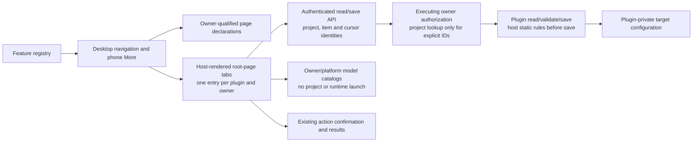

- `page.v1` contributes inert field schemas and trees. The frontend registry owns
  one generic route and a navigation entry per plugin/owner. Declared root pages
  become host-generated tabs, with the plugin display name in navigation and
  page labels on tabs. The registry contains no pentest-specific
  storage or executable plugin content.
- Page 1.1 adds bounded collections and detail properties rendered with shared
  tables and controls. Item links preserve owner/project identity. The owner reads
  the current schema, checks the revision and static rules, then runs an optional
  validation hook before saving. Errors retain browser drafts; failed validation
  never dispatches a save. See the [contribution guide](../features/plugin-contributions.md).
- Page 1.2 adds plugin-local homepages with the `page.plugin` grant. These read
  one plugin-owned registry without project enumeration. Collection links can
  enter an owner-validated project editor; project actions retain their existing
  authorization and model-session context. Project-scoped pages remain unchanged.
- Page 1.3 model fields reuse the native searchable picker. Model catalog reads
  use owner-routed PluginOperation calls and each platform's directory-free
  catalog, preserving platform-qualified selections and failing closed offline.
- Page 1.4 adds bounded summary cells with secondary text and additional-item
  counts, plus enumerated severity badges. The host owns presentation and links
  first-column summaries to existing item routes, or an opt-in right drawer.
  Drawers fetch owner/project-qualified item details only while open, cancel
  pending reads on close, and preserve the underlying list and pagination.
  Older minors reject these displays and the drawer preference.
- Independent workspace editors use opaque workspace IDs instead of project
  ownership. Workspace actions run on the explicit plugin owner. Session 1.2
  model-only turns use host-created private workspace directories with tools
  denied, while linked repositories remain many-to-many scan sources.
- The owner checks approved declarations, enablement and the page's `page.project`
  or `page.plugin` grant under the lifecycle lock and resolves explicit opaque project IDs locally.
  Disabled, revoked and offline owners cannot silently reuse another owner's data.
- Plugins own private storage and secret redaction. Browser drafts remain local
  to the selected owner/project. Save is explicit and never automatically retried;
  the pentest consumer uses revision checks and atomic mode-0600 writes.
- Scan controls use the existing action broker, including disclosure and consent.
  Result trees use the existing bounded tree renderer.

### Managed session requests

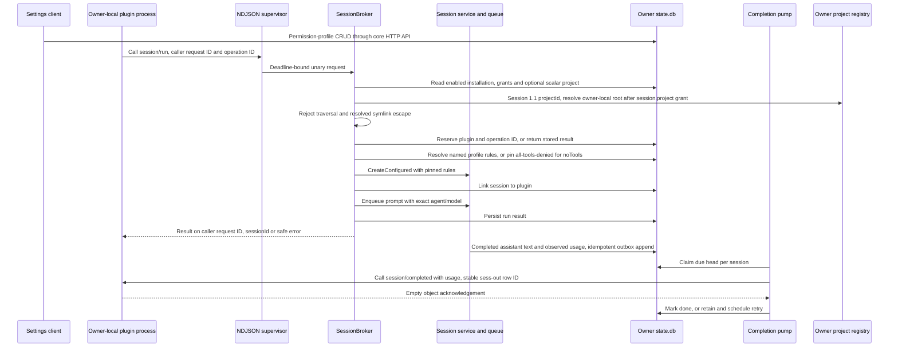

- `internal/pluginsmod/session.go` handles admission and the immediate
  result. The supervisor keeps separate request-ID sequences in each direction;
  IDs can overlap without confusing a run reply with a completed-turn reply.
  `session_runs.go` reserves each plugin's operation ID durably before creation
  and keeps its result across reloads. Conflicting payloads are rejected; pending
  receipts never start another session after an uncertain crash.
- Named permission profiles live in owner state. CreateConfigured applies their
  exact rules before the queue receives the plugin's prompt. Unknown or deleted
  names return `not_found` to the caller without creating a session.
- Session 1.1 can resolve an opaque owner-local project ID with the additional
  `session.project` grant instead of requiring a global project setting. It does
  not infer ownership from directories or fall back to another machine.
  `noTools` overrides profile rules with an all-tools-denied rule before prompt
  admission. Blank agent/model values preserve host defaults.
- `internal/pluginsmod/session_outbox.go` records and pumps completions. The durable
  mapping and AUTOINCREMENT outbox ID survive reopen. Pending deliveries replay
  after a crash, including one after the consumer's effect but before host ack.
  Consumers must durably deduplicate the stable operation ID.
- Observed tokens and cost are stored with the completion in the same outbox
  insert. Missing usage remains unknown across retries; it is never synthesized
  as free inference. The v2 compatibility converter marks synthesized UI defaults
  as unavailable, so a display zero cannot become observed zero-dollar usage.
  A new append-only module migration adds the metadata column.
- Only an empty JSON object acknowledges completion. Revocation pauses delivery
  without consuming attempts. Six failures retain a dead letter and block that
  session. Session retry/discard controls are still missing, so operator recovery
  does not yet match the conversation outbox's guarantees.
