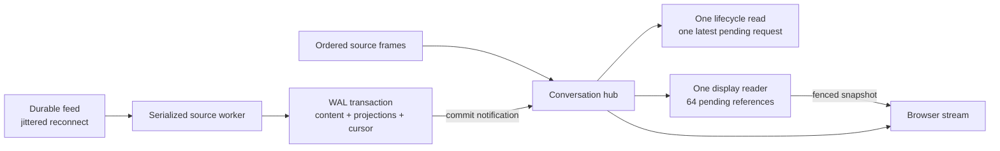

Conversation work has independent limits for live delivery, ingestion and SQLite.
No database durability setting changes to reduce load.



- Lifecycle settlement coalesces idle transitions while a read is in flight.
  Only the latest pending request runs next. Lifecycle generations and source
  epochs fence stale results; detaching or stopping workers prevents trailing work.
- Cursorless display snapshots run outside the frame-delivery lock. One reader
  batches up to 64 pending references. Ordered part updates, deltas, removals and
  history rewrites invalidate older snapshots. Closing the source cancels and
  joins its display reader. These snapshots never establish delta anchors.
- `statev2.ApplyStream` compares persisted projection inputs inside the writer
  transaction before upserts. Unchanged session and message envelopes with
  non-tool part updates skip sidebar and analytics-summary rebuilding. New or
  changed metadata, tool transitions and removals retain the required rebuilds.
  Missing projections are repaired. Content, compact analytics rows, outbox,
  revision and checkpoint still commit atomically with `synchronous=FULL`.
- Failed feed watches retry exponentially from two seconds, with 25% jitter and
  a 30-second cap. A connection lasting at least 30 seconds resets the delay.
  Explicit conversation read requests wake reconnect immediately and get a
  serialized read even during background retry cooldowns. Ordinary activity and
  feed notifications cannot bypass reconnect backoff.

## Diagnostics

Both conversation pools register database/sql metrics with `db.name=statev2`
and `db.name=statev2-read`. These expose pool connections, wait counts and wait
duration. Closing the store unregisters both callbacks.

`ocman.conversation.work.duration` records seconds and
`ocman.conversation.work.items` records admitted items per operation. Fixed
`phase` values identify `settle`, `display`, `watch`, `drain` and `commit`;
`outcome` is `ok` or `error`. A display item is a batched part reference, a
commit item is a session batch, and a drain item is a pending change or dirty
identity. No session IDs, directory names, source addresses or error text enter
these labels. Compare durations with pool waits to distinguish source latency
from writer admission pressure.

## Reproducing database measurements

Run the same benchmark fixture on the base and changed revisions:

```sh
go test ./internal/statev2 -run '^$' -bench '^BenchmarkStreamTextUpdate$' -benchtime=30x -count=3
```

The benchmark opens temporary WAL databases with production durability, seeds
100, 2,000 and 10,000 messages, and commits 30 updates per sample group. It
reports p50 and p95 for part-only updates, unchanged feed envelopes, and changed
session timestamps. The last case is a control: changed projection inputs still
need their projections rebuilt. These numbers describe the measured operation,
not whole-backend throughput or production crash frequency.
