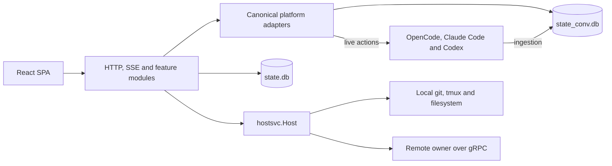

## Architecture

Ocman serves an embedded React SPA from one Go binary. Platform adapters own
agent execution and history ingestion; application browsing reads retained
conversation history. Host operations route to the machine that owns the
project. See [Architecture](architecture.md) for the full diagrams and
[Session and event architecture](architecture-events.md) for event contracts.

## Project structure

| Path | Responsibility |
| --- | --- |
| `main.go`, `internal/app/` | Entrypoint, flags, startup, database selection and application composition |
| `frontend/`, `frontend/e2e/` | React/TypeScript/Vite SPA and mocked Playwright suite |
| `internal/server/`, `internal/module/` | HTTP/static serving, feature composition, module lifetimes and event bus |
| `internal/platforms/` | Shared contracts, canonical adapters and OpenCode, Claude Code and Codex integrations |
| `internal/hostsvc/`, `internal/remote/` | Owner-routed host operations and remote gRPC transport |
| `internal/sessionsvc/`, `internal/sessionlifecycle/` | Shared session mutations and prepare/start lifecycle |
| `internal/db/` | Read-only OpenCode queries and shared analytics query adapters |
| `internal/state/` | Writable application state, settings and module schemas |
| `internal/statev2/`, `internal/conversationingest/` | Durable conversations, ingestion checkpoints, search and analytics projections |
| `internal/sidebar/` | Compact stored session-list reads |
| `internal/ocruntime/`, `internal/tmux/` | Managed runtime lifecycle and tmux process control |
| `internal/tasksvc/`, `internal/taskmod/` | Background work and task progress APIs |
| `internal/plugins/`, `internal/pluginsmod/`, `sdk/plugin/` | Native plugin protocol, management and SDK |
| `internal/webui/static/` | Embedded Vite output; build frontend before Go |
| `docs/`, `site/`, `spec/` | Published documentation, Hugo configuration and feature designs |

Repository contributors and coding agents should also read `AGENTS.md` and
its task-specific `.agents/` guides before changing an area.

## Development

### Requirements

- The Go version required by `go.mod` (currently Go 1.26.9).
- Node.js and pnpm versions pinned in `mise.toml` and `frontend/package.json`.
- [mise](https://mise.jdx.dev/) for the pinned tools (`mise install`).
- tmux on the owning machine for managed agents and in-app terminals.
- Hugo for documentation builds, also pinned in `mise.toml`.

Use pnpm for Node commands and keep `pnpm-lock.yaml` current.

### Database isolation before startup

Development must use disposable databases isolated to this checkout and branch.
A different port does not isolate data. Tests already use temporary stores.

**Current limitation:** `make dev*` selects a checkout-local `state_conv.db`,
but application startup still resolves `state.db` to the user's normal
`~/.local/share/ocman/state.db`. There is currently no application-state path
flag or environment override. Do not start these targets against your normal
account until an explicit state-path override is implemented and configured.
The OpenCode source and any managed agent's writable databases must also be
isolated. See `.agents/development.md` for the repository's isolation rules.

### Commands

The Makefile and `make help` are authoritative. Development startup targets
below require the isolation prerequisite above.

| Command | Description |
| --- | --- |
| `make dev` | Air backend on :8229 and Vite HMR on :8228 |
| `make dev-prod` | Air backend and Vite preview of a one-time production build |
| `make dev-prod-watch` | Air backend and Vite preview with automatic rebuilds; manually refresh the browser |
| `make dev-backend` | Air backend only, :8229 |
| `make dev-frontend` | Vite only, :8228; API calls proxy to :8229 |
| `make test` | Go, Vitest and development-script tests |
| `make test-e2e` | Build frontend and run the separate Playwright suite |
| `make test-all-fast` | Go, frontend and Playwright in parallel, each stopping at its first failure |
| `make lint` | Go vet, golangci-lint, TypeScript, ESLint, Stylelint and repository guards |
| `make build` | Frontend build followed by Go binary build |
| `make docs-build` | Build the published documentation into `site/public/` |
| `make clean` | Remove the binary, `tmp/` and embedded frontend assets; older dev history may still be under `tmp/` |

Vite preview has no HMR. Air rebuilds Go but does not rebuild embedded frontend
assets. Use Vite for frontend iteration or rebuild the frontend before rebuilding
Go. Keep the tracked `internal/webui/static/robots.txt` placeholder so clean
checkouts can compile the embed declaration.

## Tests and coverage

Go tests live beside their code; frontend unit tests use Vitest. Playwright
specs in `frontend/e2e/` mock the API and run in parallel against a frontend-only
server, without starting the backend or real agents. CI runs all three suites.

New behavior needs tests, and bug fixes need a regression observed failing
before the fix. For code changes, run relevant tests and `make lint`; before
committing, collect coverage and compare it with the baseline as described in
`.agents/testing.md`. Coverage must not drop. Documentation-only changes need
link checks and `make docs-build` when published content changes.

## Platform-agnostic frontend

Gate UI behavior through `/api/capabilities` and `useCapabilities()`, rather
than platform-name comparisons. Reuse the shared controls and design tokens.
Feature pages, navigation and settings register in `frontend/src/features/`.

## Forge workflow

This repository is hosted on Forgejo. Use `tea`, with `--repo dries/ocman` when
repository detection is unavailable. Keep history linear: fetch and rebase;
integrate pull requests by squash, rebase or fast-forward. Never create merge
commits or force-push without explicit permission.
