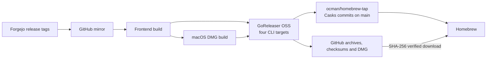

ocman releases in three channels. All tags are created on Forgejo, and
nightly and stable builds are published on the
[GitHub mirror](https://github.com/ocman/ocman/releases).
Users can install stable, nightly or an exact tag with the
[shell installer](../introduction/installation.md).

| Channel | When | Tag | Published |
| --- | --- | --- | --- |
| Dev | Every push to `main` that passes CI and contains a releasable commit | `v0.274.0-dev.3` | Tag only. Build it locally with `git checkout v0.274.0-dev.3 && make build`. |
| Nightly | Daily at 03:23 UTC, or on demand, when a newer dev tag exists | `v0.274.0-nightly.20261107` | GitHub prerelease with binaries and the macOS DMG |
| Stable | On demand only | `v0.274.0` | GitHub release, marked latest |

A nightly always tags the nearest dev-tagged commit on `main`, so it ships a
commit that passed CI. A stable release promotes the nearest nightly on
`main`, and only once that nightly's GitHub release is published with every
asset, so it ships a build that nightly users could already run. "Nearest"
follows `main`'s history, not tag creation time, because CI runs can finish
out of order; a commit whose descendant is already tagged gets no dev tag.

## Files

- `.forgejo/workflows/ci.yml`: after the frontend, backend and end-to-end jobs pass on `main`, the **Dev Tag** job pushes an annotated `vX.Y.Z-dev.N` tag. It also tags the SDK module.
- `.forgejo/workflows/cut-release.yml`: creates nightly tags on a schedule and nightly or stable tags on demand.
- `scripts/release-tag.sh`: chooses the next tag for each channel. `make lint-release-scripts` runs its self-test.
- `scripts/check_published_release.py`: before a stable promotion, checks that the nightly's GitHub release is published on the same commit with every asset. Set the optional Forgejo secret **`GITHUB_MIRROR_TOKEN`** if anonymous GitHub API limits get in the way.
- `cliff.toml`: commit grouping, filtering, changelog formatting and version-bump policy. Its tag pattern matches stable tags only, so the version always bumps from the previous stable release.
- `.github/workflows/release.yml`: runs on GitHub when a nightly or stable tag arrives through the push mirror. It builds the frontend and macOS DMG, then runs GoReleaser to build CLI archives, publish the GitHub release and update the Homebrew tap. Notes come from the annotated tag message.
- `.goreleaser.yaml`: defines the four CLI targets, compatible archive names, checksums, desktop DMG attachment and stable/nightly casks. The OSS tool version is pinned in `mise.toml` and read by the release workflow.

## Versions and release notes

The next version comes from `git-cliff --bumped-version` since the previous
stable tag. Dev and nightly tags preview that version, and their counter or
date distinguishes builds of it.

Each tag's annotation holds its changelog:

- a dev tag lists the commits since the previous tag of any channel;
- a nightly lists the commits since the previous nightly or stable tag;
- a stable release lists every commit since the previous stable release.

## Homebrew tap

The separate [ocman/homebrew-tap](https://github.com/ocman/homebrew-tap)
repository holds generated casks pointing at GitHub archives, not source
builds. GoReleaser generates casks in this tap; tap updates never commit to
the application repository.

- GoReleaser builds CLI binaries with the frontend already embedded. It keeps
  the `ocman-{darwin,linux}-{amd64,arm64}.tar.gz` download names, now containing
  an executable named `ocman`, and adds `checksums.txt`. The shell installer
  also accepts the platform-suffixed executable names from older releases.
- Stable releases generate `Casks/ocman.rb`; nightly prerelease tags generate
  `Casks/ocman-nightly.rb`. Only the releasing channel changes. We use normal
  tagged prereleases, not GoReleaser Pro's `--nightly` feature.
- The release uses `GITHUB_TOKEN` to publish on `ocman/ocman` and the separate
  `HOMEBREW_TAP_TOKEN` to update the tap's `main` through GitHub's API.
  No scheduled refresh job or custom formula generator is needed.
- Casks install the CLI, not the desktop app, and conflict with the other
  channel. On macOS, a post-install hook removes quarantine from that CLI
  because it is not notarized. See the [installation security note](../introduction/installation.md#homebrew).

### One-time tap setup

1. Create the public GitHub repository `ocman/homebrew-tap`, initialized with
   a README and `main` as its default branch. It is not a Forgejo push mirror.
2. Create a fine-grained GitHub personal access token with resource owner
   `ocman`, repository access limited to `homebrew-tap`, and repository
   **Contents: Read and write**. Metadata read access is automatic. No Actions,
   Workflows or Administration write permissions are needed. Choose an expiry
   and renew the secret before it expires. Approve the token in the organization
   if its policy requires approval.
3. In the GitHub `ocman/ocman` repository, open **Settings → Secrets and
   variables → Actions** and add the repository secret `HOMEBREW_TAP_TOKEN`.
   Store the token there, not in the tap or Forgejo. The default `GITHUB_TOKEN`
   cannot write to a different repository.
4. Ensure tap rules allow that token's user to push to `main`. A rule requiring
   pull requests or checks would block direct cask updates unless that user
   has an explicitly configured bypass. No force-push permission is required.
5. Once this change has reached GitHub's `main`, cut a new nightly whose tag
   contains `.goreleaser.yaml`. Watch GitHub's **Release** workflow and confirm
   it creates `Casks/ocman-nightly.rb` in the tap. The first stable release
   creates `Casks/ocman.rb`. Actions need not be enabled in the tap itself.

Run `mise install goreleaser`, then `goreleaser check` to validate the config.
`python3 scripts/test_goreleaser.py` exercises it against disposable Go fixtures
with stable and nightly tags, without publishing. It checks all archives,
checksums, version stamping and generated casks. `make lint-release-scripts`
also runs these tests when GoReleaser is installed; GitHub always runs them
before publishing. See [installation](../introduction/installation.md#homebrew).

## Cutting a release

1. Open **Actions → Cut Release** on Forgejo and choose **Run workflow** on `main`.
2. Pick the `nightly` channel to publish the newest dev tag now, or `stable` to promote the newest nightly.
3. For a stable release, leave **version** empty to use the version the nightly previewed, or enter a newer `X.Y.Z`.
4. Watch the **Release** workflow on GitHub publish the build.

A stable release fails when the nightly is already part of a stable release,
its GitHub release is not published yet or lacks assets, or the version is
not newer than the latest stable tag. Wait for the GitHub build, or cut a
newer nightly, and try again.

## One-time setup

1. Create a Forgejo personal access token that can push tags and sync push mirrors for this repository. Mirror sync needs repository admin rights.
2. Save it as the Forgejo repository secret **`RELEASE_PAT`**.
3. Make sure the GitHub push mirror pushes tags and that its GitHub credential can trigger workflows. Enable GitHub Actions on the mirror.

The Forgejo jobs use `RELEASE_PAT` for checkout and push credentials, tag
lookups and mirror sync, falling back to the default automation token when
it is absent. Without mirror sync, tags reach GitHub at the mirror's next
interval, and the GitHub release waits until then.

## Commit format

Use Conventional Commits for changes that should drive versioning:

| Commit | Version change |
| --- | --- |
| `fix: correct tmux session lookup` | Patch |
| `perf: reduce session query work` | Patch |
| `refactor: simplify runtime lookup` | Patch |
| `feat: add project detail page` | Minor |
| `feat!: change session API shape` | Major |

A `BREAKING CHANGE:` footer also marks a breaking change. The configured bump
policy keeps feature bumps minor and breaking bumps major even before 1.0.
Routine `docs`, `test`, `ci`, `build`, `style`, `lint` and `chore` commits are
hidden from release notes and create no dev tag. Non-conventional messages
are filtered out.

Integrate changes onto `main` with linear history: squash, rebase or
fast-forward; no merge commits. There is no release PR.

## Troubleshooting

If no dev tag is created:

1. Confirm CI ran for a push to `main` and all three prerequisite jobs passed.
2. Inspect **Dev Tag** for a skipped version or a tag lookup or push error.
3. Check that commits since the previous `v*` tag match the visible types in `cliff.toml`.

If a nightly or stable tag exists but GitHub has no release:

1. Check that the tag reached GitHub. The **Sync push mirrors** step warns when it could not sync.
2. GitHub sends no push event when more than three tags arrive at once. Run the GitHub **Release** workflow by hand with the tag name.
3. Inspect the frontend, desktop packaging and GoReleaser publish jobs for failures. Re-running the workflow replaces the release notes and matching assets. It also repoints that channel's cask to the selected tag, so rerun the newest tag for that channel.
