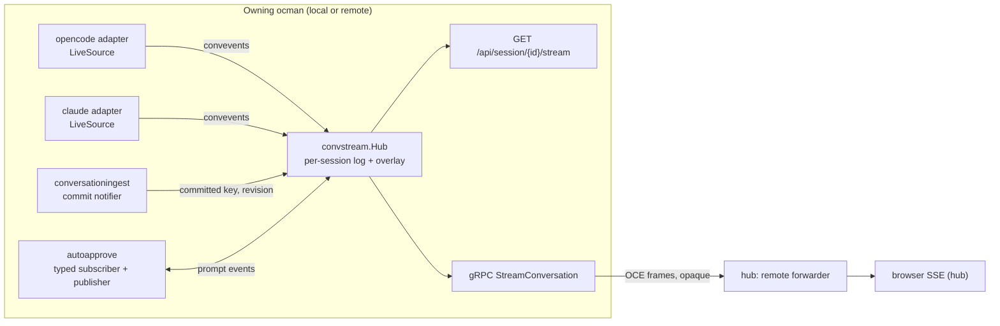
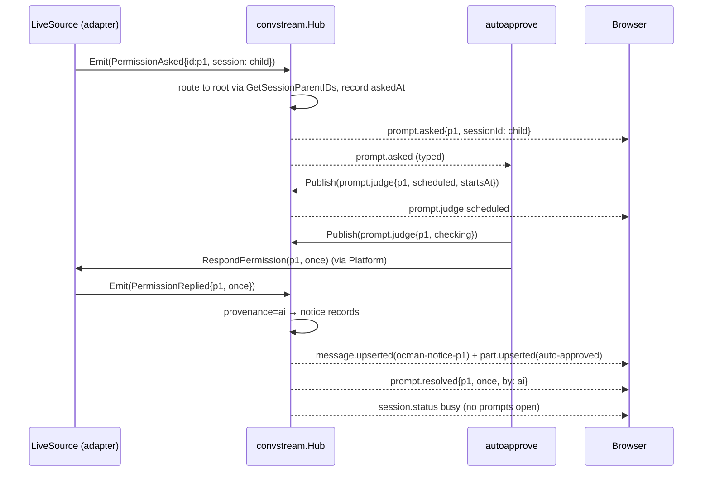
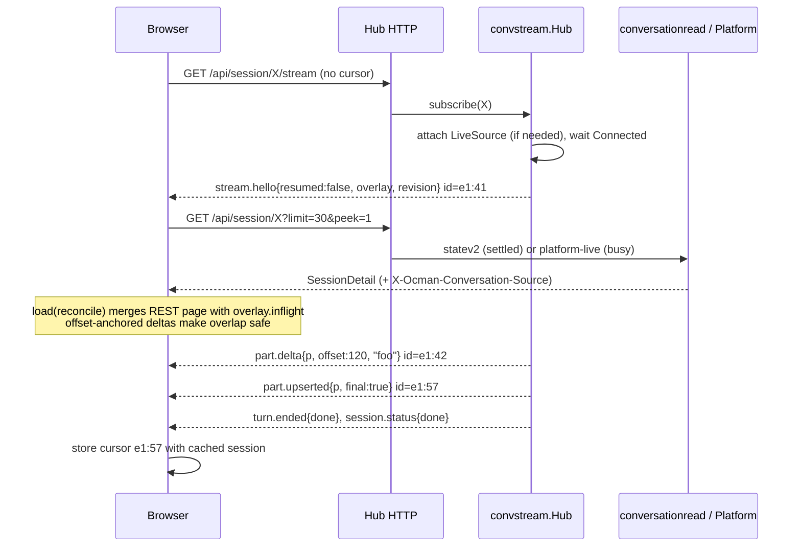
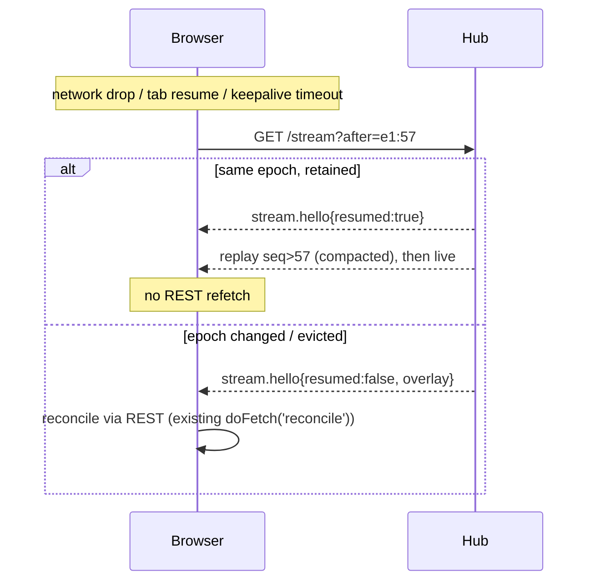

# Design: Ocman conversation events (OCE)

Status: proposal. Scope: the per-session browser stream, the owner-side
producer behind it, the hub↔remote transport, and the frontend reducer.
The global `/api/events` stream is covered in a section of its own but stays
a separate stream.

## 1. Summary

The browser currently reads OpenCode v1 event shapes, delivered by
`Platform.ProxyEvents`. OpenCode v1 events are proxied almost unchanged
(`internal/platforms/opencode/events.go`). OpenCode v2 events are translated
into v1 (`internal/ocv2/events.go`, `events_assistant.go`), and Claude Code
emits v1 shapes over the provider protocol (`internal/providerprotocol`). The
frontend reducer (`frontend/src/lib/sessionSseReducer.ts`,
`sessionPromptReducer.ts`, `sessionViewParts.ts`) and the stream client
(`frontend/src/pages/session-detail/sessionSse.ts`) parse those shapes
directly.

This design replaces that with an Ocman-owned, versioned event model:

- **One envelope**, with a per-session cursor `epoch:seq` and a small closed
  set of event types built on Ocman's message/part model (`db.Message`,
  `db.Part`, `statev2.Message/Part`, and the frontend `Message`/`Part`/`PartData`).
- **Three durability classes**, all in one ordered stream:
  - `durable`: upserts and removals that match what statev2 stores, or will
    store.
  - `live`: in-flight state that is real but not stored, such as status,
    prompts, background tasks and the queue.
  - `ephemeral`: token deltas, anchored by character offset so that
    replaying them is idempotent.
- **One producer per owner**, `convstream.Hub`. It merges adapter live streams
  (low latency, no wait for ingestion) with statev2 ingestion commits,
  keeps a bounded per-session replay log, and serves both browsers and
  in-process consumers (auto-approve, git hints).
- **Remotes forward OCE frames verbatim** over a new gRPC RPC. The hub does
  not parse platform shapes. Older remotes that only offer `StreamEvents` are
  bridged on the hub using the same v1→OCE mapper the owner uses.
- **One platform-agnostic frontend reducer** that produces the existing
  `SessionView` shape, so components keep working unchanged. Delta batching
  is moved before the reducer, and an indexed part store prevents a re-render
  for every token.

The migration starts with the frontend, as the user asked. The first backend
step is a single **v1→OCE mapper** placed in front of the existing
`ProxyEvents` byte stream. All three sources already speak v1, so one mapper
moves every platform to OCE at once. Later steps replace the v1 hop with
native mappers and connect durable ingestion.

---

## 2. What the frontend consumes today (inventory)

Taken from `NAMED_CHANNELS` in `sessionSse.ts`, the `reduceSseEvent` switch,
`sessionActivity()`, the `flush()` dirty rules, and `useSession.ts`.
Every row must have an OCE replacement (see §4.9).

| Current event (session stream) | Consumer | Effect today |
| --- | --- | --- |
| `server.connected` `{backgroundTasks, backgroundTaskDetails}` | `reduceBackgroundTaskCount` | seeds background count and tasks for this session |
| `ocman.session.background` `{count, tasks}` | `reduceBackgroundTaskCount` | absolute background count and tasks |
| `message.created` / `message.updated` `{info, parts?}` | `reduceMessageSnapshot` via `extractMessageFromEvent` | upserts message (role defaults to `assistant`), upserts parts, skips `step-start`/`step-finish`/`snapshot`, truncates big fields |
| `message.part.updated` `{part}` | `reducePartSnapshot` | upserts part; creates a stub assistant message; a running or pending tool marks the session busy and bumps `_statusRevision`; an answered question tool part clears `pendingQuestion` |
| `message.part.delta` `{messageID, partID, field, delta}` | `reducePartDelta` / `applyDelta` | appends to `text` or `state.output`; marks the field delta-owned; stubs the message and part; marks busy |
| `session.status` `{status: {type, attempt?, message?, next?, resetsAt?}}` | `reduceSessionStatus` | idle→done, retry→busy plus retry notice, `limited` plus `resetsAt`; clears notices; idle requests a refetch and clears background |
| `session.idle` | `reduceSessionIdle` + `sessionActivity` | done; clear background; refetch; deduplicated against the twin `session.status idle` |
| `session.diff` | `flush()` | bump `changesDirtyTick`; reconcile after 500 ms |
| `ocman.session.changed` | `flush()` | bump `changesDirtyTick` (commit recorded) |
| `message.part.updated` with tool ∈ {edit, write, mcp_edit, …} | `flush()` | bump `changesDirtyTick`. This is a platform-specific tool-name list in the browser. |
| `permission.asked` | `reducePermissionAsked` | `pendingPermission`; resets judge state |
| `permission.replied` `{requestID}` | `reducePermissionReplied` | clears the matching prompt and judge state |
| `ocman.permission.pending` `{permissionId, judgeStartsAt}` | `reducePermissionPending` | judge countdown |
| `ocman.permission.checking` `{permissionId}` | `reducePermissionChecking` | judge spinner |
| `ocman.permission.flagged` `{permissionId, reasoning}` | `reducePermissionFlagged` | judge reasoning on the prompt |
| `ocman.permission.auto-approved` / `.approved` | `reducePermissionAutoApproved` | synthesizes the `ocman-notice-<id>` message and part; clears the prompt |
| `question.asked` | `reduceQuestionAsked` | `pendingQuestion` |
| `question.replied` / `question.rejected` | `reduceQuestionCleared` | clears the matching question |
| `tool`, `error`, `permission`, `question`, `approval`, default channel | `reduceSseEvent` default branch | best-effort recovery of `info`/`part` payloads |
| `ocman.keepalive` (named, 15 s) | `watchKeepalive` | replace the stream after 40 s of silence |
| any `sessionID` ≠ page session | `reduceSessionView` `sse` case | dropped (child prompts reach the page through `usePromptSync` / sidebar) |

Client actions that are not events but interact with the stream:
- `load` with `replace` or `reconcile` (`reconcileLoad` merges by id and
  applies the delta-ownership rule).
- `setPendingPermission` (reverse sync from the sidebar, guarded by `ownerIds`).
- `addNotice`, `clearPrompt` and `patchSession`.
- The live-status fence: `_statusRevision` and `_statusFresh` (a REST response
  must not overwrite a newer live status).
- Pagination: `loadMore` and `hydrateHistory`.

Global stream (`frontend/src/lib/useGlobalEvents.ts`), kept as a sibling (§9):
`ocman.session.changed`, `.activity`, `.idle`, `.start.progress`,
`ocman.permission.resolved`/`.flagged`, `ocman.question.resolved`,
`ocman.queue.updated`, `ocman.inbox.changed`, `ocman.projects.changed`,
`ocman.git.command`, `ocman.artifact.created`, `ocman.settings.changed`,
`ocman.keepalive`.

Not consumed today, but needed by the model:
- v2 retry, compaction, revert and session metadata events. Today these
  arrive as v1 `session.updated` or as `emitRecent` re-sends that the browser
  ignores or treats as upserts.
- Queue changes on the session stream (`ocman.queue.changed`, used only by the
  Tee).
- Child session status: `useSubagentTracking` polls `api.task` every 2 s.

---

## 3. Design principles and constraints

1. **The frontend is platform-agnostic.** It never sees `info`/`properties`
   or the v1/v2 part-type quirks of an event. It gates behavior on
   `/api/capabilities` (see `.agents/frontend.md`). Moving the
   edit/write tool-name list from `sessionSse.ts` to the backend is part of
   this goal.
2. **Streaming never waits for ingestion.** Token deltas go straight from the
   adapter's live source to subscribers. Ingestion runs concurrently and
   commits later.
3. **The part payload is Ocman's existing `PartData`.** REST, statev2
   (`conversationread.Convert`), the Claude converter and
   `ocv2.ConvertMessage` already agree on `db.Part.Data`. OCE adopts it as the
   Ocman part schema (§4.3) instead of inventing a second one. It becomes a
   versioned contract checked by `internal/frontendcontract`.
4. **Status is settled in one place.** `db.SettleSessionStatus` remains the
   single decision point. The hub settles terminal kinds on the owner. The
   browser no longer maps `idle→done` and waits for a refetch to learn whether
   the result was `error`.
5. **Owner-local production, hub forwarding.** This follows
   `.agents/remotes-and-forges.md`: explicit owners fail closed (503). The hub
   only forwards frames and never runs a judge for remote sessions (AD-14 in
   `handlers_session_events.go`).
6. **Module rules.** `convstream` is a module (`internal/module`). It is
   registered in `Server.modules()`, receives narrow `Deps`, and has workers
   joined in `Run` before `state.db`/`statev2.db` close. It does not import
   `internal/server`.
7. **Never edit shipped migrations.** Any statev2 change is a new entry
   appended to `internal/statev2/schema.go`.

---

## 4. The event model

### 4.1 Envelope

Every frame on the wire is one envelope. It is sent as SSE `event: oce`,
with `id: <epoch>:<seq>` and `data: <json>`. The named `ocman.keepalive`
frame has no id, so heartbeats never move the cursor.

```ts
// frontend/src/lib/conversation/events.ts
export const OCE_VERSION = 1;

export type Durability = 'durable' | 'live' | 'ephemeral';

export interface OceEnvelope<E extends OceEvent = OceEvent> {
  v: 1;
  /** Stream epoch: owner process + session log generation. A change means "resume impossible". */
  epoch: string;
  /** Monotonic per (epoch, session). Absent only on stream.hello for an empty log. */
  seq: number;
  /** The session this stream is about (the page session, never a child). */
  sessionId: string;
  /** Owner-qualified platform id, e.g. "opencode" or "r-<remote>:claudecode". */
  platform: string;
  /** Owner wall clock, Unix ms. Informational; ordering uses seq. */
  at: number;
  durability: Durability;
  /** Set on replays of lifecycle edges the owner already acted on (provider `acknowledged`). */
  replayed?: boolean;
  event: E;
}
```

```go
// internal/convevents/envelope.go
package convevents

const Version = 1

type Durability string

const (
	Durable   Durability = "durable"
	Live      Durability = "live"
	Ephemeral Durability = "ephemeral"
)

type Envelope struct {
	V          int        `json:"v"`
	Epoch      string     `json:"epoch"`
	Seq        uint64     `json:"seq"`
	SessionID  string     `json:"sessionId"`
	Platform   string     `json:"platform"`
	At         int64      `json:"at"`
	Durability Durability `json:"durability"`
	Replayed   bool       `json:"replayed,omitempty"`
	Event      Event      `json:"event"` // marshals as {"type": ..., ...fields}
}

// Event is a closed, sealed set. Unknown types decode to Unknown and are
// ignored by consumers (forward compatibility within v1).
type Event interface {
	EventType() string
	durability() Durability
}
```

The cursor is the string `"<epoch>:<seq>"`. The `seq` is a JSON number.
It stays below 2^53 because it resets with each epoch.

### 4.2 Event taxonomy

| Type | Durability | Purpose |
| --- | --- | --- |
| `stream.hello` | live | First frame of every connection: protocol, cursor, resume result, live overlay |
| `stream.reset` | live | The server cannot continue the cursor (epoch changed, log evicted, slow consumer). Client must reconcile. |
| `stream.error` | live | Non-fatal source problem, e.g. platform unreachable mid-stream or remote offline |
| `message.upserted` | durable | Full message envelope (no parts) |
| `message.removed` | durable | Message no longer visible (deleted, reverted, superseded) |
| `part.upserted` | durable | Full part, with a `final` flag |
| `part.removed` | durable | Part no longer visible |
| `part.delta` | ephemeral | Offset-anchored append to `text`, `tool.input` or `tool.output` |
| `session.status` | live | Level: the closed `SessionStatus` set plus notice, `resetsAt` and a provisional flag |
| `turn.started` / `turn.ended` | live | Edges; `turn.ended` carries the settled outcome |
| `session.updated` | durable | Metadata patch: title, agent/model selection, summary, revert marker, share URL |
| `history.rewritten` | durable | Compaction, revert commit, fork or unknown-range resync. Client must reconcile the range |
| `history.committed` | durable | statev2 committed revision R for this session (bookkeeping, no content) |
| `prompt.asked` | live | Permission or question prompt, including prompts surfaced from descendants |
| `prompt.judge` | live | Auto-approve progress: scheduled, checking or flagged |
| `prompt.resolved` | live | Prompt gone, with outcome and actor |
| `queue.changed` | live | Full held-message list for the session (ocman queue or native inbox) |
| `background.changed` | live | Absolute background task count and list |
| `child.upserted` | durable | Descendant session row summary (id, parent, title, agent) |
| `child.status` | live | Descendant status level, enough to drive subagent indicators without polling |
| `changes.dirty` | live | File changes or commit observations may have changed. Bump the Changes sidebar |
| `session.error` | durable | Turn or provider error attached to a message (for display only; status settles separately) |

Heartbeats stay as the named `ocman.keepalive` SSE event (`httpx.SSEKeepalive`)
and are not envelopes.

### 4.3 Message and part payloads

The payloads are the existing frontend `Message` and `Part`
(`frontend/src/lib/api.types.ts`), mirrored by `db.Message` and `db.Part`
(`internal/db/types.go`). One wire tightening: `Part.data` is always an
object, never a JSON string.

```ts
import type { Message, PartData, SessionStatus, SessionNotice } from '../api';

/** Ocman's part schema; identical to REST Part except data is always an object. */
export interface OcePart {
  id: string;
  messageId: string;
  sessionId: string;   // the asking session; equals envelope.sessionId on root streams
  timeCreated?: number;
  /** Source-defined ordering inside the message (statev2 Part.Position) when known. */
  position?: number;
  data: PartData;      // `type` discriminates: text | reasoning | tool | file | patch | agent | subtask | compaction | auto-approved | ...
}

export interface MessageUpserted { type: 'message.upserted'; message: Message; position?: number }
export interface MessageRemoved  { type: 'message.removed'; messageId: string; reason: 'deleted' | 'reverted' | 'superseded' }
export interface PartUpserted {
  type: 'part.upserted';
  part: OcePart;
  /** True once the part can no longer grow (text ended, tool completed or errored,
   *  reasoning completed, message completed). Final upserts replace local
   *  streaming fields unconditionally. */
  final: boolean;
}
export interface PartRemoved { type: 'part.removed'; messageId: string; partId: string }

export type DeltaField = 'text' | 'tool.input' | 'tool.output';
export interface PartDelta {
  type: 'part.delta';
  messageId: string;
  partId: string;
  field: DeltaField;
  /** Character (UTF-16 code unit) offset of `text` within the field. */
  offset: number;
  text: string;
  /** Part type hint so a client can create a correct stub ('text' | 'reasoning' | 'tool'). */
  partType?: string;
}
```

`DeltaField` maps to `PartData` paths as follows. `text` → `data.text`;
`tool.output` → `data.state.output`; `tool.input` → `data.state.raw`, a new
optional string holding the streamed JSON arguments before `state.input` is
parsed. The frontend's `STREAMING_FIELDS` set becomes this mapping. The
renderer only displays `tool.input` while a tool is `pending` or `streaming`.

Lifecycle part types (`step-start`, `step-finish`, `snapshot`) never reach
the wire. The mapper filters them out, which matches the filter in
`extractMessageFromEvent` and `reducePartSnapshot` (§2) and the backend
converters. Step accounting (tokens, cost, finish) is carried on
`message.upserted`.

```go
// internal/convevents/content.go
type MessageUpserted struct {
	Message  db.Message `json:"message"`
	Position *int64     `json:"position,omitempty"`
}
type MessageRemoved struct {
	MessageID string `json:"messageId"`
	Reason    string `json:"reason"`
}
type PartUpserted struct {
	Part  Part `json:"part"`
	Final bool `json:"final"`
}
type Part struct {
	db.Part                  // data must be a JSON object
	Position *int64 `json:"position,omitempty"`
}
type PartRemoved struct{ MessageID, PartID string } // json: messageId, partId
type PartDelta struct {
	MessageID string `json:"messageId"`
	PartID    string `json:"partId"`
	Field     string `json:"field"` // text | tool.input | tool.output
	Offset    int    `json:"offset"`
	Text      string `json:"text"`
	PartType  string `json:"partType,omitempty"`
}
```

Go computes `offset` in UTF-16 code units (`utf16.RuneLen` summed), so it
matches `String.prototype.length` in the browser. Replay correctness depends
on this (§5.2).

### 4.4 Lifecycle

```ts
export interface SessionStatusEvent {
  type: 'session.status';
  status: SessionStatus;           // 'busy' | 'waiting' | 'limited' | 'done' | 'error' | 'interrupted'
  /** True when an idle edge was seen but the terminal kind is not settled yet. */
  provisional?: boolean;
  /** null clears any notice; undefined leaves it unchanged. */
  notice?: SessionNotice | null;   // kind: 'retry' | 'rate_limit' | 'provider_overloaded' | 'model_switch' | 'models_exhausted' | string
  resetsAt?: number;               // only with status 'limited'
}
export interface TurnStarted { type: 'turn.started'; startedAt: number; messageId?: string }
export interface TurnEnded {
  type: 'turn.ended';
  outcome: 'done' | 'error' | 'interrupted';
  endedAt: number;
  latestMessageId?: string;
}
```

Rules:
- Retry or backoff (v1 `status.type=retry`, v2 `session.retry.scheduled`)
  becomes `session.status {status:'busy', notice:{kind:'retry', attempt,
  retryAt, message}}`. This replaces `retryNotice()` in the reducer.
- `limited` (Claude, `opencode-rate-limit-surfacing`) becomes
  `session.status {status:'limited', resetsAt}`. An idle edge while limited is
  suppressed, which matches the `limited[sessionID]` guard in
  `provider.streamURL`.
- `waiting` is emitted by the hub whenever a prompt is open for the session
  or a descendant (`db.GetSessionParentIDs` routing). A status level is no
  longer derived from prompts in the browser.
- On an idle edge the hub immediately emits
  `session.status {status:'done', provisional:true}` and clears background.
  It then settles through `platforms.LifecycleReader.SessionLifecycle`
  (bounded, no parts) and emits `turn.ended {outcome}` plus a non-provisional
  `session.status`. The provisional level keeps today's latency, and the
  settled one removes the "refetch to learn it was an error" dependency.
- Busy inference from tool parts (`reducePartSnapshot`) and deltas
  (`reducePartDelta`) moves into the hub. The hub emits
  `session.status busy` on the first running part or delta of a turn if it
  has not already done so. The browser stops inferring status.

### 4.5 Prompts

```ts
export interface OcePrompt {
  id: string;
  kind: 'permission' | 'question';
  /** The session that asked (may be a descendant of envelope.sessionId). */
  sessionId: string;
  askedAt: number;                 // first observation, from the owner's state.db receipt
  permission?: { permission: string; patterns: string[]; always?: string[]; metadata?: Record<string, unknown> };
  question?: { questions: QuestionItem[] };   // components/session/QuestionPrompt.tsx
}
export interface PromptAsked { type: 'prompt.asked'; prompt: OcePrompt }
export interface PromptJudge {
  type: 'prompt.judge';
  promptId: string;
  phase: 'scheduled' | 'checking' | 'flagged';
  startsAt?: number;               // scheduled
  reasoning?: string;              // flagged
}
export interface PromptResolved {
  type: 'prompt.resolved';
  promptId: string;
  kind: 'permission' | 'question';
  outcome: 'once' | 'always' | 'reject' | 'answered' | 'dismissed' | 'cancelled';
  by: 'user' | 'ai' | 'rule' | 'external';
}
```

The auto-approved notice is no longer synthesized in the reducer
(`reducePermissionAutoApproved`, `addNotice`). The hub emits a
`message.upserted` with role `notice` and id `ocman-notice-<permissionId>`,
plus its `part.upserted` (`type:'auto-approved'`), immediately before
`prompt.resolved {by:'ai'}`. This is the same synthetic record the owner
already injects into history reads ("inject persisted history notices" in
`docs/other/architecture-events.md`), so REST and stream agree by id.
`AutoApprovedNoticePayload` stays as the data shape.

### 4.6 Queue, background, children, metadata, changes

```ts
export interface QueueChanged      { type: 'queue.changed'; messages: QueuedMessage[] }
export interface BackgroundChanged { type: 'background.changed'; count: number; tasks: BackgroundTask[] }
export interface ChildUpserted     { type: 'child.upserted'; child: Pick<Session, 'id' | 'parentId' | 'title' | 'timeCreated' | 'timeUpdated'> & { agent?: string } }
export interface ChildStatus       { type: 'child.status'; childId: string; status: SessionStatus; notice?: SessionNotice | null }
export interface SessionUpdated {
  type: 'session.updated';
  patch: Partial<Pick<Session, 'title' | 'summaryAdditions' | 'summaryDeletions' | 'summaryFiles' | 'shareUrl' | 'archived'>> & {
    defaultAgent?: string; defaultModel?: string;
    revert?: { messageId: string; partId?: string } | null;
  };
}
export interface HistoryRewritten {
  type: 'history.rewritten';
  reason: 'compaction' | 'revert' | 'fork' | 'resync';
  /** Oldest message that may have changed; absent means the whole session. */
  fromMessageId?: string;
}
export interface HistoryCommitted { type: 'history.committed'; revision: number }
export interface ChangesDirty     { type: 'changes.dirty'; reason: 'edit' | 'diff' | 'commit' }
export interface SessionError     { type: 'session.error'; messageId?: string; error: { name?: string; message: string; statusCode?: number } }
```

`changes.dirty` replaces three browser rules at once: the `session.diff`
handling, the edit/write tool-name list and `ocman.session.changed` on the
session stream. The backend decides with `convertToolPart`-equivalent tool
classification, once.

### 4.7 Stream control

```ts
export interface LiveOverlay {
  status: SessionStatusEvent;
  prompts: OcePrompt[];
  judge: PromptJudge[];
  background: BackgroundChanged;
  queue?: QueueChanged;            // present when the owner can read it cheaply
  /** Messages and parts of the in-flight turn as the live source sees them.
   *  Small by construction: only the current turn, not history. */
  inflight: { messages: Message[]; parts: OcePart[] };
  liveConnection: boolean;
}
export interface StreamHello {
  type: 'stream.hello';
  protocol: 1;
  /** True when `after` was honoured and replay follows; false means reconcile. */
  resumed: boolean;
  /** Present when !resumed (and always on a cold connect). */
  overlay?: LiveOverlay;
  /** Latest statev2 revision known to the owner for this session, 0 if none. */
  revision: number;
}
export interface StreamReset { type: 'stream.reset'; reason: 'epoch' | 'evicted' | 'slow-consumer' | 'source-restarted' }
export interface StreamError { type: 'stream.error'; code: 'platform-unreachable' | 'owner-offline' | 'auth' | 'internal'; message: string; retryable: boolean }

export type OceEvent =
  | StreamHello | StreamReset | StreamError
  | MessageUpserted | MessageRemoved | PartUpserted | PartRemoved | PartDelta
  | SessionStatusEvent | TurnStarted | TurnEnded | SessionUpdated
  | HistoryRewritten | HistoryCommitted
  | PromptAsked | PromptJudge | PromptResolved
  | QueueChanged | BackgroundChanged | ChildUpserted | ChildStatus | ChangesDirty | SessionError;
```

Go mirrors each type in `internal/convevents/*.go`. A table in
`convevents/registry.go` maps each type string to its constructor and
durability, and the envelope's `MarshalJSON`/`UnmarshalJSON` uses it.
`internal/frontendcontract` adds those structs to `go-dtos.json`, so
`frontend/src/lib/contracts/contracts.test.ts` fails when TS and Go drift.

### 4.8 Capabilities

The stream is the same for every platform. Capability flags only describe
what may appear:
- `caps.events` (existing) gates the stream itself.
- New `caps.streamResume`: the owner retains a replay log, so `after` can be
  honoured. It is false for hub-bridged legacy remotes, which can only send
  `resumed:false`.
- New `caps.deltaFields: DeltaField[]`: the fields the source streams. Today
  that is `['text','tool.output']` for OpenCode v1/v2 and `['text']` for
  Claude. The UI uses it to decide whether to show a "streaming input"
  affordance for tool arguments.
- `caps.pushPrompts` (existing) keeps its meaning: prompts and resolutions
  are guaranteed on the stream, so the dismissal polling described in
  `architecture-events.md` can be skipped.

### 4.9 Inventory mapping (current → OCE)

| Current | OCE |
| --- | --- |
| `server.connected` background snapshot | `stream.hello.overlay.background` |
| `ocman.session.background` | `background.changed` |
| `message.created`/`message.updated` | `message.upserted` + one `part.upserted` per included part |
| `message.part.updated` | `part.upserted` (`final` computed by the mapper) |
| `message.part.delta` | `part.delta` with `offset` |
| `session.status` idle/busy/retry/limited | `session.status` (+`turn.started`/`turn.ended` edges) |
| `session.idle` | `turn.ended` + `session.status` (provisional, then settled) |
| `session.diff`, edit/write part rule, commit `ocman.session.changed` | `changes.dirty` |
| `permission.asked`/`question.asked` | `prompt.asked` |
| `permission.replied`/`question.replied`/`question.rejected` | `prompt.resolved` |
| `ocman.permission.pending`/`checking`/`flagged` | `prompt.judge` |
| `ocman.permission.auto-approved`/`approved` | notice `message.upserted` + `part.upserted` + `prompt.resolved {by:'ai'|'user'}` |
| Answered question tool part clears the prompt | The hub emits `prompt.resolved {by:'external'}` when it sees the answered tool part. The rule moves out of the browser. |
| `tool`/`error`/default-channel recovery | removed; the mapper normalizes every recognised shape once |
| `ocman.keepalive` | unchanged |
| foreign `sessionID` | Never sent as content. Descendant prompts arrive as `prompt.asked` with `prompt.sessionId` = child. Descendant status arrives as `child.status`. |

---

## 5. Durable vs ephemeral semantics

### 5.1 Durable events and statev2

A durable event describes a record that statev2 stores or will store under
the same identity. `message.upserted.message` is exactly what
`conversationread.Convert` would return for that message id at the
corresponding revision, and the same holds for parts. Two producers emit
durable events:

1. **The live source** (adapter). It emits upserts as the platform publishes
   them. These run ahead of statev2, because ingestion reads the platform
   after its events (`conversationingest/feed.go` `applyChange` reads
   `HistoryMessages` for the named message ids).
2. **Ingestion commits.** After `statev2.ApplyStream` or `Commit` for session
   S at revision R, the hub always emits `history.committed {revision: R}`.
   When no live source is attached for S (§6.3), it also emits the committed
   records as upserts with `final:true`.

Consistency invariant: **for a settled session, the fold of all durable
events equals the statev2 snapshot at the latest `history.committed`
revision.** For a busy session, durable events may run ahead of statev2,
never behind it. The browser's reconcile-on-turn-end (§7.3) closes any
divergence.

`message.removed`/`part.removed` correspond to `StreamBatch.RemovedMessages`
/ `RemovedParts`, which are retained as `source_deleted` and are not visible.

### 5.2 Ephemeral deltas and reconciliation

The hub keeps an **overlay** for each streaming part: the accumulated value
for each `DeltaField` and whether that value is anchored. Before publishing a
delta, the hub sets `offset = len(accumulated)` and then appends to the
accumulated value.

The client applies `part.delta` as follows (pure, in `conversationReducer.ts`):

```
cur = field value of part (or "" if no part, creating a stub with partType)
if offset == len(cur):            cur += text                       // normal
elif offset <  len(cur):          overlap = len(cur) - offset
                                  if overlap < len(text): cur += text[overlap:]  // replay overlap
                                  else: no-op                                   // fully seen
else /* offset > len(cur) */:     mark part.stale; do not append                // gap
```

Then `part.upserted` resolves the part:
- `final:true` replaces the whole part, streaming fields included, and
  clears `stale`. This is the user's example: deltas accumulate, and the
  final upsert with the full text replaces them even if it is shorter, for
  instance after trimming.
- `final:false` replaces non-streaming fields. For each streaming field it
  keeps whichever of local and snapshot is longer, the current
  `upsertSnapshotPart` rule, and it clears `stale` when the snapshot is at
  least as long as the local value.

A stale part that receives no upsert within 2 s, or by `turn.ended`, triggers
one reconcile fetch, coalesced per session.

These rules replace `_deltaOwnedFields`, `seedDeltaOwnedFields` and most of
the ownership comments in `sessionReducer.ts`. Offsets make replay
idempotent, so overlapping a REST snapshot with a replay from its cursor can
never duplicate text.

**Unanchored deltas.** Suppose the hub sees a delta for a part it has no base
for, for example because it attached mid-turn. It does not publish that
delta. Instead it asks the live source to refresh that part
(`LiveSource.RefreshMessage`, §6.2) and publishes the resulting
`part.upserted` as the anchor. Deltas after the anchor carry offsets as
usual. The OpenCode v2 translator already does this with `seed()` in
`events_assistant.go`. The provider protocol already requires
`message.part.updated` before a part's deltas in replays, so Claude rarely
hits this path.

### 5.3 Live state

`live` events describe the current state, and each overlay field is
absolute: status, prompt list, judge, background, queue. A later event of the
same kind supersedes an earlier one. That makes live events safe to compact
in the replay log (§6.4). `stream.hello.overlay` restates them all.

---

## 6. Production: `convstream.Hub`

### 6.1 Placement



New packages:
- `internal/convevents` holds the wire types, the registry and the
  stateless helpers (UTF-16 offsets). It has no dependencies beyond `db`.
- `internal/convevents/v1map` is a **stateful mapper from v1 frames to OCE**.
  It has one instance per session subscription. It keeps the part overlay
  needed for `final` and offsets.
- `internal/convstream` contains the Hub, the session log, subscribers, the
  HTTP handler and the module wiring. It sits under `internal/module` rules,
  so it never imports `internal/server`.

### 6.2 Adapter-side interface

```go
// internal/platforms/live.go
package platforms

// LiveEvents is the replacement for ProxyEvents. Adapters emit Ocman events;
// they never write SSE bytes. Optional during migration: the hub falls back
// to ProxyEvents + v1map for adapters that do not implement it.
type LiveEvents interface {
	// WatchSession streams live events for sessionID (and prompts and child
	// status of its descendants) until ctx ends or the source disconnects.
	// sink.Connected must be called exactly once, after the source finished
	// any bootstrap (status seed, shell ownership, pending prompts) and before
	// the first Emit, with the source's current view of live state.
	// Returning ErrPlatformUnreachable before Connected means "no instance";
	// the hub reports stream.error and retries with backoff while subscribed.
	WatchSession(ctx context.Context, sessionID string, sink LiveSink) error

	// RefreshMessage re-reads one message (all parts) from the live
	// platform, for anchoring a part the hub has no base for. Bounded read;
	// must not launch agents.
	RefreshMessage(ctx context.Context, sessionID, messageID string) (*db.Message, []db.Part, error)
}

type LiveSink interface {
	Connected(seed LiveSeed)
	// Emit accepts content (MessageUpserted, PartUpserted, PartDelta without
	// Offset, removals), lifecycle (raw edges: Busy, Retry, Idle, Limited),
	// prompts (asked/resolved), queue/background/child/metadata changes.
	// The hub assigns offsets, settles terminal status, and derives waiting.
	Emit(ev convevents.Event, meta EmitMeta)
}

type LiveSeed struct {
	Status     *RawStatus          // nil = unknown (hub keeps last known)
	Prompts    []LivePrompt        // current pending list
	Background *convevents.BackgroundChanged
	Inflight   []db.Message
	Parts      []db.Part
}

type EmitMeta struct {
	// SourceSeq is the platform's own sequence when it has one (OpenCode v2
	// event_sequence, provider supervisor seq); used for dedupe across source
	// reconnects, never exposed to browsers.
	SourceSeq uint64
	// Acknowledged mirrors providerprotocol.Event.Acknowledged.
	Acknowledged bool
}

// RawStatus is the adapter's unsettled lifecycle observation.
type RawStatus struct {
	Kind     string // "busy" | "retry" | "idle" | "limited"
	Attempt  int
	Message  string
	RetryAt  int64
	ResetsAt int64
}
```

During migration a generic adapter, `convstream.proxyLiveSource`, implements
`LiveEvents` for any `Platform` by running `ProxyEvents` into an
`httpx.SSEFrameWriter`, parsing frames, and feeding `v1map`. Every adapter
(OpenCode v1, OpenCode v2 through `ocv2`, Claude, and remotes in fallback
mode) therefore works on day one. `RefreshMessage` falls back to
`Platform.Session` paging with a page size of 1 from the message. If that is
unavailable, the delta stays dropped and the stale/reconcile path handles it.

### 6.3 Hub responsibilities

Per subscribed session key (owner-qualified platform id + session id):

1. **Attach a live source on demand.** Attach on the first subscriber,
   whether a browser or an in-process consumer, and detach after the last one
   plus a 30 s linger. One upstream connection per session serves every tab.
   Today each tab opens its own upstream `/event` connection.
2. **Normalize.** Assign `seq` and offsets, set durability, settle status:
   provisional → `LifecycleReader` → `turn.ended`. Derive `waiting` from open
   prompts. Infer busy from running parts or deltas. Drop lifecycle part types.
3. **Prompt routing.** Run `prompt.asked` for descendants through
   `db.GetSessionParentIDs` (via an injected function) so they appear on the
   visible ancestor's stream. Record the first observation through the
   existing owner `state.db` receipt (`lastHaltAt` watermark).
4. **Ingestion.** On a commit for a subscribed key, emit
   `history.committed`. If no live source is attached or connected, also
   emit the committed records. In phase 6 these come from `revision > R`
   (see §11), and before that from a bounded latest-page read through
   `conversationread`.
5. **Synthetic events.** Accept `Publish(key, event)` from in-process
   producers: auto-approve judge phases, notices, queue service
   (`queuesvc`) changes, `changes.dirty` from commit observation.
6. **Fan-out** to subscribers with per-subscriber bounded buffers (§6.5).

How ingestion reaches the hub: `conversationingest.Deps` gains
`OnCommitted func(instanceID, sessionID string, revision int64)`. The worker
calls it after `ApplyStream`/`Commit` returns, outside the transaction. It
follows the existing `publishReceipt` pattern in `await.go`. Instance-to-
adapter mapping already exists (`Module.instanceFor`). The durable
`change_outbox` table stays the crash-safe record. On start the hub needs no
backlog, because a cold subscriber always begins with `stream.hello` plus a
REST read.

### 6.4 Session log, cursor and compaction

```go
type sessionLog struct {
	epoch    string         // random per (process, key) log creation
	next     uint64         // next seq
	entries  []logEntry     // ring, ordered by seq
	bytes    int
	overlay  overlayState   // status, prompts, judge, background, queue, inflight parts
	revision int64          // latest history.committed
}
type logEntry struct {
	seq   uint64
	frame []byte            // pre-encoded envelope JSON (encode once, fan out many)
	kind  compactKey        // e.g. ("delta", partID) / ("status") / ("prompt", id)
}
```

- **Bounds.** 4 MiB or 20,000 entries per session, whichever comes first,
  and 64 MiB total across sessions with LRU eviction of idle logs. A log for
  a session with no subscriber and no busy turn is dropped after 10 minutes.
- **Compaction keeps resume points safe.** When a newer entry supersedes an
  older one, the older entry may be dropped:
  - `part.upserted(final)` supersedes earlier deltas and upserts of that
    part.
  - `session.status` supersedes an earlier `session.status`.
  - `background.changed` and `queue.changed` supersede their predecessors.
  - `prompt.resolved` supersedes that prompt's `asked` and `judge` entries.

  Edges (`turn.*`), removals and `history.*` are never compacted. A client
  resuming from any seq ≥ the oldest retained seq − 1 reaches the same state,
  because each dropped entry has a later superseding entry within the replay.
  Seq numbers therefore have holes, and **clients must not treat seq holes as
  gaps**. The server alone decides whether a resume is possible.
- **Resume.** `GET /api/session/{id}/stream?after=<epoch>:<seq>`, also
  accepted as the `Last-Event-ID` header:
  - Same epoch and seq ≥ oldest−1: send `stream.hello {resumed:true}`, then
    replay entries with seq > after, then go live.
  - Otherwise send `stream.hello {resumed:false, overlay}` and go live. The
    client reconciles over REST.
- **Epoch.** It changes when the owner process restarts, when a log is
  evicted and recreated, and when a live source reconnects without
  continuity (`stream.reset {reason:'source-restarted'}` mid-connection,
  followed by a fresh hello overlay).

### 6.5 Backpressure

Each subscriber has a 256-frame channel. On overflow the hub stops writing
to it, sends `stream.reset {reason:'slow-consumer'}` if possible, and closes
it. The client reconnects with `after`, which usually replays from the ring
cheaply. Producers never block. This is the same principle as the global
`broadcastHub`, but lossless in effect, because the cursor makes a reconnect
exact.

### 6.6 HTTP handler

`GET /api/session/{id}/stream` is registered by the `convstream` module with
a mux pattern, ahead of the dispatcher (`.agents/backend.md`). Owner
resolution goes through the same `withSessionAdapter`/`resolveOwner` path:
`?platform=` pins the owner, and a named remote that is disconnected returns
503. It keeps the `lazyHeaderWriter` semantics from
`handlers_session_events.go`: when the source is unreachable before the first
frame, it returns 503 so EventSource stops. The hello frame is written only
after `Connected` (or immediately with `resumed:true`). Keepalive comes from
`keepSSEAlive`.

### 6.7 Mapping tables

#### 6.7.1 v1 frames → OCE (`v1map`)

Inputs are OpenCode v1, `ocv2` output, the provider protocol and the existing
ocman synthetic events.

| v1 input | Condition | OCE output |
| --- | --- | --- |
| `server.connected {backgroundTasks, backgroundTaskDetails}` | | `LiveSeed.Background` (via Connected) |
| `server.heartbeat` | | dropped |
| `message.updated {info}` / `message.created` | | `message.upserted` (`info` → `db.Message` via the same field set as `extractMessageFromEvent`); `info.parts[]` each → `part.upserted` |
| `message.part.updated {part}` | type ∈ step-start, step-finish, snapshot | dropped (step-finish accounting arrives via `message.updated`) |
| | tool `state.status` ∈ completed, error; text/reasoning with `time.end`; file, patch, agent | `part.upserted {final:true}` |
| | otherwise | `part.upserted {final:false}`. A running or pending tool raises the busy inference. A question tool answered → `prompt.resolved {by:'external'}`. Edit/write/patch tool completed → `changes.dirty {reason:'edit'}`. |
| `message.part.delta {field:'text'}` | | `part.delta {field:'text'}` |
| `message.part.delta {field:'state.output'}` | | `part.delta {field:'tool.output'}` |
| `message.removed` / `message.part.removed` | | `message.removed` / `part.removed` |
| `session.status {type:'busy'}` | | RawStatus busy |
| `session.status {type:'retry', attempt, message, next}` | | RawStatus retry |
| `session.status {type:'idle'}` / `session.idle` | twin deduplicated by the hub | RawStatus idle |
| `session.status {type:'limited', resetsAt}` | | RawStatus limited |
| `session.updated {info}` | root session | `session.updated {patch: title, summary, share, revert}` |
| | child session | `child.upserted` |
| `session.created {info}` | `info.parentID` ∈ tree | `child.upserted` |
| `session.deleted` | child | `child.upserted` with `deleted` → hub drops the child |
| `session.compacted` | | `history.rewritten {reason:'compaction'}` |
| `session.diff` | | `changes.dirty {reason:'diff'}` |
| `session.error {error}` | | `session.error` |
| `permission.asked` | | `prompt.asked {kind:'permission'}` |
| `permission.replied {requestID, reply}` | | `prompt.resolved {outcome: reply, by: 'user'}` (the hub upgrades `by` from auto-approve provenance) |
| `question.asked` | | `prompt.asked {kind:'question'}` |
| `question.replied` / `question.rejected` | | `prompt.resolved {outcome:'answered' / 'reject'}` |
| `ocman.session.background {count, tasks}` | | `background.changed` |
| `ocman.queue.changed` | | hub reads the queue (`NativeQueue` / `queuesvc`) → `queue.changed` |
| `ocman.permission.pending/checking/flagged` | legacy remotes only | `prompt.judge` |
| `ocman.permission.auto-approved/approved` | legacy remotes only | notice upserts + `prompt.resolved` |
| `ocman.session.changed` | legacy remotes only | `changes.dirty {reason:'commit'}` |
| named `tool` / bare part payloads | | treated as `message.part.updated` (the `parseEvent` recovery, done once on the server) |
| unknown | | dropped, counted in a metric |

#### 6.7.2 OpenCode v2 native → OCE (phase 7, replaces `ocv2` translation on this path)

| v2 event (`ocv2/events.go`, `events_assistant.go`) | OCE |
| --- | --- |
| `server.connected` + `activity` bootstrap | `Connected(seed)` with background from `backgroundDetails()` |
| `session.execution.started` | RawStatus busy, `turn.started` |
| `session.execution.succeeded/failed/interrupted` | RawStatus idle (busy if session-owned shells remain, per `activity.busy`) |
| `session.retry.scheduled {attempt, error, at}` | RawStatus retry |
| `shell.created/exited/deleted` (owned) | `background.changed`; status recomputed |
| `session.step.started` | `message.upserted` (assistant, agent, model, created) |
| `session.step.ended/failed {finish, cost, tokens, error}` | `message.upserted` (completed); `session.error` when error |
| `session.text.started` / `session.reasoning.started` | `part.upserted {final:false}` with synthetic id `ocv2.PartID(mid, i)` |
| `session.text.delta` / `session.reasoning.delta` | `part.delta {field:'text'}` |
| `session.text.ended` / `session.reasoning.ended {text}` | `part.upserted {final:true}` with canonical text |
| `session.tool.input.started` | `part.upserted` tool, status `streaming` |
| `session.tool.input.delta` | `part.delta {field:'tool.input'}` |
| `session.tool.called` | `part.upserted` tool running (input parsed) |
| `session.tool.progress` | `part.upserted {final:false}` (live metadata) or `part.delta {field:'tool.output'}` when the progress is append-only output |
| `session.tool.success/failed` | `part.upserted {final:true}` |
| `session.renamed`, `.metadata.updated`, `.agent.selected`, `.model.selected`, `.permissions`, `.moved` | `session.updated` |
| `session.revert.staged/cleared` | `session.updated {revert}` |
| `session.revert.committed` | `history.rewritten {reason:'revert'}` |
| `session.compaction.started/ended/failed` | `history.rewritten {reason:'compaction'}` on ended; the rest are ignored |
| `session.forked` | `child.upserted` (or nothing if unrelated) |
| `session.created/deleted` | `child.upserted` for descendants |
| `session.inbox.enqueued/cancelled/delivery.changed/delivered` | `queue.changed` (full list read); `delivered` also emits the new user `message.upserted` |
| `session.synthetic`, `session.skill.activated`, `session.shell.started/ended` | `RefreshMessage` of the latest messages → upserts (replaces `emitRecent`) |
| `permission.asked/replied` | `prompt.asked` / `prompt.resolved` |
| `form.created` (question form) / `form.replied` / `form.cancelled` | `prompt.asked {question}` / `prompt.resolved` |

The only part converter remains `ocv2.ConvertMessage`
(`.agents/platforms.md`: "Never introduce another converter"). The native
mapper builds the v2 message the same way the translator does today and calls
`ConvertMessage` for each emitted part, preserving `prt<msg suffix><index>`
ids. In practice phase 7 restructures `translator.emit` to call a `LiveSink`
instead of serialising v1 JSON. It does not add a new converter.

#### 6.7.3 Claude (provider protocol) → OCE

The provider protocol keeps v1 shapes for now, so Claude goes through
`v1map`, with these additions:

| Provider | OCE |
| --- | --- |
| SSE `id:` supervisor seq | `EmitMeta.SourceSeq` (dedupe on source reconnect) |
| `Event.Acknowledged` | `Envelope.Replayed = true` on `turn.ended` / status; the hub runs no side effects |
| `/sessions/{id}/snapshot` (`Snapshot{Cursor, Lease, Events}`) | `Connected(seed)`. The snapshot's upserts become the seed's inflight; the hub continues from `Cursor`. This is exactly `provider.proxySnapshot`. |
| `session.status limited {resetsAt}` | RawStatus limited |
| `ocman.session.background` | `background.changed` |
| interrupted prompt (`replied` with cancelled reason) | `prompt.resolved {outcome:'cancelled'}` |
| rule-decided prompt (`ruleDecision`) | Never `prompt.asked`. `prompt.resolved {by:'rule'}` only if the browser had seen it. |

Optional provider protocol v5: emit OCE natively. It is not required, and it
is deferred (§12, Q6).

### 6.8 Auto-approve and other in-process consumers

Today `proxyOwnerSessionEvents` wraps the byte stream in `autoapprove.Tee`
(`OnPromptAsked`, `OnPermission`, `OnPermissionReplied`) and registers
`autoapprove.Sink`s that write synthetic `ocman.permission.*` SSE bytes into
the same response (`WriteSSEEvent`).

The new pipeline:

```go
// internal/convstream/subscribe.go
type Filter struct{ Types []string } // e.g. prompt.asked, prompt.resolved, part.upserted
func (h *Hub) Subscribe(ctx context.Context, key Key, f Filter, fn func(convevents.Envelope)) (cancel func())
func (h *Hub) Publish(key Key, ev convevents.Event) // synthetic live/durable events
```

- The auto-approve module subscribes to `prompt.asked` and `prompt.resolved`
  for every key the hub has attached. `prompt.asked {kind:permission}` calls
  `Service.ObservePermissionPrompt` and `Service.Ensure`. `prompt.resolved`
  calls `HandlePermissionReplied` and `resolvePermissionInbox`. Calls are
  idempotent, so overlap with the headless watcher
  (`autoapprove/watcher_stream.go`) is harmless, as it is today.
- Judge progress is published as `prompt.judge` and the notice records
  through `Hub.Publish`. `RegisterSink`, `UnregisterSink`, `Sink` and
  `WriteSSEEvent` are deleted once no legacy path uses them.
  `emitSessionSseEventAsync` becomes `Publish`.
- The git command hint (`Tee.OnGitCommand`, `broadcastGitCommand`) becomes a
  `part.upserted {final:true}` subscriber that classifies bash tool parts. For
  remote sessions the hub subscribes to the forwarded OCE stream (it is now
  structured), so the "remote adapter's last cached identity" heuristic stays
  but no longer needs byte parsing.
- The headless watcher is unchanged in phases 1–6. In phase 7 or later it
  can become a hub "headless subscription" for all busy sessions, so OpenCode
  and Claude each have one upstream per machine (§12, Q4).



---

## 7. Ordering, cursors and resume (client protocol)

### 7.1 Cold open



The stream is opened first and REST second, the same order as today
(`useSessionLifecycle` calls `doFetch()` and `connect()` together). This
needs no cursor in the REST response. REST content is merged under the
offset and `final` rules, so either order converges. As an optimization
(phase 6), `SessionDetail` gains `stream: {cursor}` with the hub's seq at the
time the read began. A client that only has REST can then open the stream
with `after=cursor`, and the owner skips the overlay.

### 7.2 Reconnect and session switch



Today every reconnect triggers `doFetch('reconcile')` and bumps
`changesDirtyTick` (`evtSource.onopen`). With OCE those happen only when
`resumed:false`. Switching back to a cached session
(`useApiStore.getCachedSession`, `spec/session-switch-cache`) reuses the
stored cursor. A resumed stream brings the view current without a fetch.

### 7.3 Gap detection and healing

The client reconciles over REST, using `load` with `mode:'reconcile'`
(semantics unchanged), when:
1. `stream.hello.resumed === false`, or the epoch differs from the stored
   cursor's epoch.
2. `stream.reset` arrives.
3. `history.rewritten` arrives. If `fromMessageId` is set, the client
   refetches only from that message using the existing paging. Otherwise it
   refetches the latest page with `replace` semantics for that range.
4. A stale part (offset gap) is not resolved within 2 s or by `turn.ended`.
5. After `turn.ended`, but only when `caps.streamResume` is false, or when
   the stream saw `history.committed` with a revision older than the turn.
   This keeps today's safety net for legacy and bridged sources. Native
   sources skip it.

The client never treats seq holes as gaps (§6.4). Within one connection SSE
over TCP is ordered and lossless. Across connections the server decides.

### 7.4 Interaction with statev2 and the platform for busy sessions

- Token streaming always goes LiveSource → Hub → browser and never waits for
  ingestion. The Hub assigns seq at Emit time.
- `history.committed {revision}` arrives whenever ingestion catches up.
  During a busy turn it is bookkeeping only. The browser records
  `lastRevision` and can use it for `If-None-Match`-style conditional REST
  reads later.
- `conversationread` keeps its split: busy, limited or waiting sessions use
  `platform-live`, and settled ones use `statev2`. A REST page and the stream
  overlay can disagree by a few hundred ms. The merge rules (§5.2) absorb
  that, and the `_statusRevision` fence stays for status (REST status never
  overrides a newer live status).
- When a session settles, ingestion for OpenCode v2 commits within about
  100 ms (`feedDebounce`). For v1 and Claude, ingestion is polled until the
  journal lands. The browser does not depend on that: its final content is
  the live source's final upserts.

---

## 8. Remote owners

### 8.1 Transport

Add a new RPC alongside `StreamEvents` in `internal/remote/proto/remote.proto`:

```proto
// OCE stream for one session. Frames are UTF-8 JSON envelopes
// (convevents.Envelope) or the literal keepalive marker; the hub forwards
// them without decoding except for the cursor.
rpc StreamConversation(StreamConversationReq) returns (stream ConversationFrame);

message StreamConversationReq {
  string platform = 1;    // base platform id on the owner
  string session_id = 2;
  string after = 3;       // "<epoch>:<seq>" or empty
  int32 oce_version = 4;  // highest OCE version the hub understands (1)
}
message ConversationFrame {
  bytes envelope = 1;     // one complete envelope JSON
  string cursor = 2;      // copy of epoch:seq for SSE id without parsing
}
message HelloResp {
  // ... existing fields 1-5
  repeated string features = 6; // e.g. "oce/1"
}
```

The hub's `remotePlatform` implements a forwarder in `convstream`, not a
`LiveSource`. For remote keys the Hub does not keep a log. The browser's
`after` goes straight to the owner, and frames are written as
`id: <cursor>\nevent: oce\ndata: <envelope>\n\n`. The cursor, epoch included,
belongs to the owner, so a hub restart does not invalidate it, and an owner
restart changes the epoch. The hub inspects only the envelopes it needs for
hub-side hints: the git command hint, the `observeHistoryChange` session
notify, and `ocman.session.changed` broadcasting of title or status patches.
It does this through `convevents.Decode`, which is typed, so the hub never
parses platform shapes.

Mid-stream remote disconnect: the hub writes
`stream.error {code:'owner-offline', retryable:true}` and closes. The browser
reconnects with `after`. While the remote is down, the explicit owner fails
closed with 503 (existing rule).

### 8.2 Version negotiation and fallback

`protocolCompatible` in `internal/remote/conn.go` requires
`v == ProtocolVersion`, currently 7. Bumping that would disconnect every
older remote, so OCE uses **additive feature negotiation** and does not bump
`ProtocolVersion`:

1. The owner advertises `features: ["oce/1"]` in `HelloResp`. Older binaries
   leave the field empty.
2. The hub stores the features on `RemoteConn`, next to `protocolVersion`.
   `remotePlatform.Capabilities()` reports `streamResume` only with `oce/1`.
3. With `oce/1`, the hub uses the `StreamConversation` forwarder. If the
   remote still answers `codes.Unimplemented`, which happens when features
   lie or the binary was downgraded mid-session, the hub falls back to
   step 4 for that connection.
4. Without `oce/1`, the **legacy bridge** runs on the hub: a local `Hub` log
   for the remote key, fed by `proxyLiveSource` over
   `remotePlatform.ProxyEvents`, which uses the raw `StreamEvents` bytes, the
   owner's Tee and its synthetic `ocman.permission.*` events, then `v1map`.
   It has an epoch per bridge connection, `caps.streamResume=false`, and
   reconcile after every turn. The browser still sees only OCE.
5. A future breaking OCE change becomes `oce/2`. The owner serves the highest
   version ≤ `oce_version` from the request. The browser always gets the
   version its bundled frontend understands, because the hub's frontend is
   embedded in the same binary.

---

## 9. Frontend architecture

### 9.1 Modules

```
frontend/src/lib/conversation/
  events.ts               // OCE types (contract-checked against go-dtos.json)
  conversationReducer.ts  // pure: (SessionView, OceEnvelope[]) -> SessionView
  deltaBatch.ts           // coalesce contiguous part.delta per (part, field)
  partIndex.ts            // id -> index maps for messages/parts
  conversationStream.ts   // EventSource client: cursor, hello/reset, keepalive
```

- `conversationReducer` produces the existing **`SessionView`**
  (`sessionViewTypes.ts`). `SessionDetail`, `convertMessages`,
  `QuestionPrompt`, the permission prompt, `useSessionStatus` and the
  sidebar patching effect in `useSession.ts` consume it unchanged. The
  `PendingPermission` shape is derived from `OcePrompt`.
- `conversationStream` replaces `createSessionSse` and the `connect` and
  `onopen`/`onerror` logic in `useSessionLifecycle`. It keeps:
  - backoff (`computeReconnectDelay`) and `onPageResume`,
  - `watchKeepalive`,
  - the debug ring (`sseDebugEvents`),
  - the rAF + 50 ms flush, with urgent flush for non-content events,
  - the dispose-time "fold pending events into the cache" behavior.

  It adds cursor persistence: the cursor is written into
  `useApiStore` session cache entries next to `totalMessages`.
- What `SessionView` gains and loses:
  - Gains `cursor?: string`, `lastRevision?: number`, `_stale: Set<partId>`
    and `childStatus: Record<string, {status, notice}>`.
  - Loses `_deltaOwnedFields` after cutover. `_refetchRequested` stays as the
    reconcile signal.
- The `useSubagentTracking` 2 s polling can later be gated off when
  `child.status` and child content are available (phase 8). The stream does
  not carry child transcripts. Embedded child threads (`EmbeddedThread.tsx`)
  open their own OCE stream for the child session, which costs the hub one
  attach.

### 9.2 Reducer outline

```ts
export function reduceConversation(view: SessionView, batch: OceEnvelope[]): SessionView {
  const evs = coalesceDeltas(batch);       // merges adjacent deltas with contiguous offsets
  let s = view, idx = indexFor(view);      // memoized id->index maps
  for (const env of evs) {
    if (env.sessionId !== s.sessionId) continue;
    const e = env.event;
    switch (e.type) {
      case 'stream.hello':       s = e.resumed ? s : applyOverlay(s, e.overlay!); break;
      case 'message.upserted':   s = upsertMessageIndexed(s, idx, e.message); break;
      case 'part.upserted':      s = upsertPartIndexed(s, idx, e.part, e.final); break;
      case 'part.delta':         s = applyAnchoredDelta(s, idx, e); break;
      case 'message.removed':    s = removeMessage(s, idx, e.messageId); break;
      case 'part.removed':       s = removePart(s, idx, e.partId); break;
      case 'session.status':     s = applyStatus(s, e); break;          // bumps _statusRevision
      case 'turn.ended':         s = { ...s, _refetchRequested: needsTurnReconcile(s) }; break;
      case 'prompt.asked':       s = askPrompt(s, e.prompt); break;
      case 'prompt.judge':       s = judgePrompt(s, e); break;
      case 'prompt.resolved':    s = resolvePrompt(s, e); break;
      case 'background.changed': s = { ...s, backgroundTaskCount: e.count, backgroundTasks: e.tasks }; break;
      case 'session.updated':    s = patchMeta(s, e.patch); break;
      case 'child.status':       s = patchChild(s, e); break;
      case 'history.rewritten':
      case 'stream.reset':       s = { ...s, _refetchRequested: true }; break;
      case 'history.committed':  s = { ...s, lastRevision: e.revision }; break;
      // queue.changed and changes.dirty are side-channel signals handled by the stream client
    }
    s = { ...s, cursor: `${env.epoch}:${env.seq}` };  // done once per batch in practice
  }
  return s;
}
```

`queue.changed` is routed by `conversationStream` to the same listeners
`useMessageQueue` registers through `onQueueUpdated`, so the queue UI gets
updates from both the session stream and the global stream. Last write wins
by the monotonic token the hook already uses. `changes.dirty` calls the
existing `dirty()` callback, which bumps `changesDirtyTick`.

### 9.3 Performance

Measured today with `perfMonitor` (`sse.batch`, `sse.commit`):
- `reducePartDelta` clones the whole `_deltaOwnedFields` map for every delta.
- `upsertMessage` and `applyDelta` use `findIndex` over all messages and
  parts for every event.
- `JSON.stringify` is used for background comparison.

OCE changes:
1. **Delta coalescing before the reducer.** `coalesceDeltas` concatenates
   consecutive `part.delta` frames for the same (part, field) whose offsets
   are contiguous. A 60-token burst in one frame becomes one string append
   and one part replacement.
2. **Indexed store.** `messages` and `parts` arrays stay, for converter
   compatibility, alongside a memoized `Map<id, index>` rebuilt only when
   the array identity changes through insertion or removal. Upserts and
   deltas replace one element, so the cost is O(1) lookup plus an array copy.
   A later step can switch to a chunked or persistent array if copies show up
   in `sse.batch`.
3. **Ownership map removed.** Offsets replace `_deltaOwnedFields`, so there
   is no per-delta map clone.
4. **Re-render scope.** Today any state change re-renders `SessionDetail`
   and `convertMessages` per-message caches absorb it. Phase 8 moves
   `SessionView` into a per-session zustand store (`createStore` keyed by
   session id) with `useSyncExternalStore` selectors. The streaming message
   component then subscribes to its own part ids, and the header subscribes
   to `session`. That limits per-token renders to the streaming part's
   subtree. It follows the existing zustand pattern (`useApiStore`,
   attachment snapshots).
5. **Server pre-encoding.** Frames are encoded once per envelope and fanned
   out as bytes. The server's own delta batching is optional: it could merge
   deltas emitted within 16 ms into one frame per part. Recommend enabling it
   at the hub for subscribers only; the log keeps raw entries.

### 9.4 React Query and zustand interplay

- The session list stays in React Query (`SESSIONS_KEY`,
  `SIDEBAR_SESSIONS_KEY`, `patchSessionLists`). The detail stream continues
  to patch the open session's row (status, notice, liveConnection) through
  the effect in `useSession.ts`. `session.updated {title}` also patches the
  row, which duplicates the global `ocman.session.changed` title patch
  harmlessly.
- The session detail cache stays in `useApiStore` (zustand LRU). Entries
  gain `cursor` so a revisit resumes without a REST read.
- React Query is not used for the stream. The stream is a push store, and
  React Query stays the cache for request/response data.

### 9.5 Capability gating

The reducer has no platform branches. `scripts/check-platform-branching.sh`
continues to apply. The UI reads:
- `caps.events` to decide whether to open a stream at all (else REST only);
- `caps.streamResume` to decide whether to keep cursors;
- `caps.deltaFields` to choose rendering affordances.

---

## 10. Global and dashboard events

Recommendation: **keep `/api/events` as a sibling stream** with its current
semantics.

- Different cardinality and guarantees. The global stream covers all
  sessions, is coalescing and lossy-tolerant (`broadcastHub`
  `coalescingEvents`, latest-wins per key), and is backed by polling
  (`/api/sessions`, `/api/sessions/notify`). The per-session stream is
  lossless with a cursor. Merging them would force either per-session cursors
  for every row or lossy content streams.
- Share types, not transport. `ocman.session.changed` already carries
  Ocman-owned payloads (`patch: Partial<Session>`). Its TS type moves into
  `lib/conversation/events.ts` as `GlobalSessionChanged`, reusing
  `SessionStatus`, `SessionNotice` and the prompt ref shape
  (`ocman.permission.resolved` carries `permissionId`/`requestId`, aligned
  with `OcePrompt.id`).
- The Hub feeds the global stream. Status changes the hub settles (provisional
  idle, `turn.ended`) are already the trigger for `ocman.session.changed`
  status patches and `ocman.session.idle`. In phase 7, the existing
  publishers (`autoapprove` watcher `broadcastSessionStatus`,
  `session_events.go`) can move behind hub subscriptions for attached
  sessions. For sessions with no subscriber the headless watcher remains the
  source.
- Unread and activity (`ocman.session.activity`, `unreadCount`) stay
  list-level concerns, computed by `UnreadCounter` on poll and patched by
  activity events.
- Optional later step: give the global stream an `epoch:seq` so a reconnect
  can skip the full list refetch. This is not needed for this design.

---

## 11. statev2 additions (phase 6)

To emit exact durable upserts after a commit and serve
`?sinceRevision=` reads cheaply:

```sql
-- appended migration in internal/statev2/schema.go (never edit earlier entries)
ALTER TABLE message ADD COLUMN revision INTEGER NOT NULL DEFAULT 0;
ALTER TABLE part    ADD COLUMN revision INTEGER NOT NULL DEFAULT 0;
CREATE INDEX message_revision ON message(instance_id, session_id, revision);
CREATE INDEX part_revision    ON part(instance_id, session_id, revision);
```

`applyContent` (snapshot `Commit` and `applyStreamBatch`) sets each touched
row's `revision` to the new session revision. `retainRemovals` sets it too,
so removals are discoverable. A new read
`statev2.DB.ChangedSince(ctx, key, revision) (messages, parts, removed, error)`
returns visible changed rows. The hub converts them through the existing
`conversationread.Convert` row logic, extracted to per-row helpers, so the
upsert payloads are byte-identical to REST.

Existing rows keep `revision = 0`. A client whose `lastRevision` is below the
first post-migration revision gets a full reconcile, the safe default.

---

## 12. Migration plan

Each step ships on its own, keeps `make test`/`make lint` green, and leaves
`GET /api/session/{id}/events` working until step 9. The frontend is embedded
in the binary, so browser and hub always match except for stale tabs. A stale
tab on the old endpoint keeps working until step 9, and after that receives a
404, which the existing error path turns into a reload hint. The
compatibility period matters for hub↔remote mixes and for rollback, not for
browser↔hub.

| # | Step | Ships | Removes |
| --- | --- | --- | --- |
| 0 | **Contract and fixtures.** Add `internal/convevents` types and registry. Add `lib/conversation/events.ts`. Extend `internal/frontendcontract` and `contracts.test.ts`. Capture golden fixtures (§13.2). | No behavior change | — |
| 1 | **`v1map` mapper** with golden tests (v1 JSONL → OCE JSONL) for OpenCode v1, ocv2 output, Claude provider and ocman synthetics. Fuzz from existing corpora (`internal/ocv2/testdata/fuzz`, `internal/autoapprove/testdata/fuzz`, `internal/claudeprovider/testdata/fuzz`). | Pure library | — |
| 2 | **`convstream` Hub (local)** plus `GET /api/session/{id}/stream`. Fed by `proxyLiveSource` (ProxyEvents → `SSEFrameWriter` → Tee → v1map). Sinks keep writing synthetic bytes into the feeder, so the mapper sees `ocman.permission.*`. Status settling, waiting derivation, ring log, resume, backpressure. Remote keys use the legacy bridge. | New endpoint, unused by UI | — |
| 3 | **Frontend cutover** (user priority). Add `conversationReducer`, `conversationStream` and the new `useSessionLifecycle` connect path. Parity tests run the legacy reducer on v1 fixtures and the new reducer on their OCE goldens and require identical `SessionView` (modulo `_` fields). Remove the browser's edit-tool list and status inference. | Browser speaks only OCE | `createSessionSse` usage (file kept until step 9) |
| 4 | **Remote forwarding.** `HelloResp.features`, `StreamConversation`, owner serves its Hub. The hub forwarder passes `after` through, with `Unimplemented` fallback to the bridge. `caps.streamResume` reported per remote. | Remotes resume across hub restarts | — |
| 5 | **Auto-approve on typed events.** `Hub.Subscribe` and `Publish`. Judge phases and notices published server-side. The git hint becomes a subscriber. Tee removed from the session path; Sinks deleted. | Server-side notices; no byte tapping | `Tee` in `proxyOwnerSessionEvents`, `Sink`, `WriteSSEEvent` |
| 6 | **Durable integration.** `conversationingest.Deps.OnCommitted`, `history.committed`, durable upserts for subscribed non-live sessions, the statev2 `revision` columns migration, `SessionDetail.stream.cursor`, cursor kept in the session cache for resume on switch. Turn-end reconcile skipped for resumable sources. | Fewer REST reads; Claude terminal sessions update live once the journal lands | the unconditional reconcile on every reconnect |
| 7 | **Native mappers.** `ocv2` implements `LiveEvents` directly: `translator` emits to a `LiveSink`, still through `ConvertMessage`. Adds `tool.input` deltas. Claude adapter `LiveEvents` over the provider stream without re-serialising. Optionally move global status publishing behind the hub. | Lower latency and CPU; richer deltas | v1 hop on the browser path |
| 8 | **Frontend performance and children.** Per-session zustand store with selectors. `child.status` replaces the `useSubagentTracking` polling for status. | Fewer renders and polls | 2 s status polling |
| 9 | **Retire legacy.** Remove `/events`, `sessionSseReducer.ts`, `sessionPromptReducer.ts` event paths, `sessionSse.ts` and `ProxyEvents` from the `Platform` interface (adapters keep it internally if `proxyLiveSource` still needs it). Keep the hub bridge for old remotes until the remote compatibility window closes (≥ 2 releases after step 4). | Single path | legacy code |

Documentation updates in the same PRs, per AGENTS.md:
- `docs/other/architecture.md`: the diagram plus a new "Conversation event
  stream" bullet list.
- `docs/other/architecture-events.md`: the session stream rows in the
  sequence diagram.
- `.agents/platforms.md`: `LiveEvents` replaces `ProxyEvents`.
- `internal/providerprotocol/README.md`: only if step 7 changes the provider
  protocol.

---

## 13. Testing strategy

### 13.1 Contract tests
- `internal/frontendcontract` adds every `convevents` struct.
  `contracts.test.ts` gains `flags<...>()` blocks for each OCE type, so a
  renamed or added field fails CI on whichever side drifted.
- `convevents` round-trip tests: marshal → unmarshal → equal for every type.
  Unknown types decode to `Unknown` without error.

### 13.2 Golden fixtures from real captures
- Capture real streams with the existing debug paths: the `debug` option of
  `useSession` (`sseDebugEvents`, the last 50) is too short, so add a
  development-only `OCMAN_CAPTURE_EVENTS=<dir>` writer in `proxyLiveSource`.
  It writes raw frames as JSONL against disposable databases only, as
  `.agents/development.md` requires.
- Scenarios:
  - text and reasoning streaming;
  - tool start → output deltas → completion;
  - retry backoff;
  - permission asked → judge approved, and judge flagged → user reply;
  - question answered in the TUI;
  - compaction;
  - revert;
  - native queue enqueue/deliver (v2);
  - background shell;
  - subagent with child prompt;
  - Claude `limited`;
  - Claude acknowledged replay;
  - v2 snapshot-before-step race (the `snapshots` path).
- Layout: `internal/convevents/v1map/testdata/<platform>/<scenario>.v1.jsonl`
  → `.oce.jsonl`. Tests regenerate with `-update`. The `.oce.jsonl` files are
  also imported by the frontend tests.

### 13.3 Reducer property tests (vitest, table-driven or seeded random; no new dependency required)
For a fixture's OCE sequence E with final state S = fold(E):
1. **Batch independence.** Any partition of E into batches folds to S, which
   exercises delta coalescing.
2. **Resume equivalence.** For any cut point k, fold(E[0..k]) followed by
   fold(E[j..]) for any j ≤ k+1 (overlapping replay) yields S.
3. **Snapshot equivalence.** For any k, a REST view built from the Go-side
   statev2 conversion at the point matching k, loaded with `reconcile`, then
   fold(E[k'..]) for k' ≤ k, yields S modulo `_` fields.
4. **Compaction safety** (Go, hub tests). For any resume point ≥ oldest−1,
   the compacted log replay folds to the same state as the uncompacted one.
5. **Final wins.** Random delta streams followed by `part.upserted{final}`
   with arbitrary text always end with exactly that text. Non-final upserts
   never shorten streamed text.
6. **Session isolation.** Envelopes for another `sessionId` never change the
   view.

### 13.4 Hub tests (Go)
- Fake `LiveEvents` adapter.
- Attach and detach with linger. One upstream for N subscribers.
- Epoch change on source restart.
- Slow consumer reset.
- Resume within and beyond retention.
- Provisional-then-settled status with a fake `LifecycleReader`.
- Prompt routing to the root through an injected parent resolver.
- Ingestion `OnCommitted` producing `history.committed` and, when detached,
  upserts.
- All tests use `statetest.Path(t)` or temporary statev2 databases.

### 13.5 Remote tests
- gRPC bufconn tests in the `internal/remote` style:
  - `oce/1` forwarding with `after` passthrough;
  - `Unimplemented` → bridge fallback;
  - owner-offline mid-stream → `stream.error`;
  - an old-remote fixture (raw v1 bytes plus `ocman.permission.*`) producing
    OCE identical to the local mapping.

### 13.6 E2E (Playwright)
Use the fake Claude binary (`claudetest.Binary`) and a fake OpenCode SSE
server. Assert:
- streaming text appears progressively and never rewinds;
- a tool block appears live;
- reconnect (forced via `retryNow`) does not trigger a `/api/session/{id}`
  fetch when resumed (network assertion);
- a prompt round-trip works;
- the auto-approve notice appears once across a reload.

Use the stable locators in `.agents/testing.md`. Run the `perf` suite before
and after step 3 and step 8. `sse.batch` p95 must not regress.

Coverage must not drop (`.agents/testing.md`). Deleting the legacy reducer in
step 9 removes its tests together with its code.

---

## 14. Open questions and risks

| # | Question / risk | Recommendation |
| --- | --- | --- |
| Q1 | **Normalize `PartData` further now?** It is v1-derived (`state.status`, `callID`, `tool` names like `mcp_edit`). | No. Freeze it as Ocman's schema under contract tests and move tool classification (edit/write/question detection) to the backend so the browser stops matching tool names. Tighten it into a discriminated union later behind `oce/2`. |
| Q2 | **Cursor in REST response vs stream-first ordering.** | Ship stream-first (step 3) because merge rules make it convergent. Add `SessionDetail.stream.cursor` in step 6 as an optimization only. |
| Q3 | **Ring log memory** on machines with many busy sessions. | Byte-bounded per session and globally, with compaction of superseded deltas. Metrics: `oce_log_bytes`, `oce_resets{reason}`. Eviction only costs a REST reconcile. |
| Q4 | **One upstream per session (per-session `WatchSession`) vs machine-wide multiplexing.** | Keep per-session at the interface. Adapters may multiplex internally: v2 already shares one firehose shape. Revisit after step 7 if the hub's attaches exceed what OpenCode handles. A machine-wide subscription could then merge the headless watcher too. |
| Q5 | **Settling terminal status costs a `LifecycleReader` read per turn end.** | Acceptable: it is bounded, there is one per turn, and the provisional status keeps latency. When the read fails, keep provisional `done`, emit `turn.ended {outcome:'done'}` and let the reconcile correct it. |
| Q6 | **Provider protocol: emit OCE natively (v5) or keep v1?** | Keep v1 for now. The supervisor spool, acknowledgment and lease semantics are v1-shaped and stable. One mapper on the adapter side is cheap. Revisit when a second backend appears (`.agents/platforms.md`: "no stability promise until a second provider exists"). |
| Q7 | **Offsets in UTF-16 vs bytes/runes.** | UTF-16 code units, matching JS `length`. Go helper and tests with emoji and CJK fixtures. A mismatch only produces stale parts, which heal, never corrupt text, because gaps are refused. |
| Q8 | **Auto-approve double triggering** (hub subscription plus headless watcher). | Already idempotent (`Ensure`, `EnsurePending`). Keep both until the headless watcher moves behind the hub, and add a test asserting a single judge run per prompt. |
| Q9 | **Remote mixed versions.** Strict `ProtocolVersion` equality. | Never bump it for OCE. Use `HelloResp.features`, plus the bridge fallback on `Unimplemented`. |
| Q10 | **Notice synthesis moving server-side**: ids must match persisted history notices. | Use the same `ocman-notice-<permissionId>` id and the same `AutoApprovedNoticePayload` fields. A golden test compares the stream notice with the REST-injected notice. |
| Q11 | **Children: carry child transcripts on the parent stream?** | No. Carry `child.upserted` and `child.status` only. Child threads open their own stream. This keeps logs small and avoids cross-session ordering coupling. |
| Q12 | **Busy inference from parts moves to the hub**: a v1 source that never sends `session.status busy`. | The hub emits busy on the first running part or delta per turn, matching today's browser behavior, with the same `_statusRevision` fence semantics on the client. |
| Q13 | **Statev2 `revision` columns** add write amplification in `applyContent`. | One extra integer per touched row, indexed. Measure with `conversation_performance_test.go`. Defer to step 6. Until then, durable upserts for detached sessions read the latest page only. |
| Q14 | **Stale tabs after step 9.** | Keep `/events` at least one release after step 3. After removal, a 404 on the stream shows the existing "reload" affordance. |
| R1 | **Regression risk in the reducer swap** (many subtle rules: the `_statusRevision` fence, the idle twin, prompt reverse-sync). | Parity tests on golden fixtures (step 3) gate the cutover. Keep `reconcileLoad` and `setPendingPermission` untouched. Move only the event handling. |
| R2 | **Hub becomes a single point of contention.** | One mutex per session log. Pre-encoded frames. Subscriber writes off-lock through channels. No platform reads under locks (`LifecycleReader` and `RefreshMessage` run in workers bound via `module.Workers`). |
| R3 | **Shutdown ordering.** | The hub is a module `Runner`. It closes subscribers in `Closer` after HTTP listeners stop, and joins source workers before `statev2.db` and `state.db` close, the same as `conversationingest`. |
