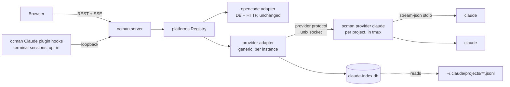

# Multi-Agent Support - Architecture

Companion to `requirements.md`. Decisions below were settled in a design
review on 2026-10-05. Facts marked **(spike)** are assumptions to be
confirmed by phase 0 before the dependent work starts.

## Overview



- The OpenCode adapter keeps reading OpenCode's SQLite database. It is not
  rewritten as a provider.
- The provider adapter is generic. It implements `platforms.Platform` by
  speaking ocman's provider protocol and keeps its own caches and index.
- The Claude provider is built into the ocman binary (`ocman provider
  claude`) but lives in its own package and talks to ocman only through
  the protocol, so it could become a separate executable later.

## Decisions

### AD-1: Seam refactor before any Claude code

Today every create path calls `Host.EnsureProjectOpencode` and six sites
hard-code `"opencode"` (routines `service.go:269`, Factory
`factory_implementation.go:295`, plugin conversations
`plugin_conversation.go:202`, PR launch `handlers_project_handle.go:258`,
MCP create `handlers_mcp.go:285`, `/wt` `handlers_worktree.go:34`).

- `EnsureProjectOpencode` becomes `EnsureRuntime(ctx, platform, dir)`
  returning an endpoint whose port is optional. The gRPC RPC is renamed;
  the old name stays as an alias for one release.
- Every create request carries `platform`. Defaults resolve from a
  setting, never from a model name.
- `knownPlatforms` (`main.go:84`) learns `claudecode`; `ocv2.InstalledV2`
  and `LookPath("opencode")` run only when OpenCode is enabled.
- Live status and idle edges stop being produced only by the OpenCode
  watcher: the adapter-facing hook is an `onSessionIdle` /
  `onSessionStatus` sink any platform can feed.
- `db.SessionStatus` gains `limited` (with `resetsAt`). Queue, routines and
  plugin replies treat it as not idle.
- The auto-approve judge goes behind a `Judge` interface (AD-8).
- Remotes advertise their enabled platforms in the handshake; the hub
  registers one `remotePlatform` per (remote, platform):
  `r-<id>:opencode`, `r-<id>:claudecode`. A remote that does not send the
  field is OpenCode-only.

This phase ships alone and changes no OpenCode behaviour.

### AD-2: Ocman-owned provider protocol, not OpenCode v2 compatibility

The supervisor could have imitated OpenCode's v2 API so the OpenCode
adapter would drive it. Rejected:

- The OpenCode adapter lists, owns and archives through the database
  (`adapter.go:134,253,338`), not the API; reuse would cover only the live
  half.
- Its caches and `SetMachineServer` are package-global, assuming one
  OpenCode per machine.
- Tracking a young external API would couple Claude support to OpenCode
  releases.

The protocol is HTTP + SSE over a unix socket, shaped after the subset
ocman uses:

| Area | Operations |
|---|---|
| Handshake | `GET /hello` → protocol version, provider id, CLI version, capabilities |
| Sessions | list, get (paged), lifecycle (status + latest message), create, fork, rename, compact, abort |
| Turns | send, hold-for-next-turn, command, shell |
| Prompts | list/respond permissions, list/respond/reject questions |
| Rules | get/set permission ruleset |
| Catalogs | directory catalog (agents, commands, models) |
| Events | `GET /events?after=<seq>` SSE in OpenCode v1 event shapes |
| Account | subscription type, rate-limit utilisation |

Events reuse the v1 shapes the frontend already reduces
(`message.updated`, `message.part.updated`, `message.part.delta`,
`session.status`, `session.idle`, `permission.asked/replied`,
`question.asked/replied/rejected`). The Claude provider owns the single
Claude→v1 converter (same rule as `ocv2.ConvertMessage`): stored and live
data go through it, so part ids agree.

The protocol is internal. It gets a stability promise only when a second
provider exists (see "Out of scope" in requirements).

### AD-3: One supervisor per project, in tmux

- Hosted by a native-tmux `ocruntime.Runtime` (`Launch`/`Probe`/`Stop`),
  persisted like `managed_opencode`, re-probed on recovery. Probe is
  `GET /hello` on the socket.
- One supervisor per repo root serves the main checkout and all its
  worktrees; each session's `claude` gets its own cwd.
- `claude` is never driven through the pane's TTY (echo and the canonical
  line limit corrupt stream-json). The supervisor spawns it with pipes.
- ocman owns policy (idle timeout ≈10 min, concurrency cap); the
  supervisor executes it. Idle processes exit and are `--resume`d on the
  next send.

### AD-4: Replay across ocman restarts

- The supervisor appends every outbound event to a per-session spool with
  a monotonically increasing sequence number.
- ocman reconnects with `after=<last seq>`; unresolved `can_use_tool`
  requests are re-sent on reconnect.
- A spool is truncated after its turn completes and ocman acknowledged
  it. Claude's JSONL remains the durable history.

### AD-5: Version skew

- `/hello` carries the protocol version. ocman speaks the current and
  previous versions.
- Out of range: mark the supervisor draining, wait for its sessions to go
  idle, replace it. Never interrupt a running turn for an upgrade.
- A supported `claude` CLI version range is pinned; outside it the
  provider reports an explicit unsupported-version error.

### AD-6: Driving `claude`

- `claude -p --input-format stream-json --output-format stream-json
  --include-partial-messages --replay-user-messages`, plus `--session-id`
  on create, `--resume` / `--fork-session` as needed,
  `--permission-prompt-tool stdio` (control protocol), `--mcp-config` for
  ocman's MCP server and `--plugin-dir` for ocman's skills.
- Go implements the stream-json and control protocol directly; there is
  no Node or Agent SDK sidecar.
- Never `--bare`: it does not read OAuth or the keychain, which would drop
  subscription auth.
- Mid-turn input semantics, `!cmd` support and the exact control messages
  are **(spike)**.

### AD-7: Permissions owned by ocman

- `claude` runs in `default` mode and every tool call that reaches
  `can_use_tool` is decided by ocman: session ruleset, inherited "Allow
  always" rules (#101), live YOLO/custom mode, then the judge or the user.
- Rules in the user's Claude settings resolve inside the CLI first. This
  is documented, not worked around.
- Approval provenance and the `auto_approved_permission` table are reused
  unchanged; prompts from Claude subagents bubble up to the top-level
  session through the same parent resolution.

### AD-7a: Permission prompt flow is push-only

```
claude ──stdout pipe──▶ supervisor ──SSE /events──▶ provider adapter ──SSE──▶ browser
claude ◀──stdin pipe─── supervisor ◀──POST reply─── ocman (rules / judge / user)
```

1. `claude` writes a `can_use_tool` control request to stdout. The
   supervisor, blocked on that pipe, assigns an ocman permission id, records
   it in its pending map and the spool, and emits `permission.asked` on the
   open `/events` stream.
2. The provider adapter feeds it into the existing pipeline in-process:
   session ruleset, inherited "Allow always" rules, YOLO/custom mode,
   safe-command cache, judge, then the user via the existing browser SSE.
3. ocman answers with `POST /permissions/{id}/reply` on the keep-alive
   unix-socket connection; the supervisor writes the `control_response` to
   stdin and emits `permission.replied`.

Rules:

- No component polls. Every hop is a blocking pipe read, a long-lived
  stream, or a direct request.
- Rules are evaluated only in ocman. The supervisor never holds a copy of
  the ruleset; while ocman is down a prompt waits and is re-sent from the
  spool on reconnect (AD-4).
- `ListPermissions` is served from the adapter's event-maintained pending
  map with no network call; `RefreshPermissions` asks the supervisor and is
  used only for reconciliation.
- `AskUserQuestion` arrives as `can_use_tool` for that tool; the supervisor
  emits `question.asked`, and answers return as the tool's updated input.
- An interrupt cancels pending prompts; the supervisor emits
  `permission.replied` with a cancelled reason.
- Transport stays HTTP + SSE over the unix socket (AD-2), debuggable with
  `curl --unix-socket`.
- **(spike):** whether a pending `can_use_tool` times out inside `claude`;
  whether the request identifies the originating subagent (needed for
  bubbling); the exact `AskUserQuestion` shape; whether a
  `PermissionRequest` hook exists (would allow answering terminal-session
  prompts later; out of scope now).

### AD-8: Judge without OpenCode

`Judge` interface with two backends:

- OpenCode judge (today's `judge.go`) when an OpenCode instance is
  reachable.
- Otherwise `claude -p --model haiku --no-session-persistence
  --strict-mcp-config` with no tools. The safe-command cache in front of
  it is unchanged.

### AD-9: Transcript index

- Disposable `claude-index.db` beside `state.db`: no migrations, wiped and
  rebuilt on schema change or a different config directory.
- Keyed by transcript path, mtime and size. Holds the list projection
  (title, cwd, model, tokens, last message, inferred status), byte offsets
  per message for paging, and subagent → parent links.
- Watches directories, not files (kqueue holds one fd per watched file),
  with an mtime sweep as the backstop.
- Salvage the parser and scanner from `0fe96f0a1^:internal/platforms/claudecode/`.

### AD-10: Status

- Sessions owned by a supervisor: status comes from the process (turn
  open, waiting on prompt, rate-limited, exited) via `session.status` /
  `session.idle` events into the shared sinks from AD-1.
- Terminal sessions with the hook plugin: hook events update an in-memory
  live view.
- Otherwise: inferred from the transcript tail, settled by
  `db.SettleSessionStatus` the same way as OpenCode.

### AD-11: The ocman Claude plugin

One plugin directory, maintained by ocman, serves two uses:

- Passed to launched sessions with `--plugin-dir`: ocman skills (and MCP
  config). Nothing is written to `~/.claude`.
- Installed at user scope with `claude plugin install` from a local
  marketplace directory after the user opts in: adds hooks
  (`SessionStart`, `Stop`, `Notification`, `PreToolUse`, `PostToolUse`)
  that run `ocman hook <event>`, posting to the loopback listener with a
  1 s timeout and always exiting 0.
- Hook events for a session a supervisor owns are ignored; the stream
  wins.
- Fallback if plugin install proves unreliable **(spike)**: edit
  `~/.claude/settings.json` with backup and lossless round-trip, like
  `internal/opencodeconfig`.

### AD-12: Analytics

An ingester fills `analytics-cache.db`'s OpenCode-shaped tables from the
index, so the existing analytics SQL runs unchanged. Subscription
sessions show tokens, API-equivalent cost (labelled) and limit
utilisation.

### AD-13: Platform choice

- Composer: platform selector beside the machine selector; draft survives
  switching, as for machines.
- Factory: platform per Epic, next to the implementation model.
- Plugin conversations: platform setting per installation next to the
  required `project`.
- One Claude instance per machine; platform id `claudecode`, leaving room
  for `claudecode@<name>`.

## Testing

- A fake `claude` executable built from Go test code replays recorded
  stream-json fixtures (transcripts, permission requests, rate-limit
  events, crashes, partial output). Tests pin the CLI version and never
  run the real binary.
- Contract tests on both sides of the provider protocol: the generic
  adapter against a fake provider, the Claude provider against the fake
  `claude`.
- Restart test: kill the ocman side mid-turn and mid-prompt, reconnect,
  assert the turn completes and the prompt is answerable.
- One optional, manually triggered smoke test against the real CLI.

## Spec conformance

- The spec lives in `spec/multi-agent-support/` on the Epic's shared branch
  `factory/claude-code-provider`.
- Any departure from `requirements.md` or `architecture.md` is recorded in
  `deviations.md` in the same commit as the change, using its entry format.
- A final conformance review audits the combined change against every FR,
  NFR and AD, records anything missing in `deviations.md`, and links the
  log from the pull request description.

## Phases

| # | Phase | Ships on its own |
|---|---|---|
| 0 | Spike: RSS idle/busy, resume latency and prompt cache, mid-turn stdin, `!cmd`, control protocol, `claude plugin install` from a local marketplace. Findings in `spec/multi-agent-support/spike-findings.md` | yes |
| 1 | Seam refactor (AD-1) | yes |
| 2 | Provider protocol, generic adapter, tmux supervisor runtime, spool/replay, version skew; tested with a fake provider | yes (no user-visible change) |
| 3 | Claude read-only: index, list/detail, subagents, archive; hook plugin for terminal sessions | yes |
| 4 | Claude interactive: composer, queue, permissions + judge, worktrees, PR launch, routines, MCP create, `limited` status | yes |
| 5 | Factory, plugin conversations, analytics for Claude | yes |
| 6 | Remotes, user docs (`docs/features/`), architecture diagrams | yes |
| 7 | Spec conformance review; complete `deviations.md` | yes |

## Risks

| Risk | Mitigation |
|---|---|
| Control protocol and stream-json are undocumented and change between CLI releases | Pinned version range, fixture tests, explicit unsupported-version error |
| Per-session process memory | Pool with idle timeout and cap, sized from spike numbers |
| Resume cost (latency, prompt cache, subscription quota) | Measure in spike; tune idle timeout |
| Anthropic terms for subscription use by third-party tools | Only the user's own binary authenticates; docs disclaimer |
| Large transcript histories | Index with offsets, directory watches, mtime sweep |
| Supervisor and ocman version skew | Handshake version, drain-then-replace |
| User Claude allow rules bypass ocman | Documented limitation |
